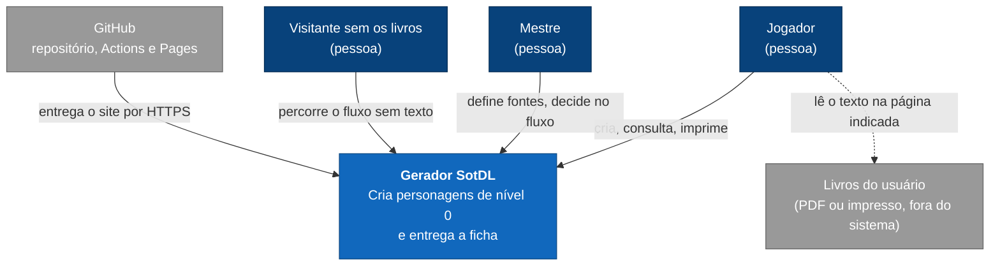
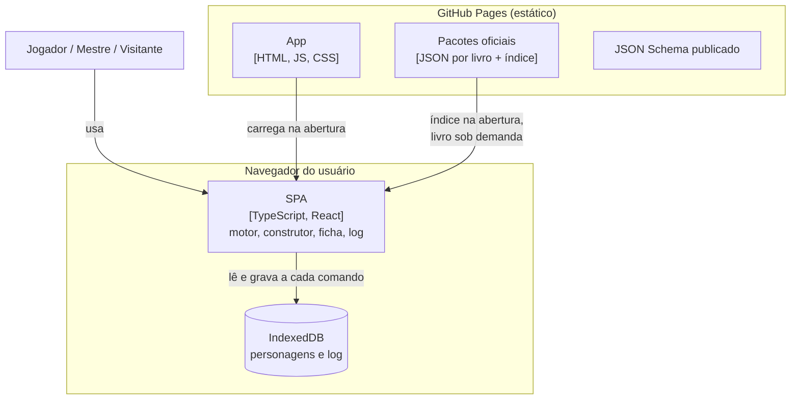
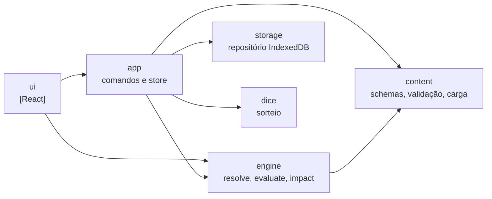
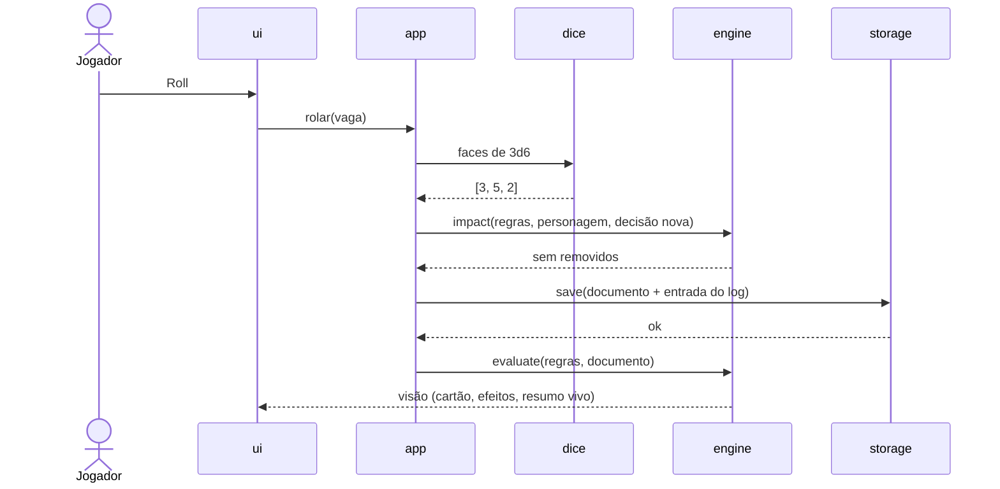
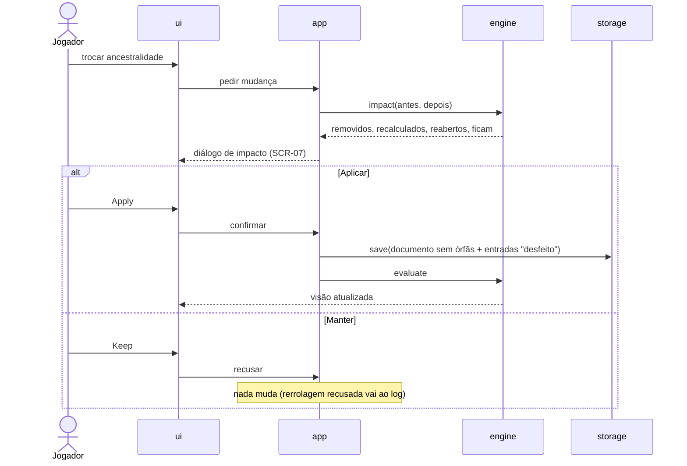
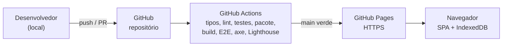

# Arquitetura: Gerador de personagens SotDL

> Status: Aprovada · Última atualização: 2026-11-11 · Autor: Antônio Cruz
> Requisitos: `docs/srs.md` v1.1 · Casos de uso: `docs/use-cases.md` · Decisões: `docs/adr/`

## 1. Introdução e metas

Aplicação web que conduz a criação de um personagem de *Shadow of the Demon Lord* pelo core e pelos suplementos que a mesa escolher, mostrando a origem de cada regra e de cada resultado (SRS §1.2). O MVP cria personagens de nível 0 com Human, Dwarf e Clockwork, com o Halfling e o Human revisado como prova do modelo de fontes (SRS §1.2.1).

**Metas de qualidade, em ordem:**
1. **Conteúdo evolui só com dados** [NFR-MAINT-001, NFR-CAP-002]: novos livros e suplementos entram como pacotes, sem mudar o motor. É o núcleo do sistema (ADR-003, ADR-004).
2. **Custo zero e nada pessoal** [NFR-COST-001, NFR-PRIV-001, NFR-OBS-001]: nada para operar, nenhum dado fora do navegador (ADR-001, ADR-007).
3. **Resposta imediata e nada perdido** [NFR-PERF-002, NFR-PERF-003, NFR-REL-001]: recalcular localmente e gravar a cada decisão (ADR-002, ADR-004).

Acessibilidade WCAG 2.2 AA [NFR-ACC-001] é obrigatória, mas não disputa com as metas acima.

## 2. Restrições

| Restrição | Origem |
|---|---|
| Um desenvolvedor, projeto pessoal e não comercial. | CLAUDE.md |
| Hospedagem e operação a US$ 0 (teto de US$ 5). | NFR-COST-001 |
| Repositório público: só mecânica oficial entra; texto, arte e PDFs nunca. `content/` fica local. | P22, D35, D36, D38; SRS §2.5 |
| Conteúdo oficial e da casa no mesmo formato documentado. | P21a; FR-CONT-001 |
| Interface, conteúdo e ficha em inglês; documentos de projeto em português. | P25, D12; NFR-L10N-001 |
| Sem contas e sem serviço de terceiros no MVP. | SRS §1.2.1; §3.2 |
| Decidido pelo usuário: React, GitHub Pages, JSON com JSON Schema publicado. | Entrevista de arquitetura |
| Lock-in: nenhum serviço proprietário; o build é uma pasta estática que troca de host sem custo. | ADR-001, ADR-007 |

## 3. Contexto e escopo

O sistema não chama nenhuma API externa. Os livros são complemento: o app mostra a mecânica e a página; o texto se lê no livro (D35). Os atores são papéis, não perfis de acesso (use-cases.md).

## 4. Estratégia da solução

- **SPA estática no navegador, sem backend**; persistência atrás de uma interface de repositório para não impedir contas depois → ADR-001.
- **Personagens no IndexedDB**, gravados a cada comando → ADR-002.
- **Modelo de fontes:** livro › componente › item; ids globais com `revises`/`replaces`; herança por JSON Merge Patch; procedimento de criação como dado → ADR-003.
- **Esqueleto calculado:** o personagem guarda só entradas em camadas; `evaluate` deriva tudo; o impacto de uma mudança é a diferença entre duas avaliações → ADR-004.
- **JSON com JSON Schema publicado**, gerado de schemas Zod → ADR-005.
- **TypeScript, React, Vite, React Aria Components**, roteamento por hash → ADR-006.
- **GitHub Pages** com deploy por GitHub Actions; só produção → ADR-007.
- **Vitest e Playwright**, com axe, Lighthouse CI e teste de impressão → ADR-008.
- **Dados com `crypto.getRandomValues`, sem semente** → ADR-009.
- **Do repositório anterior, só conceitos e peças pequenas, reescritas** → ADR-010.

## 5. Visão de blocos

### 5.1 Contêineres

O JSON Schema é publicado para quem escreve pacotes; o app usa a mesma validação embutida.

### 5.2 Módulos da SPA

| Módulo | Responsabilidade | Depende de |
|---|---|---|
| `engine` | Funções puras: `resolve` (regras vigentes, ADR-003), `evaluate` (visão do personagem, ADR-004), `impact` (diferença antes × depois), fórmulas e linha de mecânica (FR-CONT-009). | Só dos tipos de `content`. Sem React, DOM ou armazenamento (regra de lint). |
| `content` | Schemas Zod do pacote e do personagem, geração do JSON Schema, validação em camadas, carga do índice e dos livros, migrações de formato. | — |
| `app` | Comandos (decidir, rolar, trocar modo, mudar fontes, ajustar, renomear, excluir, exportar, importar), log, store do personagem aberto, tratamento de erros. Único módulo que escreve. | `engine`, `content`, `storage`, `dice` |
| `storage` | Repositório de personagens sobre IndexedDB; revisão e aviso entre abas. | — |
| `dice` | Sorteio de faces com `crypto.getRandomValues`; injetável nos testes (ADR-009). | — |
| `ui` | Telas (SCR-*), componentes acessíveis, impressão. Lê a visão do personagem; chama comandos. | `app`, `engine` (só leitura da visão) |
| `packs/` (dados) | Pacote oficial: um arquivo por livro e um índice. Só mecânica. | — |

## 6. Visão de execução

### 6.1 Decidir uma tabela por rolagem [UC-005]

Rerrolagem com dependentes segue o fluxo 6.2. Falha ao gravar mantém o estado na tela e avisa (FR-CHAR-010).

### 6.2 Mudar uma decisão que tem dependentes [UC-010]

Mudança de fontes [UC-002, 5a] usa o mesmo caminho, com o impacto agrupado por livro.

### 6.3 Abrir um personagem [FR-CHAR-007, FR-CONT-015, FR-CONT-016, FR-HELP-004]

1. A tela inicial lista os personagens a partir dos metadados no IndexedDB, sem carregar pacotes.
2. Ao abrir um personagem, o app carrega os livros ligados nele e chama `resolve`.
3. Se um pacote não carregar, o app mostra a mensagem e não grava nada no personagem.
4. Com os pacotes carregados, `impact` compara o documento com as regras atuais. Decisões que deixaram de existir voltam a ficar abertas; o app avisa e registra no log.

## 7. Implantação

- **Ambientes:** só produção. PRs rodam o CI, sem prévia.
- **Promoção:** merge no `main` com CI verde → deploy automático.
- **Reversão:** reverter o commit e publicar de novo.

## 8. Conceitos transversais

**Segurança.** Sem login, sem segredos, sem API. HTTPS do Pages (NFR-SEC-001). CSP por `<meta>` só com recursos do próprio site. Nada importado é executado: arquivos são JSON validado e fórmulas são árvores, nunca `eval` (NFR-SEC-002).

**Dados.** Um documento por personagem no IndexedDB, com camadas e log (ADR-002, ADR-004). Versão de schema com migração na leitura. A cópia de segurança é o arquivo do personagem, exportado e importado pelo usuário (FR-CHAR-018, 019, 023; UC-015).

**Conteúdo e propriedade intelectual.** O pacote oficial mora em `packs/`, escrito à mão a partir do PDF, com página em toda entidade, tabela e entrada. O CI valida schema, integridade, ausência de texto descritivo (M3) e ids removidos entre versões. Dados vindos de memória ou de `content/extracted/` entram marcados como não verificados e não são publicados até a conferência.

**Erros e resiliência.** Error boundary na raiz e por zona, com mensagem sem termos internos (FR-HELP-005, NFR-USE-001). Falha de pacote não toca personagens (FR-HELP-004). Falha de gravação não perde o estado na tela (FR-CHAR-010).

**Observabilidade.** Nenhuma telemetria nem analytics (NFR-OBS-001, NFR-PRIV-001). O erro aparece só para o usuário.

**Desempenho.** A tela inicial não carrega o construtor nem os pacotes (NFR-PERF-001). `resolve` é memoizado por configuração de fontes; `evaluate` roda a cada mudança, dentro dos 100 ms (NFR-PERF-002), e `impact` são duas avaliações (NFR-PERF-003). Livros carregados sob demanda (NFR-CAP-002).

**Offline (Should).** Service worker com pré-cache do app e dos pacotes, quando a NFR-REL-003 entrar. Nada na arquitetura impede.

**Acessibilidade e impressão.** React Aria Components para teclado e leitor de tela; axe no CI e revisão manual (NFR-ACC-001). Folha `@media print` para a ficha, testada em até 2 páginas (NFR-COMP-003).

**Testes.** Pirâmide com base no motor puro. Vitest para unitários e componentes; Playwright em Chromium, Firefox e WebKit para três fluxos críticos (UC-001 → UC-012 com as três ancestralidades; UC-010; UC-013); `@axe-core/playwright`; Lighthouse CI; PDF de impressão. Cobertura só relatada (provedor v8 do Vitest); o critério é um teste para cada Must de FR-CALC, FR-CHG e FR-DEC (NFR-MAINT-002). Detalhes na ADR-008.

## 9. Decisões de arquitetura

| ADR | Decisão | Status |
|---|---|---|
| [ADR-001](adr/001-aplicacao-estatica-no-navegador.md) | Aplicação estática no navegador, sem backend | Aceita |
| [ADR-002](adr/002-persistencia-local-indexeddb.md) | Persistência local em IndexedDB atrás de um repositório | Aceita |
| [ADR-003](adr/003-modelo-de-fontes-e-componentes.md) | Modelo de fontes, componentes e versões | Aceita |
| [ADR-004](adr/004-esqueleto-e-camadas-editaveis.md) | Esqueleto calculado e camadas editáveis | Aceita |
| [ADR-005](adr/005-formato-json-com-schema-publicado.md) | Pacotes e arquivos de personagem em JSON com JSON Schema publicado | Aceita |
| [ADR-006](adr/006-pilha-de-front-end.md) | Pilha de front-end: TypeScript, React e Vite | Aceita |
| [ADR-007](adr/007-hospedagem-github-pages.md) | Hospedagem no GitHub Pages com deploy por GitHub Actions | Aceita |
| [ADR-008](adr/008-estrategia-e-frameworks-de-teste.md) | Estratégia e frameworks de teste | Aceita |
| [ADR-009](adr/009-aleatoriedade.md) | Aleatoriedade com gerador criptográfico, sem semente | Aceita |
| [ADR-010](adr/010-porte-do-repositorio-anterior.md) | O que portar do repositório anterior | Aceita |

## 10. Cenários de qualidade

| NFR | Cenário | Como se verifica |
|---|---|---|
| NFR-MAINT-001 | O Halfling e o Human revisado entram só com arquivos em `packs/`, sem mudança em `engine`. | Revisão do diff no plano; teste com pacote sintético de cada padrão. |
| NFR-PERF-002 | Personagem de nível 0 completo: decisão → visão nova em até 100 ms (p95) no notebook e 200 ms no celular. | Teste de tempo do `evaluate`; medição manual no celular. |
| NFR-PERF-003 | Trocar a ancestralidade de um personagem completo abre o diálogo em até 300 ms. | Teste de tempo do `impact`. |
| NFR-REL-001 | Decidir e fechar a aba logo em seguida: a decisão está lá ao reabrir. | E2E: decidir, fechar o contexto, reabrir. |
| NFR-CAP-001 | 100 personagens salvos: a lista inicial abre dentro do LCP. | E2E com 100 personagens semeados + Lighthouse. |

## 11. Riscos e dívida técnica

- **Safari apaga dados sem uso por 7 dias.** No Safari e no iOS, personagens de quem não volta ao site em 7 dias podem sumir; `persist()` não garante proteção fora de apps na Tela de Início. Mitigação: exportar e importar o arquivo do personagem, trazido para o MVP na v1.1 do SRS (FR-CHAR-018, 019, 023). Quem não exportar ainda pode perder personagens; o aviso da FR-CHAR-016 diz isso.
- **Estabilidade dos ids.** Decisões salvas dependem dos ids de concessão e de entrada (ADR-004). Renomear um id no pacote desfaz decisões. Mitigação: regra de nunca renomear e comparação no CI.
- **Tipos de vaga.** O procedimento é dado, mas cada tipo de vaga novo exige código. Suplementos com procedimentos muito diferentes (ex.: Development do *Only Human*) podem pedir tipos novos.
- **Autoria do pacote oficial.** Escrever e conferir no PDF é o trabalho mais longo do projeto; as páginas do SRS são aproximadas (página impressa = página do PDF − 1 no core).
- **GitHub Pages sem cabeçalhos.** CSP só por meta, sem `frame-ancestors`; rotas por hash.
- **Risco de licença aceito (Q1).** Um pedido de retirada derruba o site; o build estático pode ser movido, mas o conteúdo oficial é o ponto sensível.
- **Um mantenedor.** Toda a operação depende de uma pessoa; por isso nada a operar além do CI.

## 12. Glossário técnico

| Termo | Significado |
|---|---|
| Regras vigentes | Resultado do `resolve`: a versão de cada item para a configuração de fontes de um personagem. |
| Vaga | Ponto de decisão gerado pelo procedimento ou por uma concessão; tem chave estável que inclui a vaga mãe e o valor escolhido nela. |
| Decisão órfã | Decisão cuja vaga deixou de ser gerada depois de uma mudança; é removida (com confirmação) e vai ao log como desfeita. |
| Visão do personagem | Resultado do `evaluate`: etapas, vagas abertas, valores com composição, campos da ficha. |
| Patch | Correção de campos de um item por outro livro ou componente, pelas regras do JSON Merge Patch (RFC 7386). |

Termos do domínio: SRS, Apêndice A.
