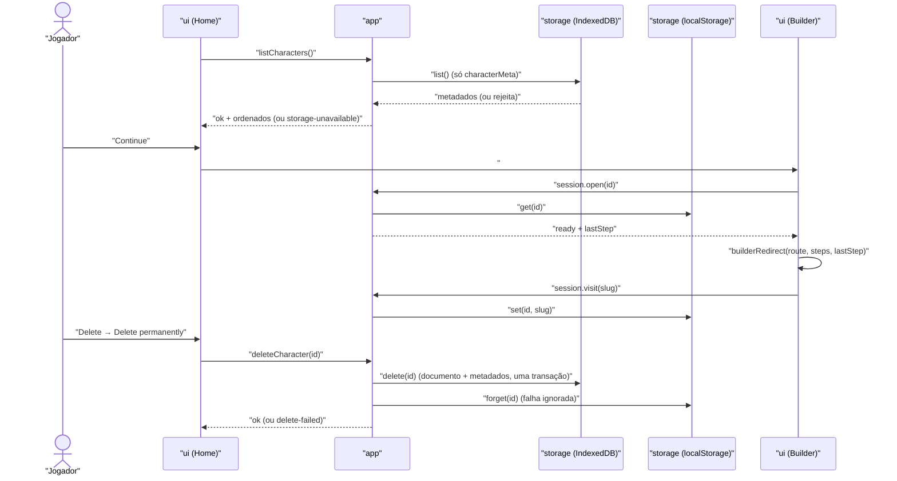

# Technical Design: FEAT-001 — Home: listar, continuar e excluir personagens

> Feature de: `docs/implementation-plan.md` §3 (E1) e §4 (posição 3) · Épico: E1 Personagens
> Implementa: FR-CHAR-003, 004, 005, 006, 007, 011, 013, 014, 015, 016 · Verifica: NFR-CAP-001 (plano §6)
> Realiza: UC-001 (parcial: fluxo alternativo 1a e a lista da tela inicial) · Telas: SCR-WEB-001 (desenhada pelo ui-design)
> Status: Verified · Data: 2026-11-12

## 1. Intenção

Na Home, o jogador vê os personagens salvos neste navegador, do mais recente ao mais antigo, cada um com nome, ancestralidade, nível, estado, fontes e data. Ele continua um personagem na última etapa visitada ou o exclui com confirmação. Sem personagens, a Home explica o que o app faz. A fatia vem depois da 007 e da 008 porque precisa da contagem de decisões abertas do `evaluate`, e porque torna o app usável entre sessões (plano §4).

## 2. Contexto do código

Levantado no `1d218fe`, no `docs/scaffold-notes.md` e nas FEAT-007 e FEAT-008:

- **Convenções em vigor:**
  - o `app` devolve resultado discriminado (`{ ok: true, … } | { ok: false, reason }`), sem exceção para erro esperado (FEAT-007 §2);
  - o `ui` não importa `content`, `storage` nem `dice`, e o `idb` só aparece no `storage` (lint);
  - nome de teste começa pelo FR ou NFR.
- **Armazenamento:** banco `sotdl-generator` v1, com as stores `characters` e `characterMeta` (`keyPath: id`). O `Repository` tem `list`, `get`, `save` e `delete`. O `delete` já remove documento e metadados numa transação. O `list` lê só `characterMeta`.
- **Metadados hoje** (`src/app/session.ts`): `summarize(document, rules?)` devolve `{ id, name, ancestry, status: 'creating', sources: string[], updatedAt }`. O `createCharacter` chama `summarize(document)` sem regras. O `status` é fixo.
- **Contagem:** `view.openDecisions` lista só vagas obrigatórias sem decisão (FEAT-008 D2). Etapas sem vaga têm estado `not-started` (FEAT-008 §3.3).
- **Rotas:** `#/characters/:id` sem etapa redireciona para a primeira (FEAT-007 D10, `builderRedirect`). O cabeçalho do construtor mostra "Unnamed character" fixo.
- **Stub que esta feature substitui:** a casca da Home (`src/ui/screens/Home.tsx`, scaffold-notes, "Stubs"). Hoje ela trata a falha da lista como lista vazia (FEAT-007 §8).
- **Divergências do plano, registradas:**
  - **`storage` fora do IndexedDB.** A última etapa visitada fica no `localStorage`, pelo módulo `storage` (§3.3, D3). A arquitetura §5.2 descreve o `storage` como "repositório de personagens sobre IndexedDB". A emenda está na §8.
  - **`engine.resolve`.** O `Rules` ganha `books` (§3.2, D7). O plano lista para a FEAT-001 os blocos `app`, `storage` e `engine.evaluate`, sem o `resolve`.
- **Guardas existentes que esta feature mantém:**
  - o `skeleton.spec.ts:61`: a Home não pede `/packs/` nem o chunk `Builder-*.js`;
  - o `lighthouserc.*.cjs`: LCP da Home vazia, mediana de 3 execuções.

## 3. Contratos

A SPA não tem API HTTP (ADR-001). Os contratos são os do `app`, do `engine`, do `storage` e os pontos de integração do `ui`.

### 3.1 `app`

```ts
/** Projeção do documento para a lista inicial (ADR-002). Derivada a cada gravação; nunca entrada de cálculo (D1). */
CharacterSummary = {
  id: string
  name: string                          // text.name ?? ''
  ancestry: string | null               // nome da ancestralidade escolhida
  status: 'creating' | 'complete'       // FR-CHAR-005, 006
  openDecisions: number | null          // view.openDecisions.length; null só em metadado antigo (§3.1, leitura)
  sources: { id: string, name: string, abbr: string }[]   // na ordem de prioridade
  contentVersion: string                // do documento (D1, desatualização)
  updatedAt: string                     // do documento (ISO)
}

summarize(document: CharacterDocument, rules: Rules): CharacterSummary   // `rules` passa a ser obrigatório

ListResult   = { ok: true, characters: CharacterSummary[] } | { ok: false, reason: 'storage-unavailable' }
DeleteResult = { ok: true } | { ok: false, reason: 'delete-failed' }
CreateResult = sem mudança

app.listCharacters(): Promise<ListResult>
app.deleteCharacter(id: string): Promise<DeleteResult>
app.createCharacter(): Promise<CreateResult>        // agora com regras (abaixo)
```

**`summarize`.** `status` é `'complete'` quando `openDecisions === 0`; senão é `'creating'` (D2). `openDecisions` conta só as vagas obrigatórias, então o ajuste opcional da Attributes nunca conta (FEAT-008 D2). `sources` sai de `rules.books` (§3.2).

**`createCharacter`**, na ordem:
1. `loadBookIndex`; acha o livro da camada `core`.
2. `loadRules([core])` pelo **mesmo** carregador da sessão (`createRulesLoader`, memoizado), para o construtor reaproveitar o livro sem novo pedido.
3. Monta o documento v1, sem mudança.
4. `repository.save(document, summarize(document, rules))`.

| Passo | Falha | Resultado |
| :-- | :-- | :-- |
| 1 ou 2 | `PackLoadError` ou `EngineError` | `pack-load-failed`; nada é gravado (FR-HELP-004) |
| 4 | rejeita | `save-failed` (FR-CHAR-010) |

Personagem novo no core: `ancestry: null`, `status: 'creating'`, `openDecisions: 1` (a vaga da Ancestry), `sources: [{ id: 'sotdl.core', name: 'Shadow of the Demon Lord', abbr: 'CORE' }]`.

**`listCharacters`:**
- `repository.list()` rejeita → `{ ok: false, reason: 'storage-unavailable' }`. Fecha a pendência da FEAT-007 §8.
- Cada registro passa por `readSummary(raw: unknown): CharacterSummary | null`, uma leitura tolerante, sem Zod: metadados gravados antes desta feature não têm os campos novos, e só existem em bancos de desenvolvimento.

  | Campo gravado | Valor lido |
  | :-- | :-- |
  | `id` ausente ou não string | registro ignorado (`null`) |
  | `name` não string | `''` |
  | `ancestry` não string | `null` |
  | `openDecisions` não inteiro ≥ 0 | `null`, com `status: 'creating'` |
  | `status` | recalculado de `openDecisions` quando este é válido; o valor gravado é ignorado |
  | `sources` | só as entradas `{ id, name, abbr }` válidas; ids soltos do formato antigo saem |
  | `contentVersion`, `updatedAt` não string | `''` |

- **Ordem (FR-CHAR-004):** `updatedAt` decrescente, por comparação de string. O `toISOString` tem formato fixo, em UTC. Empate pelo `id` crescente. `updatedAt` vazio vai para o fim. A ordem é regra do `app`, não da tela (D5).

**`deleteCharacter(id)`:**
1. `repository.delete(id)`: documento e metadados numa transação. O log mora no documento (ADR-002, "Excluir um personagem remove o registro inteiro, log incluído"; ADR-004 §1), então essa transação já remove "o personagem e o seu log" (FR-CHAR-014), também antes de o log ter entradas (FEAT-009).
2. Rejeita → `{ ok: false, reason: 'delete-failed' }`. A transação desfaz tudo e nada é removido. A chave da última etapa não é tocada.
3. Sucesso → `lastStep.forget(id)` (§3.3). Uma falha nesse passo é ignorada: uma chave que sobra para um id inexistente é inerte. Depois, `{ ok: true }`.

Excluir não pede o documento antes nem confere revisão. Personagem aberto em outra aba é a FR-CHAR-017 (FEAT-031, §8).

### 3.2 `engine`

`Rules` (FEAT-007 §3.3) ganha um campo; o resto não muda:

```ts
Rules = { …, books: { id: string, name: string, abbr: string }[] }   // na ordem de `order`, do `Book` carregado
```

`resolve(books, order)` o preenche a partir dos `Book` recebidos. É a fonte do nome dos livros no metadado (FR-CHAR-003, "resumo das fontes"; D7). O `evaluate` não muda.

### 3.3 `storage`

O `Repository` não muda. Entra um store pequeno de estado de interface, fora do IndexedDB (D3):

```ts
interface LastStepStore {
  get(id: string): string | undefined   // slug da etapa
  set(id: string, slug: string): void
  forget(id: string): void
}
createLastStepStore(storage?: Pick<Storage, 'getItem' | 'setItem' | 'removeItem'>): LastStepStore
```

- **Chave:** `sotdl-generator:last-step:<id>`. **Valor:** o slug da etapa (`attributes`).
- **Padrão:** `globalThis.localStorage`, acessado dentro de `try`, porque o próprio acesso pode lançar `SecurityError` com armazenamento bloqueado. Qualquer exceção faz `get` devolver `undefined` e `set` e `forget` não fazerem nada.
- **Nunca entra no documento**, no metadado nem no arquivo exportado (FEAT-002). Não mexe em `updatedAt` nem em `revision`. Não é estado de regra.
- NFR-PRIV-001: chave do próprio site, só preferência de interface, sem identificador de pessoa nem rastreamento.

### 3.4 `app`: sessão

`createCharacterSession` (FEAT-007 §3.2) ganha uma dependência opcional e um método:

```ts
SessionDeps = { repository, loadRules, now?, lastStep?: LastStepStore }   // padrão: store que não guarda nada
Snapshot (ready) = { …FEAT-007, lastStep?: string }                       // lido em `open`
session.visit(slug: string): void
```

- `open(id)`: no passo que hoje produz `ready`, inclui `lastStep: lastStep.get(id)`. Uma falha de leitura não é falha de abertura.
- `visit(slug)`: com o snapshot `ready`, faz `lastStep.set(snapshot.id, slug)`. Não muda o snapshot nem grava nada pelo repositório (ADR-004 §5: o documento não é tocado).
- `createApp` cria um `createLastStepStore()` e o passa às sessões e ao `deleteCharacter`. Os testes injetam um store em memória.

### 3.5 `ui`: rotas e pontos de integração

**`builderRedirect(route, steps, lastStep?)`** (FR-CHAR-007; FEAT-007 D10):
- `route.step` definido: igual a hoje (desconhecida → primeira; bloqueada → primeira liberada; liberada → `null`).
- `route.step` ausente: candidata = a etapa cujo slug é `lastStep`.
  - Candidata liberada → ela.
  - Candidata bloqueada → a primeira liberada (FR-FLOW-005).
  - Sem candidata (sem registro, ou etapa que não existe mais no procedimento) → a primeira.
  - Nesse caso, a função nunca devolve `null`, porque a URL sempre ganha a etapa.

**`Builder`:**
- Passa `snapshot.lastStep` ao `builderRedirect`.
- Com a etapa resolvida (sem redirect pendente), chama `session.visit(current.slug)` num efeito, a cada troca de etapa: pelo mapa, por Next ou Back, ou pelo atalho de Open decisions.
- O cabeçalho mostra `displayName(document.text.name)`, em vez do "Unnamed character" fixo (FR-CHAR-011).

**Home (SCR-WEB-001):**

| Estado | Quando | Conteúdo (a forma é do ui-design) |
| :-- | :-- | :-- |
| `loading` | antes do `listCharacters` responder | esqueleto `sunken` (design.md §4, `loading`) |
| `error` | `{ ok: false, reason: 'storage-unavailable' }` | `inline-alert` danger: o que aconteceu, que nada foi alterado, o que tentar. Nunca o estado vazio. "New character" continua e avisa a própria falha (FAILURE de hoje). |
| `empty` | lista vazia | o que o app faz, que o texto das regras está nos livros, "New character" (FR-CHAR-015), e o aviso "só neste navegador" (FR-CHAR-016) |
| `populated` | lista não vazia | um `character-card` por personagem, na ordem do `app`, mais o aviso (FR-CHAR-016) |

- **`character-card`** (FR-CHAR-003, design.md §4):
  - `displayName(name)`;
  - `ancestry`, quando houver, e "Level 0" (sempre: o nível 0 é implícito no documento v1, FEAT-007 D2);
  - estado: `creating` com número → "Creating · N open"; `creating` com `openDecisions: null` → "Creating", sem número; `complete` → "Complete";
  - fontes, pelo `name` ou pelo `abbr` (escolha do ui-design);
  - data, por `formatEdited(updatedAt)`.
- **Ação principal:** "Continue", sempre: um link para `href.builder(id)`, sem etapa, e o `Builder` resolve a etapa. "Open sheet" é da FEAT-018.
- **Menu "···":** só "Delete". Preview sheet (FEAT-018) e Export character file (FEAT-002) entram nas features deles.
- **Excluir** (FR-CHAR-013, 014), com o `dialog` do design.md §4:
  - Esc e "Cancel" fecham sem excluir; "Delete permanently" (`button-danger`) chama `deleteCharacter`, com `isPending` enquanto grava.
  - Sucesso: o diálogo fecha e o cartão sai da lista local, sem nova leitura. Se era o último, a tela passa ao estado `empty`.
  - `delete-failed`: o diálogo **fica aberto**, com `inline-alert` danger: nada foi excluído, o personagem continua salvo, tentar de novo (D6).
- **Funções de texto do `ui`** (puras, testadas):
  - `displayName(name)`: `name.trim() || 'Unnamed character'`;
  - `formatEdited(iso)`: `new Intl.DateTimeFormat('en', { dateStyle: 'medium' })` no fuso do navegador ("Nov 12, 2026"); data inválida ou vazia → `null`, e a data não aparece. O texto em volta ("Edited …") é do ui-design (NFR-L10N-001).
- A Home **não importa nada de `src/ui/builder/`**, para não puxar código do construtor para o chunk inicial, que a guarda do `Builder-*.js` acompanha. A mensagem de falha da lista é texto da Home. Rascunho, a partir do `storage-unavailable` da FEAT-007: "This browser didn't let the generator read your saved characters. Nothing was changed. Reload the page to try again. If it keeps happening, check that this site is allowed to store data."
- **Textos em rascunho; o texto final é do ui-design (NFR-USE-001):**
  - diálogo: "Delete {name}?" / "This permanently deletes {name} and its creation log from this browser. You can't undo this." / "Cancel" · "Delete permanently";
  - falha: "{name} wasn't deleted. It's still saved in this browser. Try again.";
  - o aviso "só neste navegador" fica pendente (§8).

## 4. Mudanças de esquema

- **IndexedDB:** nenhuma. O banco `sotdl-generator` continua na v1, com as mesmas stores e chaves.
- **Registro `characterMeta`:** a forma passa a ser a do `CharacterSummary` da §3.1. Não há migração: o `readSummary` lê os registros antigos. Ele é projeção do documento (ADR-002), regravado inteiro a cada `save`.
- **Documento do personagem v1:** sem mudança.
- **`localStorage`:** chave nova `sotdl-generator:last-step:<id>` → slug (§3.3).
- **Pacote (`packs/`):** sem mudança.

## 5. Desenho dos componentes



| Onde | Arquivo | Muda |
| :-- | :-- | :-- |
| `engine` | `resolve.ts` | `Rules.books` |
| `storage` | `index.ts` (ou `last-step.ts`, exportado pelo `index.ts`) | `createLastStepStore` |
| `app` | `session.ts` | `CharacterSummary`, `summarize`, `readSummary`, `lastStep` na sessão, `visit` |
| `app` | `index.ts` | `createCharacter` com regras, `listCharacters`, `deleteCharacter`, `LastStepStore` |
| `ui` | `router.ts` | `builderRedirect` com `lastStep` |
| `ui` | `screens/Builder.tsx` | `visit`, `lastStep` no redirect, nome no cabeçalho |
| `ui` | `screens/Home.tsx`, `home/*` (a organização é do ui-design) | estados, cartão, menu, diálogo, `displayName`, `formatEdited` |
| `e2e/` | `home.spec.ts` (novo), `capacity.spec.ts` (novo), `seed-characters.js` (novo), `skeleton.spec.ts` | §6 e §7 |
| raiz | `lighthouserc.capacity.desktop.cjs`, `lighthouserc.capacity.mobile.cjs`, `lighthouserc.shared.cjs`, `package.json` | D8 |

## 6. Critérios de aceitação

| # | Critério | Origem |
| :-- | :-- | :-- |
| AC-1 | Cada cartão mostra nome, ancestralidade (quando houver), "Level 0", estado, fontes e data da última edição, todos lidos do metadado. A Home não pede `/packs/` nem o chunk do construtor, vazia ou com personagens salvos. | FR-CHAR-003, NFR-PERF-001 |
| AC-2 | A lista vem da edição mais recente para a mais antiga, com empate pelo id. Decidir algo num personagem o leva ao topo. Só navegar pelas etapas não muda a ordem nem o `updatedAt`. | FR-CHAR-004 |
| AC-3 | Personagem novo: "Creating · 1 open". Human com Size adiado: "Creating · 3 open" (Size, +1, idioma ou profissão). A contagem é a de `view.openDecisions`; o ajuste opcional da Attributes nunca conta. | FR-CHAR-005 |
| AC-4 | Dwarf escolhido, sem vagas obrigatórias abertas: "Complete" (D2). | FR-CHAR-006 |
| AC-5 | "Continue" abre o construtor na última etapa visitada. Se ela estiver bloqueada, abre a primeira liberada. Se ela não existir mais, sem registro, ou com o `localStorage` indisponível, abre a primeira. A visita não grava o documento. | FR-CHAR-007, FR-FLOW-005, FR-FLOW-006 |
| AC-6 | Sem nome, ou com nome só de espaços, o personagem aparece como "Unnamed character" no cartão e no cabeçalho do construtor. | FR-CHAR-011 |
| AC-7 | "Delete" pede confirmação num diálogo que diz que a exclusão é irreversível. "Cancel" e Esc fecham sem excluir. | FR-CHAR-013 |
| AC-8 | Confirmada, a exclusão remove documento e metadados (o log mora no documento) numa transação, e a chave da última etapa depois dela. O cartão sai da lista; depois de recarregar, o personagem não está na Home e `get(id)` devolve `undefined`. Excluir o último leva ao estado vazio. | FR-CHAR-014 |
| AC-9 | Se a exclusão falhar, nada é removido, o diálogo fica aberto com o aviso, e tentar de novo exclui. Falha ao apagar a chave da última etapa não impede a exclusão. | FR-CHAR-014, NFR-USE-001 |
| AC-10 | Sem personagens, a Home diz o que o app faz, que o texto das regras está nos livros, e oferece "New character". | FR-CHAR-015; UC-001 1a |
| AC-11 | O aviso de que os personagens ficam só neste navegador aparece com e sem personagens. | FR-CHAR-016 |
| AC-12 | Se a leitura da lista falhar, a Home mostra o aviso de falha, e não o estado vazio. "New character" continua disponível. | FEAT-007 §8; FR-HELP-005 |
| AC-13 | "New character" grava o metadado com as regras do core ("Creating · 1 open", fontes com o nome do livro), sem pedido de pacote além dos que o construtor já faria. Com pacote que não carrega, nada é gravado (`pack-load-failed`). | FR-CHAR-001, FR-CHAR-003, FR-HELP-004 |
| AC-14 | Um metadado sem os campos novos aparece com nome e "Creating", sem número. Um registro sem `id` é ignorado. | FR-CHAR-003 (D1) |
| AC-15 | Com 100 personagens salvos, a Home lista os 100 na ordem da AC-2, sem pedir `/packs/` nem o chunk do construtor, e o LCP mediano do Lighthouse fica em até 2,5 s no perfil desktop e até 4 s no móvel. A Home vazia continua medida. | NFR-CAP-001, NFR-PERF-001 |
| AC-16 | O axe não acusa violação grave na Home com personagens nem com o diálogo de exclusão aberto. Excluir e cancelar funcionam só com teclado. | NFR-ACC-001 |
| AC-17 | Todo texto visível em inglês, sem id, `reason` nem termo interno. | NFR-L10N-001, NFR-USE-001 |

**Outros NFRs:**
- NFR-PRIV-001: a chave do `localStorage` é do próprio site e não identifica pessoa (§3.3).
- NFR-REL-001: sem mudança. A Home não grava, exceto ao excluir, e a gravação das decisões continua a da FEAT-007 D11.

## 7. Decisões

- **D1. Metadado derivado ao salvar (1A).**
  - Motivo: a ADR-002 já prevê o registro com "estado", e a §6.3 lista a partir dele, sem pacotes (NFR-PERF-001, NFR-CAP-001).
  - Alternativas rejeitadas:
    - avaliar os pacotes depois da primeira pintura (1B): emendaria ADR-002, §6.3 e §8, enfraqueceria a guarda de rede e deslocaria o layout;
    - híbrido com carimbo (1C): exigiria `saveMeta` no repositório e um carimbo de build, sem ganho antes da publicação.
  - Consequência: o metadado pode ficar desatualizado depois de uma versão nova do pacote, até a próxima gravação (§8). Ele leva o `contentVersion` do documento para a FEAT-011 detectar isso. O `createCharacter` passa a avaliar as regras do core.
- **D2. "Complete" pela FR-CHAR-006 literal (2A).**
  - Motivo: zero decisões obrigatórias abertas é a regra do SRS. No fim do MVP ela está certa, e é o mesmo comportamento de um pacote novo que acrescenta vagas.
  - Alternativas rejeitadas:
    - marca `unmodeled` na etapa (2B): campo transitório no formato publicado, e estreitaria a FR-CHAR-006;
    - estado das etapas (2C): Review, sem vagas por natureza, nunca ficaria `done` e pediria uma marca permanente.
  - Consequência: da FEAT-009 à FEAT-015, um Dwarf pode aparecer "Complete" com etapas ainda sem vagas. É aceitável enquanto o site não é divulgado (linha de risco do plano, §8).
- **D3. Última etapa visitada no `localStorage`, pelo `storage` (3C).**
  - Motivo: navegar não grava (ADR-004 §5), toda gravação muda `updatedAt` e `revision` (FR-CHAR-004, FR-CHAR-017), e o schema v1 é estrito. É estado de interface.
  - Alternativas rejeitadas:
    - no documento (3A): emendaria a ADR-004 §1 e §5;
    - no metadado (3B): pediria `saveMeta` e tiraria do metadado o caráter de projeção;
    - store própria no IndexedDB (3D): banco v2 e contrato do repositório maior, para uma chave.
  - Consequência: a etapa não viaja no arquivo exportado (FEAT-002). A exclusão apaga a chave depois da transação, e uma falha nisso é ignorada. Arquitetura §5.2 e §8 "Dados" a emendar (§8).
- **D4. `listCharacters` com resultado discriminado.**
  - Motivo: convenção do `app` (FEAT-007 §2) e a pendência da FEAT-007 §8.
  - Consequência: a falha da lista é um estado da Home, separado do erro inesperado da FEAT-022.
- **D5. Ordem no `app`, com empate pelo `id`.**
  - Motivo: FR-CHAR-004 é regra; o `id` dá ordem estável sem campo novo.
  - Alternativa rejeitada: `createdAt` no metadado (um campo a mais para um empate raro).
- **D6. Falha ao excluir mantém o diálogo aberto.**
  - Motivo: P6 e FR-CHAR-010 (nada some sem aviso; a falha diz o que ficou a salvo).
  - Alternativa rejeitada: fechar e mostrar o aviso na Home (o jogador perde o ponto de tentar de novo).
- **D7. Nome dos livros no metadado, por `Rules.books`.**
  - Motivo: FR-CHAR-003 pede o resumo das fontes, e o nome só está no índice e no `Book`, que a Home não carrega.
  - Alternativa rejeitada: guardar só ids e carregar o índice na Home (pedido a `/packs/`).
  - Consequência: toca o `engine.resolve` (§2).
- **D8. NFR-CAP-001 pelo LHCI com `puppeteerScript`, mais um E2E funcional.** Conferido no `node_modules`:
  - O `@lhci/cli` 0.16.1 fixa `lighthouse` **13.6.0**, que depende de `puppeteer-core` **25.17.0**.
  - A API Node é `lighthouse(url, flags, config, page)` (`lighthouse/core/index.js`). Sem `page`, ela conecta por `puppeteer.connect({ browserURL: http://127.0.0.1:${flags.port ?? 9222} })` e abre uma aba nova (`core/gather/navigation-runner.js`).
  - O perfil desktop é `lighthouse/core/config/desktop-config.js` (`formFactor: 'desktop'`, `desktopDense4G`, `screenEmulation` desktop). O móvel é o padrão.
  - **O que preserva os personagens não é o `disableStorageReset`.** O padrão `clearStorageTypes` é `['file_systems', 'shader_cache', 'service_workers', 'cache_storage']` (`core/config/constants.js`), sem `indexeddb` nem `local_storage`. Com o reset padrão, o Lighthouse limpa o cache HTTP (`clearBrowserCaches`: `Network.clearBrowserCache` e `setCacheDisabled`) e mantém o IndexedDB (`core/gather/driver/prepare.js`, `resetStorageForUrl`; `storage.js`, `clearDataForOrigin`).
  - O `disableStorageReset: true` também pularia a limpeza do cache, e a 2ª e a 3ª execuções mediriam com cache quente, um LCP otimista. Por isso ele **não** é usado.
  - No LHCI, o `puppeteerScript` roda uma vez por URL, antes das execuções, no navegador lançado pelo `PuppeteerManager`. As execuções conectam pela porta dele (`@lhci/cli/src/collect/collect.js`, `runCommand`, e `puppeteer-manager.js`).
  - Sem o pacote `puppeteer`, o LHCI usa o `puppeteer-core` do `node_modules` da raiz, que exige `collect.chromePath`. O `chrome-launcher` 0.13.4 exporta `Launcher.getInstallations()`. Com `puppeteerScript`, o `chromeFlags` é ignorado (aviso do próprio LHCI); valem as `puppeteerLaunchOptions`.

  As duas opções comparadas:
  - **Playwright e a API do Lighthouse:** o semeador fica junto do E2E, mas exige contexto persistente com `--remote-debugging-port`, o `puppeteer-core` 25 falando com o Chromium do Playwright e mediana e asserção reescritas à mão.
  - **LHCI com `puppeteerScript` (escolhido):** reaproveita a mediana, a asserção, o relatório e o mesmo Chrome do sistema que hoje mede a NFR-PERF-001, então os números das duas medidas são comparáveis. O custo é um script de semente e duas configs.

  Escolhido o LHCI, pela estabilidade (o mesmo caminho e o mesmo navegador da medição que já passa no CI) e pelo custo (sem runner nem asserção novos).
  - **`puppeteer-core` vira devDependency explícita, fixada em `25.17.0`.** O LHCI o procura em `node_modules/puppeteer-core`, que hoje só existe por içamento. O `lighthouse` continua transitivo pelo LHCI, sem dependência direta.
  - **Job do CI:** `lighthouse`, sem passo novo: o `npm run lighthouse` passa a rodar as quatro configs (Home vazia e com 100, desktop e móvel).
  - **Tempo:** local, o `npm run lighthouse` levou 86 s (build e 6 execuções). No CI, o job levou 1 min 46 s (run 43344097383). Mais 6 execuções e duas sementes somam cerca de 1 a 1,5 min, e o job fica perto de 3 a 3,5 min. Continua abaixo do job `e2e` (4 min 17 s no mesmo run), então o tempo total do CI não muda.
  - **E2E funcional:** o `capacity.spec.ts` (Playwright, 5 projetos) semeia 100 personagens, confere a lista e a guarda de rede.
- **D9. Uma fonte só para a semente.**
  - O `e2e/seed-characters.js` é uma função de navegador em JavaScript puro, lida como texto e avaliada pelo CDP, o que não passa pela CSP. O Playwright usa `page.evaluate(\`(${source})(100)\`)` e o `puppeteerScript` faz o mesmo.
  - Ela parte de um personagem criado pela interface ("New character"), lê o documento e o metadado do IndexedDB e grava, numa transação, 99 clones com `id` novo (`crypto.randomUUID`), nome "Seed NNN" (em `text.name` e no metadado) e `updatedAt` distinto, igual no documento e no metadado, até 100.
  - Motivo: o metadado vem do `summarize` real, sem duplicar a regra, e nada vai para o bundle.
  - Alternativa rejeitada: um JSON fixo de documentos e metadados (repetiria a forma do `CharacterSummary` e ficaria velho a cada mudança de contrato).

### Contratos alterados

Expectativas antigas que mudam por decisão aprovada. Este documento é o commit de documentação, anterior a qualquer tarefa de implementação.

| Teste | Expectativa antiga | Nova | Por quê |
| :-- | :-- | :-- | :-- |
| `src/app/index.test.ts`, "FR-CHAR-001: creates a level 0 character…" | `repository.list()` igual a `{ id, name: '', ancestry: null, status: 'creating', sources: ['test.core'], updatedAt }` | `{ id, name: '', ancestry: null, status, openDecisions, sources: [{ id: 'test.core', name: 'Core', abbr: 'CO' }], contentVersion: '0.0.0', updatedAt }`. Na fixture, `step:one` não tem vagas, então `openDecisions: 0` e `status: 'complete'` | §3.1, D1, D2, D7 |
| `src/ui/screens/Home.test.tsx` (mock) | `listCharacters: async () => []` | `listCharacters: async () => ({ ok: true, characters: [] })` | D4 |
| `e2e/skeleton.spec.ts:77` | `getByRole('list', { name: 'Saved characters' }).getByRole('link')` com texto `['Unnamed character']` | o cartão com o nome "Unnamed character" e um "Continue" com nome acessível próprio, vindo do conteúdo. O seletor exato é do ui-design | §3.5 (cartão no lugar da lista de links) |
| `summarize(document, rules?)` (chamadas) | `rules` opcional | obrigatório; a única chamada sem regras (`createCharacter`) passa a ter | D1 |

Conferidos, sem mudança:
- `session.test.ts`: o `toMatchObject` parcial do metadado continua valendo;
- `Builder.test.tsx`: o mock só tem `createSession`, e o `lastStep` é opcional;
- `router.test.ts` (FR-FLOW-005): sem `lastStep`, o resultado é o de hoje;
- `storage/index.test.ts`: o `Repository` não muda;
- `e2e/flow.ts`, `ancestry.spec.ts`, `attributes.spec.ts`, `perf.spec.ts`: todos os `goto` levam a etapa, e cada contexto tem um personagem;
- o "Back to My characters" do `AppHeader` e do erro do construtor;
- a guarda `skeleton.spec.ts:61`.

**Expectativas novas** (não são contratos alterados):
- `skeleton.spec.ts`, depois do `reload` com o personagem salvo: nenhum pedido a `/packs/` nem ao `Builder-*.js`;
- `capacity.spec.ts`: a mesma guarda com 100 personagens.

## 8. Escalações e pendências

**Emendas a rodar depois desta sessão** (este design não edita esses documentos):
- **software-architecture:**
  - **ADR-004 §1**, depois de "Nada derivado é gravado": "O registro de metadados da ADR-002 é uma projeção derivada, gravada fora do documento a cada gravação, só para a lista inicial. Nunca é entrada de cálculo, e pode ficar desatualizada até a próxima gravação."
  - **architecture.md §5.2**, linha do `storage`: "Repositório de personagens sobre IndexedDB; estado de interface por personagem (última etapa visitada) no `localStorage`; revisão e aviso entre abas."
  - **architecture.md §8 "Dados"**: "A última etapa visitada fica no `localStorage`, fora do documento e do arquivo exportado, e é apagada na exclusão."
- **implementation-planning** (plano §7, riscos): "'Complete' antes das etapas: até a FEAT-015, a Home mostra 'Complete' para um personagem sem decisões obrigatórias abertas, mesmo com etapas ainda sem vagas (D2). Aceitável enquanto o site não é divulgado."
- **ux-foundations**, se o ui-design mudar o texto do aviso: `design.md` §6 (tabela "Faça / Não faça").

**Desatualização do metadado (D1):** depois de uma versão nova do pacote, o estado, a contagem e o nome da ancestralidade na Home ficam como na última gravação, até a próxima. O mesmo vale quando muda a regra de contagem. A **FEAT-011** atualiza ao abrir: com versão de pacote nova, o `impact` reabre as decisões, avisa e registra no log por comando (FR-CONT-015/016; architecture.md §6.3, passo 4), e essa gravação regrava o metadado. Para isso, a FEAT-011 precisa versionar os pacotes: o `CONTENT_VERSION` continua `0.0.0`, e o metadado já leva o `contentVersion` para a comparação. **Se pesar depois da publicação, o caminho é a 1C:** carimbo de build, revalidação depois da primeira pintura e `saveMeta` (emenda da ADR-002).

**Para o ui-design (SCR-WEB-001 e moldura do construtor):**
- O texto do aviso "só neste navegador": o `design.md` §6 traz "Characters are saved in this browser only. Export a character file to keep a copy.", mas exportar só existe na FEAT-002. A ADR-002 pede ainda que o aviso diga que limpar os dados do navegador apaga os personagens. O texto não é decidido aqui.
- Foco ao entrar no construtor pelo "Continue" e depois de "Next" (achado menor 2 do aceite da FEAT-008: hoje o foco fica no botão e o primeiro Tab vai ao resumo vivo), com a mesma regra. Candidato: o `h1` da etapa, como já faz o atalho de Open decisions.
- Foco depois de excluir (no cartão seguinte, no anterior, ou no `h1`), depois de cancelar (de volta ao gatilho "···") e na passagem para o estado vazio quando o último personagem sai.
- Nomes acessíveis distintos para "Continue" e para o menu "···" de cada cartão, vindos do conteúdo (como no `LiveSummary` da FEAT-007), sem `aria-label` que repita o texto visível. Ex.: o nome do personagem ligado por `aria-labelledby`.
- Textos em rascunho da §3.5 (falha da lista, diálogo, falha ao excluir), forma da data ("Edited …") e fontes por nome ou sigla.

**Fora desta fatia:**
- Exportar e importar, e o "Import character file" na Home (FEAT-002).
- Preview sheet, e "Open sheet" como ação principal do personagem Complete: até lá, "Continue" (FEAT-018).
- Abrir Sources & rules ao criar (FR-CHAR-002, FEAT-004).
- Erros inesperados na Home e ao abrir (FEAT-022).
- **FEAT-031 (FR-CHAR-017):** um personagem aberto noutra aba e excluído aqui é recriado pela próxima gravação daquela aba, porque o `save` faz `put`. O aviso entre abas deve tratar a exclusão.

**Escalações de arquitetura:** nenhuma entidade nova. Metadado e documento são os da ADR-002 e da ADR-004; a última etapa é estado de interface (emendas acima).
