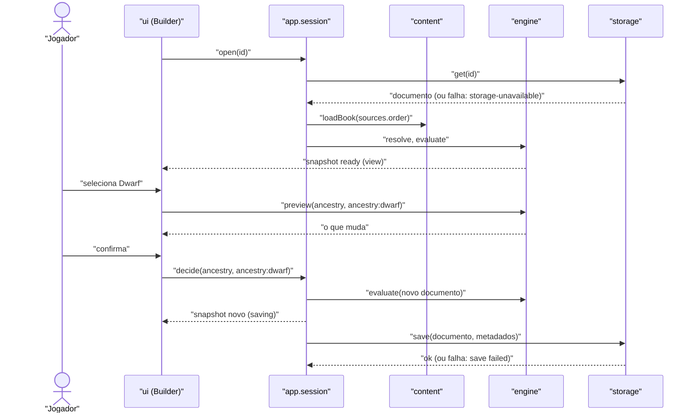

# Technical Design: FEAT-007 — Etapa Ancestry, mapa de etapas e resumo vivo

> Feature de: `docs/implementation-plan.md` §3 (E3) e §5 · Épico: E3 Construtor de nível 0
> Implementa: FR-STEP-001, 002, 003; FR-FLOW-001 a 014, 018; FR-CALC-001; FR-DEC-011; FR-SRC-010; FR-CONT-006, 009; FR-CONT-003 (parcial: Dwarf e Human do core na etapa Ancestry)
> Realiza: UC-003 (fluxo principal e 4a) · Telas: SCR-WEB-003, SCR-WEB-016 (desenhadas pelo ui-design)
> Status: Draft · Data: 2026-11-12

## 1. Intenção

O jogador abre o construtor de um personagem novo, escolhe Dwarf ou Human com a mecânica e a página à vista, resolve ou adia o Size do Human e vê as etapas se liberarem e o resumo vivo se calcular. É a primeira fatia porque exercita o núcleo de maior risco: `resolve` e `evaluate` reais, o procedimento como dado, fórmulas como árvore, chaves de vaga e vagas filhas (ADR-003, ADR-004; plano §5).

## 2. Contexto do código

Levantado no código em `a862f5d`/`4149623` e no `docs/scaffold-notes.md`:

- **Módulos e fronteiras** (lint): `engine` só importa tipos de `content`; `ui` não importa `content`, `storage` nem `dice`; React só no `ui`; `idb` só no `storage`.
- **Convenções:**
  - comandos do `app` devolvem resultado discriminado (`{ ok: true, … } | { ok: false, reason }`), sem exceção para erro esperado;
  - erros de carga do `content` são `PackLoadError`;
  - schemas Zod estritos com `z.config({ jitless: true })` (CSP);
  - nomes de teste começam pelo FR.
- **Stubs que esta feature substitui:** `engine.resolve`, `engine.evaluate`, a casca do `Builder` (`src/ui/screens/Builder.tsx`) e o `CharacterView` de uma etapa só. Os schemas de `src/content/schemas.ts` são ampliados.
- **Armazenamento:** IndexedDB `sotdl-generator` v1, stores `characters` e `characterMeta` (`keyPath: id`), gravados numa transação.
- **Rotas:** hash (`#/`, `#/about`, `#/characters/:id`).
- **Divergências encontradas:**
  - O documento v1 do esqueleto não segue a ADR-004: tem `name` no topo, `level`, e não tem `text`. Resolvido na D1.
  - O `openCharacter` não trata falha do repositório: uma rejeição do IndexedDB deixa o construtor em "Loading…". Corrigido na §3.2.
  - O `Home` trata falha da lista como lista vazia. Fica no §8, para a FEAT-001.

## 3. Contratos

A SPA não tem API HTTP (ADR-001). Os contratos são o formato do pacote (§3.1), os comandos e a sessão do `app` (§3.2) e as funções puras do `engine` (§3.3).

### 3.1 Formato do pacote, `format: 1` (ADR-003, ADR-005)

O formato 1 é redefinido: nada foi publicado (D3). Todo objeto é estrito, e campo desconhecido é recusado, o que barra texto livre (P22, FR-CONT-004). Os únicos textos são `name` de entidade e `abbr` de livro.

```ts
Book = {
  format: 1, id: BookId, name, abbr: /^[A-Z0-9]{2,8}$/,
  layer: 'core'|'supplement'|'house', published: YYYY[-MM[-DD]],
  components: Component[] (min 1)
}
Component = {
  id: slug, type: 'adds'|'replaces'|'table'|'procedure'|'optional-rule'|'errata',
  default: 'on'|'off', items: Item[]
}
Index = { format: 1, books: { id, name, abbr, layer, published }[] }
```

**Itens.** O schema de cada item é escolhido pelo prefixo do id (D4). Prefixo desconhecido é erro. Id: `<kind>:<slug>`, com slug em `[a-z0-9-]+`, estável e independente do nome (FR-CONT-006).

| Prefixo | Campos |
| :-- | :-- |
| `procedure:` | `steps: StepId[]` (min 1, ordem do mapa, FR-FLOW-002) |
| `step:` | `name`, `page?`, `regime?: 'choice'\|'roll-or-choose'\|'roll'\|'derived'\|'free'` (princípios §1.1), `optional?: true`, `requires?: StepId[]`, `slots?: Record<slotName, SlotDef>` |
| `attribute:` | `name`, `page`, `modifier: Formula` (usa `{ ref: 'self' }`) |
| `characteristic:` | `name`, `page`, `formula?: Formula` (fórmula padrão, D5) |
| `ancestry:` | `name`, `page` (início da entrada), `attributes: Record<AttributeId, int>`, `characteristics?: Record<CharacteristicId, Formula>`, `languages?: Record<LanguageId, ('speak'\|'read'\|'write')[]>`, `talents?: TalentId[]`, `level4?: { characteristics?: Record<CharacteristicId, int>, oneOf?: ({ spells: int } \| { talent: TalentId })[] }`, `grants?: Record<grantId, GrantedSlot>` |
| `talent:`, `language:` | `name`, `page` |

**Vagas.**

```ts
SlotDef     = { kind: 'choose-entity', of: 'ancestry' }                 // vaga raiz da etapa
GrantedSlot = { step: StepId } & (
    { kind: 'choose-value', target: CharacteristicId, options: number[] (min 2) }  // Size ½ ou 1
  | { kind: 'attribute-increase', amount: int }                          // resolvida na FEAT-016
  | { kind: 'language-or-profession' } )                                 // resolvida na FEAT-016
```

**Fórmula.** Árvore JSON (ADR-004 §2), recursiva, nunca texto avaliado:

```ts
Formula = number
  | { ref: AttributeId | CharacteristicId | `grant:${grantId}` | 'self' }
  | { add: Formula[] } | { div: [Formula, Formula] }
  | { min: Formula[] } | { max: Formula[] }
  | { round: 'down'|'up'|'nearest', of: Formula }
```

`grant:<id>` lê o valor decidido na vaga concedida pela própria entidade. Sem decisão, o resultado é `null` (pendente).

**Regras de formato verificadas na carga** (subconjunto; o resto é da FEAT-003):
- `requires` de uma etapa só aponta para etapas anteriores no `procedure`;
- `step` de uma concessão existe no procedimento;
- referência de fórmula a um id que existe nos livros carregados.

Ciclo de fórmula: o `evaluate` acusa `EngineError` (§3.3); a rejeição na carga é da FEAT-003.

### 3.2 `app`: sessão do personagem e comandos

`createCharacterSession(deps)` substitui o `openCharacter` do esqueleto. É um store externo lido pelo React com `useSyncExternalStore` (ADR-006).

```ts
session.open(id): Promise<void>
session.subscribe(listener): () => void
session.getSnapshot(): Snapshot
session.decide(key: SlotKey, value: EntityId | number): Promise<DecideResult>
session.retrySave(): Promise<DecideResult>

Snapshot =
  | { status: 'loading', id }
  | { status: 'error', id, reason: 'not-found' | 'storage-unavailable' | 'unreadable' | 'pack-load-failed' }
  | { status: 'ready', id, document, rules, view, save: 'saved' | 'saving' | 'failed' }

DecideResult =
  | { ok: true }
  | { ok: false, reason: 'unknown-slot' | 'invalid-value' }
  | { ok: false, reason: 'has-dependents', dependents: SlotKey[] }   // D8, até a FEAT-011
  | { ok: false, reason: 'save-failed' }
```

**`open(id)`**, na ordem:

| Passo | Falha | `reason` | Mensagem (rascunho; o texto final é do ui-design, NFR-USE-001) |
| :-- | :-- | :-- | :-- |
| `repository.get(id)` | rejeita (IndexedDB indisponível, bloqueado, cota) | `storage-unavailable` | "This browser couldn't open your saved characters. Reload the page to try again. If it keeps happening, check that this site is allowed to store data." (FR-HELP-005) |
| — | `undefined` | `not-found` | "This character is not saved in this browser." |
| `characterDocumentSchema.safeParse` | inválido (inclui os documentos do esqueleto, D1) | `unreadable` | "This character can't be read by this version of the app." |
| `loadBook` de cada livro em `sources.order` | `PackLoadError` | `pack-load-failed` | "The rules for this character could not be loaded. Nothing was changed." (FR-HELP-004; nada é gravado) |
| `resolve` → `evaluate` | — | — | snapshot `ready` |

`resolve` é memoizado pela ordem de fontes mais os livros carregados (architecture.md §8, Desempenho).

**`decide(key, value)`**, comando único da FEAT-007, usado por "confirmar ancestralidade" e por "Size":
1. A vaga `key` precisa estar viva no `view` atual (`unknown-slot` se não estiver), e `value` precisa estar entre as opções dela (`invalid-value`).
2. O novo documento é o atual com `decisions[key] = { mode: 'chosen', value }`, mais `revision + 1` e `updatedAt`.
3. `evaluate` do novo documento. As decisões do documento que não correspondem a nenhuma vaga viva são dependentes órfãos. Se houver algum, o comando devolve `has-dependents` e nada muda (D8).
4. O snapshot passa ao novo estado (`save: 'saving'`), e só então a gravação começa: a tela nunca espera o IndexedDB (NFR-PERF-002).
5. `repository.save(document, summarize(document, rules))`. Em sucesso, `save: 'saved'`. Em falha, `save: 'failed'`: o estado novo fica na tela e o comando devolve `save-failed` (FR-CHAR-010). `retrySave()` grava de novo o documento atual.

As gravações são serializadas: a última vence, e o documento é gravado inteiro, então repetir é idempotente. Os metadados (`CharacterSummary`) passam a levar `ancestry` como o **nome** da ancestralidade escolhida (ou `null`), para a Home exibi-lo sem carregar pacotes (NFR-PERF-001); `name` vem de `text.name ?? ''`.

Nenhuma entrada de log é escrita nesta feature: o log de decisões entra com a FEAT-009 (FR-LOG-001; §8).

### 3.3 `engine`: funções puras

```ts
resolve(books: Book[], order: BookId[]): Rules
evaluate(rules: Rules, character: CharacterDocument): CharacterView
preview(rules, character, key: SlotKey, value): { view: CharacterView, changes: Changes }
ancestryDetail(rules, ancestryId): AncestryDetail
formatFormula(rules, formula, ownerId?): string
```

- **`Rules`**: itens vigentes por id, cada um com a procedência `{ book, abbr, page, type: 'core' | 'adds' }` (FR-SRC-010). O tipo sai da camada do livro; `replaces` é da FEAT-005. Também traz o procedimento, as etapas na ordem, os atributos e as características na ordem do pacote e as ancestralidades. Só componentes com `default: 'on'` entram (exceção por personagem é Should). Se o mesmo id vier de dois livros, vale o primeiro da ordem (ADR-003 §5.3); `revises` e `replaces` são da FEAT-005.
- **`CharacterView`**:

```ts
{
  level: 0,
  ancestry: EntityId | null,
  steps: StepView[],      // { id, slug, name, page?, regime?, index, status, lockedBy: StepId[],
                          //   decided, open, total }
  slots: SlotView[],      // { key, kind, stepId, decided, value?, options?, source: { id, name } | null }
  openDecisions: { key, kind, stepId, source: { id, name } | null, target? }[],   // FR-FLOW-010, FR-DEC-011
  summary: {              // FR-FLOW-012
    attributes: { id, name, score: number | null, modifier: number | null }[],
    characteristics: { id, name, value: number | null, formula: string, pendingOn?: SlotKey }[],
    gained: { languages: { id, name, abilities }[], talents: { id, name, page }[] }
  }
}
```

  - **`status`** de cada etapa:
    - `locked`: algum `requires` com vaga própria em aberto (FR-FLOW-004, 005);
    - `optional`: `optional: true`;
    - `not-started`: nenhuma vaga da etapa decidida;
    - `open`: alguma decidida e N em aberto;
    - `done`: todas decididas e pelo menos uma vaga.
  - **`options`** de `choose-entity`: cada ancestralidade com id, nome, procedência e `mechanics: string[]`. De `choose-value`: os números.
- **Árvore de vagas** (ADR-004 §3). Raízes: os `slots` de cada etapa, com chave = nome da vaga (`ancestry`). Uma decisão em `choose-entity` abre as `grants` da entidade escolhida como filhas, com chave `<mãe>=<parte local do valor>/<grantId>`, ex.: `ancestry=human/size`. Gramática: `^[a-z0-9-]+(=[a-z0-9.-]+/[a-z0-9-]+)*$`.
- **Valores** (FR-CALC-001; nada derivado é gravado):
  - score do atributo: o da ancestralidade (`null` sem ancestralidade);
  - modificador: a fórmula do item `attribute` com `self` = score;
  - característica: a fórmula da ancestralidade para aquela característica, ou a padrão do item (D5), avaliada em ordem de referências;
  - `null` propaga (pendente) e registra `pendingOn` com a vaga que falta;
  - ciclo → `EngineError`.
  - O +1 do Human não altera atributos nesta feature (vaga aberta até a FEAT-016).
- **`preview`**: `evaluate` do documento hipotético com a decisão. `changes` lista atributos, características e etapas cujo valor ou estado mudaria, antigo → novo (FR-FLOW-014). É puro: nada é gravado (D7).
- **`ancestryDetail`**:
  - atributos iniciais;
  - características com fórmula legível e valor-base;
  - idiomas com o que se faz em cada um, talentos com página;
  - nível 4 ("Health +6; one spell or Shake it Off");
  - concessões pendentes (Size, +1, idioma ou profissão);
  - página e procedência (FR-STEP-002).
- **`mechanics`** (FR-CONT-009), gerada só dos dados, em partes curtas:
  - os quatro atributos ("Strength 10", …);
  - cada característica cuja fórmula difere da padrão, via `formatFormula` ("Perception = Intellect + 1", "Health = Strength + 4", "Speed 8", "Size 1/2"; o Human dá "Size 1/2 or 1");
  - os nomes dos talentos.
- **`formatFormula`**: `ref` vira o nome da entidade, constantes como números, `add` com negativos como subtração, `div` e `round` em notação genérica ("Health / 4, rounded down"), `grant:<id>` como as opções da vaga ("1/2 or 1"). Fração 0.5 → "1/2". Reusado pela FEAT-008 (FR-CALC-003).

### 3.4 `ui`: rotas e pontos de integração

- **Rotas:**
  - `#/characters/:id` redireciona (replace) para a primeira etapa;
  - `#/characters/:id/:step` (slug = parte local do id da etapa), com `?slot=<key codificada>` para o atalho de uma pendência (FR-FLOW-011);
  - etapa bloqueada na URL redireciona para a primeira etapa liberada.
  - A última etapa visitada é da FEAT-001 (FR-CHAR-007).
- **Pontos de integração:**
  - hook `useCharacterSession(id)` sobre o store;
  - Next e Back pela ordem do `view.steps`: Next só para etapa liberada, mesmo com pendência na atual (FR-FLOW-007, 008);
  - a seleção de uma ancestralidade é estado local da tela, com `preview` para o "o que muda" e confirmação por `decide`;
  - a pergunta de cada etapa e os rótulos das pendências são texto do app, por id de etapa e por `kind` de vaga, nunca do pacote (D6).
- Telas, componentes e o layout de celular (SCR-WEB-003, SCR-WEB-016; `design.md` §4: `step-map`, `step-header`, `option-card`, `subdecision`, `live-summary`, `open-decisions`) são do ui-design.

## 4. Mudanças de esquema

**IndexedDB:** nenhuma. Banco `sotdl-generator` continua na v1, com as mesmas stores e chaves.

**Documento do personagem, `schema: 1`, redefinido sem migração** (D1, D2):

```ts
CharacterDocument = {
  schema: 1, id, contentVersion, revision: int >= 1,
  createdAt: ISO, updatedAt: ISO,          // envelope: data da última edição (FR-CHAR-003, 004)
  sources: { order: BookId[] (min 1) },
  decisions: Record<SlotKey, { mode: 'chosen', value: EntityId | number }>,
  text: { name?: string },                 // fora do log (FR-LOG-008)
  log: unknown[]                           // forma na FEAT-009 e FEAT-020
}
```

- Sai do v1 do esqueleto: `name` no topo (vai para `text.name`) e `level`. O nível 0 é implícito até a subida de nível (Should), que entra como camada nova.
- As camadas `adjustments`, `grants` e `session` entram como campos opcionais nas features delas, sem mudar `schema`.
- **Personagens locais do esqueleto:** nada foi publicado, então não há migração. Ao abrir, eles caem em `unreadable` (§3.2). Para limpar, apague o banco de desenvolvimento (DevTools → Application → IndexedDB → `sotdl-generator` → Delete database). Registrar no `scaffold-notes`.

**Pacote `packs/sotdl.core.json`**, reescrito no formato da §3.1: um componente `base` (`adds`, `on`). Os ids das 8 etapas não mudam, então o `packs:check` não acusa remoção. Itens e dados na tabela abaixo. Convenção de página: impressa = PDF − 1 (`scaffold-notes`).

| Item | Dados | Página | Conferido |
| :-- | :-- | :-- | :-- |
| `procedure:level-0` | as 8 etapas na ordem atual | — | sim (2026-11-12) |
| `step:ancestry` | `regime: choice`; `slots.ancestry: choose-entity of ancestry` | 9 | sim |
| demais `step:*` | `requires: [step:ancestry]`; Roleplaying `optional: true` (FR-FLOW-017); sem vagas nesta feature | 10–27 (já no pacote) | sim |
| `attribute:strength`, `agility`, `intellect`, `will` | `modifier = self − 10` | 10 | sim |
| `characteristic:perception`, `defense`, `health`, `healing-rate` | padrão: Intellect; Agility; Strength; `round down (Health / 4)` | 10 | sim (igual nas entradas do Human e do Dwarf) |
| `characteristic:power`, `damage`, `insanity`, `corruption` | padrão 0 | 10 | sim |
| `characteristic:size`, `speed` | sem padrão (a ancestralidade define) | 10 | sim |
| `ancestry:human` | 10/10/10/10; Size = `grant:size`; Speed 10; Common Tongue (speak); grants `size` (choose-value, options ½ e 1, etapa Ancestry), `attribute-increase` (1, etapa Attributes), `language-or-profession` (etapa Professions & languages); nível 4: Health +5, uma magia ou Determined | 11 (mecânica na 12) | sim |
| `ancestry:dwarf` | Str 10, Agi 9, Int 10, Wil 10; Perception = Intellect + 1; Health = Strength + 4; Size ½; Speed 8; Common Tongue (speak), Dwarfish (speak, read, write); talentos Darksight, Hated Creature, Robust Constitution; nível 4: Health +6, uma magia ou Shake it Off | 17 | sim |
| `language:common-tongue`, `language:dwarfish` | — | 10 | sim |
| `talent:darksight`, `hated-creature`, `robust-constitution`, `shake-it-off` · `talent:determined` | só id, nome e página (efeitos não modelados) | 17 · 12 | sim |

Não verificado: nenhum dado desta feature. A vaga da Hated Creature (tabela Hatred, impressa 18) é da FEAT-009.

## 5. Desenho dos componentes



| Onde | Arquivo | Muda |
| :-- | :-- | :-- |
| `content` | `schemas.ts` | formato da §3.1 (livro, componente, itens por prefixo, vagas, fórmula recursiva com `z.lazy`), documento da §4, tipos exportados |
| `content` | `load.ts` | sem mudança de contrato; valida com os schemas novos e as regras de formato da §3.1 |
| `engine` | `resolve.ts`, `evaluate.ts`, `formula.ts`, `mechanics.ts`, `index.ts` | substitui os stubs; `EngineError` |
| `app` | `session.ts`, `index.ts` | `createCharacterSession`; `createCharacter` passa a gravar o documento novo; `summarize` com nome da ancestralidade |
| `ui` | `router.ts`, `screens/Builder.tsx`, `useCharacterSession.ts` | rotas da §3.4 e hook; telas do ui-design |
| `packs/` | `index.json`, `sotdl.core.json` | `abbr`; conteúdo da §4 |
| `e2e/` | `skeleton.spec.ts` | expectativa do mapa (Ancestry "Not started", demais bloqueadas) |

## 6. Critérios de aceitação

| # | Critério | Origem |
| :-- | :-- | :-- |
| AC-1 | Dado um personagem novo, quando o construtor abre, só Ancestry está liberada; as outras 7 etapas aparecem no mapa como bloqueadas, com `lockedBy: [step:ancestry]` exposto como "Choose an ancestry first" no nome acessível, e não abrem por clique nem por URL. | FR-FLOW-004, 005; UC-001 5 |
| AC-2 | Na etapa Ancestry aparecem Dwarf e Human, uma vez cada, com a linha de mecânica gerada dos dados (Dwarf inclui "Health = Strength + 4", "Speed 8", "Size 1/2"), o selo "CORE p.17"/"CORE p.11" e o tipo "Core". | FR-STEP-001, FR-SRC-010, FR-CONT-009; UC-003 1 |
| AC-3 | Ao selecionar uma ancestralidade, aparecem atributos iniciais, características, idiomas, talentos, benefício de nível 4 e página da descrição, sem texto do livro, e a prévia do que muda (atributos, características e etapas liberadas), sem gravar nada. | FR-STEP-002, FR-FLOW-014; UC-003 2–3 |
| AC-4 | Ao confirmar Human, surge a subdecisão Size (½ ou 1). Adiada, ela entra em Open decisions com atalho que abre a etapa Ancestry na vaga; o +1 e o idioma ou profissão do Human também aparecem como pendências, nas etapas deles. A contagem inclui as três. | FR-STEP-003, FR-DEC-011, FR-FLOW-010, 011; UC-003 4a |
| AC-5 | Depois da escolha, o mapa mostra o estado de cada etapa na ordem do procedimento, com a atual destacada; a etapa liberada abre pelo mapa; Next abre a seguinte mesmo com pendência na atual; Back volta. | FR-FLOW-001, 002, 006, 007, 008 |
| AC-6 | O cabeçalho da etapa mostra regime, pergunta, linha de regra com página ("CORE p.9" em Ancestry) e contadores (decididas/total e abertas). | FR-FLOW-009 |
| AC-7 | O resumo vivo mostra os quatro atributos com modificador e as características calculadas pelas fórmulas do pacote (Dwarf: Health 14, Perception 11, Healing Rate 3, Speed 8, Size 1/2) e se atualiza ao trocar a escolha. O documento gravado só tem entradas; nenhum valor derivado. | FR-FLOW-012, 013, FR-CALC-001 |
| AC-8 | Trocar Dwarf por Human sem outras decisões aplica direto e recalcula etapas e resumo. Com dependentes (Human com Size decidido → Dwarf), o comando devolve `has-dependents` e nada muda (até a FEAT-011). | FR-FLOW-003, D8; UC-003 4c |
| AC-9 | Abaixo de 768px vale o layout de celular do SCR-WEB-016 para as etapas: seletor no topo, resumo recolhível, Back e Next fixos. | FR-FLOW-018 |
| AC-10 | A decisão sobrevive a recarregar a página. Renomear uma entidade no pacote, mantendo o id, preserva a decisão. | FR-CONT-006, NFR-REL-001 |
| AC-11 | Se o IndexedDB falhar ao abrir o personagem, o construtor mostra a mensagem de `storage-unavailable`, em vez de ficar em "Loading…"; documento inválido mostra `unreadable`; pacote que não carrega mostra `pack-load-failed` e nada é gravado. | FR-HELP-004, 005, NFR-USE-001 |
| AC-12 | Se a gravação de uma decisão falhar, a decisão fica na tela, o aviso aparece e "Try again" grava o estado atual. | FR-CHAR-010 |
| AC-13 | O pacote do core passa no schema estrito e no `packs:check`; um campo de texto num item é recusado. | FR-CONT-003 (parcial), FR-CONT-004 |

**NFRs:**
- NFR-PERF-001: a Home continua sem pacotes (E2E existente).
- NFR-PERF-002: a tela atualiza antes da gravação; a medição formal é da FEAT-008.
- NFR-ACC-001: axe sem violação grave no construtor com escolha feita.
- NFR-L10N-001: tudo em inglês.

## 7. Decisões

- **D1. Documento v1 redefinido, sem migração.**
  - Motivo: ADR-004 §1 (camadas `sources`, `decisions`, `text`, `log`); nada publicado.
  - Alternativa rejeitada: v2 com migração do v1 do esqueleto (código para dados que só existem em máquinas de desenvolvimento).
  - Consequência: personagens do esqueleto viram `unreadable`; apaga-se o banco local.
- **D2. Envelope mantém `createdAt`/`updatedAt` e tira `level`.**
  - Motivo: FR-CHAR-003/004 pedem a data da última edição, e os metadados são derivados do documento a cada gravação. `text` não vai para o log, então o log não serve de relógio.
  - Alternativa rejeitada: derivar a data do log.
  - Consequência: o nível 0 é implícito; a subida de nível (Should) cria a camada dela.
- **D3. Componentes entram já no formato 1.**
  - Motivo: ADR-003 §1 (todo item pertence a um componente).
  - Alternativa rejeitada: itens soltos no livro até a FEAT-005, o que quebraria o formato depois.
  - Consequência: o core ganha um componente `base`; `revises`, `replaces` e `patches` ficam para a FEAT-005.
- **D4. Tipo do item pelo prefixo do id.**
  - Motivo: o id já é `<kind>:<slug>` (ADR-003 §2).
  - Alternativa rejeitada: um campo `kind`, que duplicaria o prefixo e exigiria checagem de consistência.
  - Consequência: prefixo desconhecido é erro com caminho no arquivo.
- **D5. Fórmulas padrão nos itens `characteristic`.**
  - Motivo: P11a ("uma fonte pode substituir a fórmula padrão") e ADR-003 (Clockwork substitui Defense).
  - Alternativa rejeitada: repetir as 10 fórmulas em cada ancestralidade, como o livro faz.
  - Consequência: a linha de mecânica mostra só o que difere do padrão.
- **D6. Nada de texto de produto no pacote.**
  - Motivo: P22, objeto estrito.
  - Consequência: pergunta da etapa e rótulos das pendências são texto do app, por id de etapa e por `kind`. O regime vem do pacote, porque é dado da regra (princípios §1.1).
- **D7. Selecionar é estado da tela; confirmar é comando.**
  - Motivo: UC-003 2–4 e FR-FLOW-014.
  - Consequência: o `preview` é o mesmo `evaluate`, que a FEAT-011 reaproveita para o `impact`.
- **D8. Mudança com dependentes é recusada até a FEAT-011.**
  - Motivo: P6 (dependentes só saem com confirmação); FR-CHG-001/002/005 são da FEAT-011.
  - Alternativa rejeitada: aplicar e deixar órfãs inertes no documento (estado escondido).
  - Consequência: a ui mostra um aviso simples; a FEAT-011 troca pelo diálogo de impacto.
- **D9. +1 e idioma ou profissão do Human como concessões já declaradas.**
  - Motivo: o plano (§5, "ficam como decisões abertas até o FEAT-016").
  - Consequência: os `kind` `attribute-increase` e `language-or-profession` existem sem resolvedor; a FEAT-016 pode estendê-los antes da publicação.
- **D10. Etapa na URL.**
  - Motivo: FR-FLOW-006/011 (abrir etapa e ponto exato) com roteamento por hash (ADR-006).
  - Consequência: o construtor abre na primeira etapa; a FEAT-001 acrescenta a última visitada.
- **D11. A tela atualiza antes de gravar; gravações em série.**
  - Motivo: NFR-PERF-002, NFR-REL-001, FR-CHAR-010.
  - Consequência: `save: 'failed'` mantém o estado na tela, e "Try again" regrava o documento inteiro.

## 8. Escalações e pendências

- **Escalações de arquitetura:** nenhuma. Vagas, concessões, fórmulas e componentes são formas físicas das entidades das ADR-003/004.
- **Log:** a ADR-004 §5 diz que todo comando gera entradas de log; a FR-LOG-001 está na FEAT-009. Até lá, `decide` não escreve no log.
- **FEAT-001:** a Home trata falha do `listCharacters` como lista vazia; deve mostrar mensagem como a §3.2.
- **FEAT-003:** validação completa (integridade referencial, ciclo de fórmula na carga, consistência do `index.json` com os livros, página obrigatória).
- **FEAT-011:** substituir o `has-dependents` pelo diálogo de impacto.
- **`CONTENT_VERSION`:** continua `0.0.0` (scaffold-notes).
- **Texto do app:** perguntas das etapas, rótulos das pendências e mensagens da §3.2 são rascunho; o ui-design fecha (NFR-USE-001).
