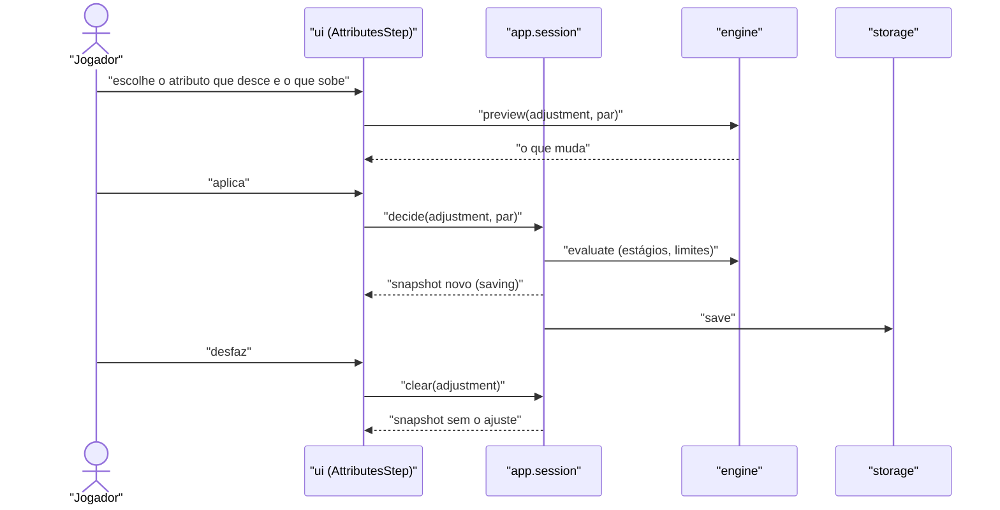

# Technical Design: FEAT-008 — Etapa Attributes: ajuste ±1, características com fórmula e composição

> Feature de: `docs/implementation-plan.md` §3 (E3) · Épico: E3 Construtor de nível 0
> Implementa: FR-STEP-007, 009, 010, 011; FR-CALC-002, 003, 006, 007, 008; FR-CALC-005 (parcial: base, modifier e limit); FR-CALC-009 (parcial: resumo vivo e etapa, sem a ficha)
> Realiza: UC-004 (fluxo principal 1, 3 e 4; 3a; 3b) · Telas: SCR-WEB-005 (desenhada pelo ui-design)
> Status: Verified · Data: 2026-11-12

## 1. Intenção

O jogador abre a etapa Attributes, vê os quatro atributos e as dez características com fórmula, valor e composição, e aplica, se quiser, o ajuste de −1 num atributo e +1 noutro, uma vez só, com desfazer. É a segunda fatia porque completa o cálculo com a ordem do P11b, os limites e a composição por parcela, e mede a NFR-PERF-002 (plano §4).

## 2. Contexto do código

Levantado no código em `fe43325` e na FEAT-007 (`technical-design.md`, `ui-design.md`, `acceptance-report.md`):

- **Fronteiras e convenções:** as da FEAT-007 §2, sem mudança. Comandos devolvem resultado discriminado; schemas estritos; nome de teste começa pelo FR.
- **Contratos que esta feature estende** (FEAT-007 §3):
  - formato do pacote (§3.1): `SlotDef` só tem `choose-entity`; `characteristic` não tem limites;
  - documento (§4): `decisions[key].value` é `EntityId | number`;
  - `session.decide` (§3.2) é o único comando;
  - `evaluate` (§3.3) calcula só o termo base. `Stage` tem só `stage: 'base'`, e a FEAT-007 deixou o ponto de extensão para os demais estágios. `evaluateFormulas` resolve a referência a outra característica pelo valor da fórmula, sem estágios;
  - `formatFormula` já é a fonte da FR-CALC-003 ("Health / 4, rounded down", frações como "1/2").
- **Interface:** o `Builder` escolhe o corpo da etapa pelo `kind` da vaga raiz (`choose-entity` de ancestry → `AncestryStep`; o resto → `FallbackStep`). A composição no `LiveSummary` lista os estágios e uma linha de total com o `value` do resumo.
- **Armazenamento:** IndexedDB `sotdl-generator` v1, sem mudança.
- **Divergências encontradas:** nenhuma entre código e documentos da FEAT-007. As divergências entre documentos estão no §8.

## 3. Contratos

### 3.1 Formato do pacote (acréscimos ao `format: 1`)

Tudo continua estrito. Nenhum campo de texto novo.

**Vaga raiz `attribute-shift`** (o ajuste ±1 como dado; ADR-003 §6):

```ts
SlotDef =
  | { kind: 'choose-entity', of: 'ancestry', optional?: true }
  | { kind: 'attribute-shift', amount: int >= 1, optional?: true }   // novo
```

- `attribute-shift`: diminui um atributo em `amount` e aumenta outro em `amount`. As opções são os atributos vigentes (`Rules.attributes`).
- `optional: true`: a vaga nunca bloqueia etapa, nunca é decisão aberta e não entra nos contadores da etapa (D2).

**Limites na característica** (FR-CALC-006):

```ts
characteristic: { …, limits?: { max?: Formula, min?: Formula } }   // pelo menos um dos dois
```

O limite é uma fórmula, então "Insanity ≤ Will" é `{ max: { ref: 'attribute:will' } }`. Regras de formato acrescentadas à carga, com caminho:
- referências do limite resolvidas como as da fórmula; `self` e `grant:` recusados;
- os limites entram no grafo de ciclos de cada ancestralidade (FEAT-007 §3.1), como arestas da característica para o que o limite referencia.

### 3.2 `app`: comandos

```ts
DecisionValue = EntityId | number | AttributeShift
AttributeShift = { decrease: AttributeId, increase: AttributeId }

session.decide(key, value: DecisionValue): Promise<DecideResult>   // estendido
session.clear(key): Promise<DecideResult>                          // novo

DecideResult =
  | { ok: true }
  | { ok: false, reason: 'unknown-slot' | 'invalid-value' | 'already-decided' | 'not-decided' }
  | { ok: false, reason: 'has-dependents', dependents: SlotKey[] }   // D8 da FEAT-007
  | { ok: false, reason: 'save-failed' }
```

**`decide` em `attribute-shift`:**
1. A vaga precisa estar viva (`unknown-slot`).
2. Vaga já decidida → `already-decided`, e nada muda (FR-STEP-010; D3). A ui oferece desfazer.
3. `decrease` e `increase` precisam ser atributos vigentes e diferentes (`invalid-value`).
4. Daí em diante, o mesmo caminho da FEAT-007 §3.2, passos 2 a 5: documento novo, `evaluate`, dependentes, snapshot antes da gravação, gravação em série.

Nas demais vagas, `decide` não muda: decidir de novo substitui (Size).

**`clear(key)`**, comando genérico de limpar uma decisão (FR-STEP-011; D4):
1. A vaga precisa estar viva (`unknown-slot`) e decidida (`not-decided`).
2. O documento novo é o atual sem `decisions[key]`, com `revision + 1` e `updatedAt`.
3. Dependentes: o mesmo cálculo do `decide`. Limpar uma vaga cujas filhas têm decisão devolve `has-dependents` (ex.: limpar `ancestry` com o Size decidido).
4. Snapshot, gravação e `retrySave` como no `decide`.

Desfazer o ajuste é `clear('adjustment')`. Os dois atributos voltam ao valor anterior porque nada derivado foi gravado: o valor sai de novo do `evaluate` sem a decisão (FR-CALC-001).

O `clear` vale para qualquer vaga, inclusive o Size do Human: `clear('ancestry=human/size')` não tem dependentes, e depois dele trocar Human por Dwarf deixa de devolver `has-dependents`. Isso resolve no comando o beco da D8 da FEAT-007. A tela da Ancestry não ganha o controle: fica como está até a FEAT-011 (§7).

Nenhuma entrada de log nesta feature (FEAT-009; FEAT-007 §8).

### 3.3 `engine`

Assinaturas da FEAT-007 mantidas. `preview` passa a aceitar `DecisionValue` e serve para mostrar o que um ajuste muda antes de aplicá-lo (FR-FLOW-014).

**Ordem de cálculo (FR-CALC-005; P11b; ADR-004 §2).** Cada atributo e cada característica passa pelos estágios na ordem fixa `base → modifier → define → sum → limit → manual`. O motor coleta efeitos com origem a partir das vagas vivas decididas (ADR-004 §2, "efeitos coletados com a origem"), e cada estágio aplica os efeitos dele.

| Estágio | P11b | Nesta feature |
| :-- | :-- | :-- |
| `base` | base da ancestralidade | **Implementado.** Atributo: score da ancestralidade. Característica: fórmula da ancestralidade ou padrão do item (FEAT-007). |
| `modifier` | modificadores permanentes | **Implementado** para o `attribute-shift`: dois efeitos, −`amount` e +`amount`. Paths e itens: ponto de extensão (Should, FEAT-030). |
| `define` | efeitos que definem | Ponto de extensão: resultados de tabela que fixam um valor (FEAT-009, FR-CALC-010; Form da Clockwork, FEAT-017). |
| `sum` | efeitos que somam | Ponto de extensão: resultados de tabela e concessões que somam (FEAT-009, FR-CALC-010, 011; Purpose da Clockwork, FEAT-017). |
| `limit` | limites | **Implementado:** `limits` do item `characteristic` (§3.1). |
| `manual` | ajuste manual | Ponto de extensão: FEAT-019 (P12). |

- Os atributos são calculados primeiro. Toda referência de fórmula ou de limite a um atributo ou característica lê o **total** dele, depois de todos os estágios (FR-CALC-009). Ex.: Healing Rate lê a Health já limitada. `evaluateFormulas` ganha um passo de acabamento por id, e as referências dos limites passam pelo mesmo resolvedor, com a mesma detecção de ciclo.
- O modificador do atributo (`self − 10`) lê o score total, depois do ajuste: Intellect 11 dá +1 e Strength 9 dá −1 (AC-2).
- O arredondamento é só o que a fórmula declara (`round`), sem regra global (FR-CALC-008). Um valor sem `round` continua fracionário (Size 1/2).
- Pendente (`null`) propaga por todos os estágios. Um limite cujo próprio valor está pendente não corta.

**Composição (FR-CALC-002, 007).** `composition` lista as parcelas na ordem dos estágios. Toda parcela é aditiva, então o total (`score` ou `value`, já no resumo) é sempre a soma dos `value` das parcelas (D5).

```ts
Stage =
  | { stage: 'base', value: Value, formula?: string,
      origin: { kind: 'ancestry', id, name } | { kind: 'default', id } }            // FEAT-007, sem mudança
  | { stage: 'modifier', value: number,
      origin: { kind: 'slot', key: SlotKey, stepId: StepId, slotKind: SlotKind } }  // novo
  | { stage: 'limit', value: number, bound: 'max' | 'min', limit: number, formula: string,
      origin: { kind: 'default', id } }                                             // novo: só quando corta
```

- Parcela de limite: aparece só quando o limite corta (FR-CALC-007). `value` é a diferença (ex.: total antes 27, máximo 25 → `value: −2`). `formula` é o texto do limite ("25", "Will"), e `limit`, o valor dele.
- Origem `slot` no ajuste: a chave e a etapa da vaga, mais o `kind`. A ui escreve o rótulo pelo `kind` (D6 da FEAT-007), nunca pelo id.

**Linha legível (FR-CALC-003).** `CharacteristicSummary` ganha `limits`, sempre presente, cortando ou não:

```ts
CharacteristicSummary = { …FEAT-007, limits: { bound: 'max' | 'min', formula: string, limit: Value }[] }
```

`formula` continua vindo de `formatFormula`, sem mudança: "Health / 4, rounded down", frações como "1/2". O limite vem à parte ("min 1", "max Will (10)"), e o ui-design junta fórmula e limite na linha (§7).

**Vaga `attribute-shift` no `CharacterView`:**

```ts
SlotView (acréscimo) = SlotBase & { kind: 'attribute-shift', amount, optional?: true,
                                    options: { id, name }[], value?: AttributeShift }
```

- Decisão válida: dois atributos vigentes e diferentes. Inválida é ignorada e a vaga fica sem decisão, como a decisão sem opção viva da FEAT-007.
- Vaga com `optional`:
  - fica fora de `decided`, `open` e `total` da etapa e de `openDecisions`;
  - não entra no cálculo de `locked` (D2);
  - continua em `slots`, com `decided` e `value`.

**Estado da etapa** (muda a regra da FEAT-007 §3.3; D2). `locked` e `optional` não mudam. Para a etapa liberada:
- `done`: tem ao menos uma vaga, contando as opcionais, e nenhuma obrigatória aberta;
- `open`: alguma obrigatória aberta, e alguma vaga da etapa decidida ou concedida (aberta por decisão de outra etapa);
- `not-started`: o resto: sem vaga nenhuma, ou só vagas raiz obrigatórias, todas abertas.

No core: com Dwarf, Attributes fica `done` logo ao escolher a ancestralidade; com Human, Attributes fica `open` pelo +1, e Professions & languages também, pela concessão de idioma ou profissão (`step:professions-languages`); as outras etapas sem vagas continuam `not-started`. Ancestry não muda (`not-started` antes da escolha, `open` com o Size do Human aberto).

### 3.4 `ui`: pontos de integração

- **Despacho:** o `Builder` escolhe o corpo pelo `kind` da vaga raiz da etapa. `attribute-shift` → `AttributesStep` (novo). O motor não sabe que a etapa se chama Attributes (ADR-003 §6).
- **Dados da SCR-WEB-005:**

| Elemento | Fonte |
| :-- | :-- |
| Atributos (valor, modificador, composição) | `view.summary.attributes` |
| Características (fórmula, limites, valor, composição) | `view.summary.characteristics` |
| Ajuste: opções, estado e escolha atual | `view.slots` da vaga `attribute-shift` (`options`, `decided`, `value`) |
| O que o ajuste muda | `engine.preview(rules, document, key, { decrease, increase })` |
| Aplicar / desfazer | `session.decide(key, { decrease, increase })` · `session.clear(key)` |
| Ajuste aplicado | grupos só leitura, motivo e "Undo adjustment" visíveis; a tela não chama `decide` com o ajuste aplicado (ui-design, estado `applied`). `already-decided` continua no comando (D3) |
| +1 do Human | `view.slots` com `kind: 'attribute-increase'` desta etapa |

- Escolher o atributo que desce e o que sobe é estado local da tela. Só a confirmação vira comando (D7 da FEAT-007).
- **+1 do Human (FR-STEP-008, FEAT-016):** a `AttributesStep` mostra a vaga `attribute-increase` desta etapa como pendência sem controle. O id do elemento vem da chave da vaga, para o atalho `?slot=` focar nele. A vaga continua em Open decisions e na contagem. O texto provisório da FEAT-007 ("You can't make this choice here yet…") **não** aparece nesta etapa. O `FallbackStep` deixa de servir a Attributes e continua servindo Story a Review (lição 4). Rascunho, fechado pelo ui-design: "Humans raise one attribute by 1. Choosing it here comes in a later version; until then it stays in Open decisions."
- **Rótulos novos** (texto do app, por `kind` e por estágio; rascunho, fechado pelo ui-design):
  - pendência e origem do `attribute-shift`: "Score adjustment";
  - parcela `modifier`: "Score adjustment" → "−1";
  - parcela `limit`: "Standard rule: maximum 25" → "−2" (ou "minimum 1").
- Telas, estados (ajuste livre, em seleção, aplicado, segunda tentativa, +1 pendente) e celular são do ui-design. Também é dele o contador do cabeçalho numa etapa `done` só com a vaga opcional (Dwarf: `decided` 0, `total` 0).

## 4. Mudanças de esquema

**IndexedDB:** nenhuma.

**Documento do personagem, `schema: 1`, sem migração:** `decisions[key].value` passa a aceitar `{ decrease: AttributeId, increase: AttributeId }` (objeto estrito). Só alarga a união: todo documento gravado continua válido. Exemplo: `"adjustment": { "mode": "chosen", "value": { "decrease": "attribute:strength", "increase": "attribute:intellect" } }`.

**Pacote `packs/sotdl.core.json`:** só acréscimos; nenhum id muda ou sai (`packs:check`). Página na convenção do `scaffold-notes` (impressa = PDF − 1), conferida no PDF do core em 2026-11-12.

| Item | Acréscimo | Página impressa | Conferido |
| :-- | :-- | :-- | :-- |
| `step:attributes` | `slots.adjustment: { kind: 'attribute-shift', amount: 1, optional: true }` | 10 ("Adjusting Scores": um +1 contra um −1, uma vez) | sim |
| `step:attributes` | `regime: 'choice'` | — | não se aplica: classificação do produto (princípios §1.1, "Fixos + escolha"), não dado do livro (D7) |
| `characteristic:defense` | `limits: { max: 25 }` | 34 ("Maximum Defense") | sim |
| `characteristic:perception` | `limits: { max: 25 }` | 34 (Perception, score) | sim |
| `characteristic:healing-rate` | `limits: { min: 1 }` | 34 (Healing Rate) | sim |
| `characteristic:insanity` | `limits: { max: { ref: 'attribute:will' } }` | 35 ("Insanity Total"); também 34, em Will | sim |

Não verificado: nenhum dado desta feature.

## 5. Desenho dos componentes



| Onde | Arquivo | Muda |
| :-- | :-- | :-- |
| `content` | `schemas.ts` | `SlotDef` com `attribute-shift` e `optional`; `limits` em `characteristic`; `AttributeShift` no documento; regras de formato dos limites e grafo de ciclos com os limites |
| `engine` | `evaluate.ts` | vaga `attribute-shift` na árvore; vaga opcional fora de contadores, pendências e bloqueio; regra de estado da etapa; coleta de efeitos; estágios e composição; `limits` no resumo; `preview` com `DecisionValue` |
| `engine` | `formula.ts` | passo de acabamento por id em `evaluateFormulas` (referência lê o total); `formatFormula` sem mudança |
| `app` | `session.ts` | `decide` com par e `already-decided`; `clear`; dependentes num ajudante comum aos dois |
| `ui` | `builder/copy.ts`, `builder/LiveSummary.tsx`, `builder/FallbackStep.tsx` | rótulo do `attribute-shift`; rótulos das parcelas `modifier` (T2) e `limit` (T3); vaga opcional fora das pendências (T2) |
| `ui` | `builder/AttributesStep.tsx` (novo), `screens/Builder.tsx` | despacho por `kind`; integração da §3.4 (T6). A tela é do ui-design |
| `packs/` | `sotdl.core.json` | §4 |
| `e2e/` | `ancestry.spec.ts`, `attributes.spec.ts` (novo), `perf.spec.ts` (novo) | §6 e T7, T8 |

**NFR-PERF-002, método de medição** (ADR-008, "teste de tempo"):
- **Ambiente:** o build servido pelo `vite preview` do `playwright.config.ts`, com a CSP ativa, como no E2E.
- **Perfis**, só no Chromium (o CDP só existe nele):
  - notebook médio: projeto `chromium`, sem estrangulamento, limite p95 ≤ 100 ms;
  - celular médio: projeto `mobile-chrome` (Pixel 7) com `Emulation.setCPUThrottlingRate` 4×, o fator do perfil móvel padrão do Lighthouse já usado na NFR-PERF-001; limite p95 ≤ 200 ms.
- **Medida:**
  - início: `event.timeStamp` do clique que confirma a decisão, lido por um ouvinte em captura no `document`;
  - fim: o primeiro `requestAnimationFrame` depois que a etapa **e** o resumo vivo mostram o valor novo (`MutationObserver`).
  - Elementos observados, pelo score do atributo que sobe:
    - na etapa, a linha do atributo, pelo nome acessível que o ui-design definir;
    - no `chromium` (≥ 768 px), o item do atributo em `.live-summary__attributes`, no painel `#builder-summary`;
    - no `mobile-chrome` (< 768 px), o resumo fica recolhido (SCR-WEB-016), e o teste observa o item do atributo em `.summary-bar__attributes`, sem abrir o painel.
  - Tudo é instalado pelo teste com `page.evaluate`; o app não ganha código de medição (NFR-OBS-001).
- **Amostras:** por perfil, 5 de aquecimento descartadas e 40 medidas, alternando aplicar e desfazer o ajuste. p95 pelo posto mais próximo (38ª de 40).
- **Resultado:** cada execução anexa um JSON ao relatório do Playwright (amostras, p95, perfil) e uma anotação "NFR-PERF-002". O relatório de aceite da FEAT-008 registra os números e a máquina medida. No CI, o teste roda no job `e2e` e falha acima do limite.
- **Guarda unitária** (ADR-008; "personagem de nível 0 completo" da architecture.md §10): `evaluate`, 200 execuções, p95 ≤ 20 ms (um quinto do limite do notebook), em dois casos:
  - o pacote real com o personagem mais completo de hoje (Human, Size e ajuste decididos);
  - um pacote fictício do porte de um nível 0 completo, com folga de 2× sobre a contagem do core (páginas impressas):

| Medida | Human de nível 0 completo no core | Fictício |
| :-- | :-- | :-- |
| Vagas decididas | 18: ancestralidade, Size e +1 (p.12) e ajuste (p.10); 6 tabelas da ancestralidade (pp.12–13; o Dwarf também tem 6, pp.18–19); idioma ou profissão (p.12); 2 profissões, com tipo e entrada quando roladas (4, p.23); riqueza (p.25); coisa interessante, tabela e entrada (2, p.26) | 36 |
| Efeitos sobre valores | 5 contados: o ajuste (2), o +1, o Size e a Corruption de uma entrada do Background (p.12). O equipamento que a riqueza dá (p.25) não foi contado efeito a efeito; a folga o cobre | 20 |
| Fórmulas | 4 modificadores de atributo; 10 características, 4 com referência (Perception, Defense, Health, Healing Rate) e 4 limites (pp.34–35) | 4 modificadores; 10 características, todas com fórmula, numa cadeia de referências de profundidade 3; 4 limites |

  O motor desta feature só tem `choose-entity`, `choose-value` e `attribute-shift`, então o fictício monta o porte assim: 1 ancestralidade; 25 vagas `choose-value` concedidas por ela, no lugar das tabelas, profissões, riqueza e coisa interessante, lidas pelas fórmulas por `grant:`; e 10 vagas `attribute-shift` em 3 etapas, que dão os 20 efeitos.

## 6. Critérios de aceitação

| # | Critério | Origem |
| :-- | :-- | :-- |
| AC-1 | Com Dwarf escolhido, a etapa Attributes mostra Strength 10 (+0), Agility 9 (−1), Intellect 10 (+0), Will 10 (+0), cada um com a composição ("Dwarf starting score"), e as dez características com fórmula legível, limites e valor. | FR-STEP-007, FR-CALC-003; UC-004 1 |
| AC-2 | Aplicar o ajuste Strength −1 / Intellect +1 deixa Strength 9 (−1) e Intellect 11 (+1). A composição de cada um lista a base e a parcela "Score adjustment", e o total é a soma. O documento gravado tem só `decisions.adjustment` com o par; nenhum valor derivado. | FR-STEP-009, FR-CALC-002, FR-CALC-001; UC-004 3 |
| AC-3 | Com o ajuste aplicado, uma segunda tentativa devolve `already-decided`. Nada muda nem é gravado, e a tela oferece desfazer. O mesmo atributo nos dois lados, ou um id que não é atributo, devolve `invalid-value`. | FR-STEP-010; UC-004 3b |
| AC-4 | Desfazer (`clear`) restaura os dois atributos e as características que dependem deles, e o documento gravado fica sem a chave. Depois disso, um ajuste novo pode ser aplicado. | FR-STEP-011; UC-004 3a |
| AC-5 | Mudar um atributo recalcula os dependentes sem botão de recalcular, na etapa e no resumo. Dwarf com Intellect +1: Perception 12. Com Strength −1: Health 13 e Healing Rate 3. Human com Strength −1: Health 9 e Healing Rate 2. Os valores sobrevivem a recarregar. Parcial: a atualização da ficha chega com a FEAT-018, e o aceite registra a FR-CALC-009 como "(partial)" no RTM. | FR-CALC-009 (parcial), NFR-REL-001; UC-004 4 |
| AC-6 | Com pacote fictício, a composição sai na ordem base → modifier → limit. O limite se aplica depois do ajuste, e uma fórmula que referencia uma característica limitada lê o valor já limitado. Parcial: os estágios `define` e `sum` chegam com a FEAT-009 e o `manual` com a FEAT-019, e o aceite registra a FR-CALC-005 como "(partial)" no RTM. | FR-CALC-005 (parcial) |
| AC-7 | O pacote do core declara os quatro limites da §4. Com pacote fictício: um valor acima do máximo vira o máximo, e a composição traz a parcela de limite com a diferença negativa; um valor abaixo do mínimo sobe; um máximo dado por um atributo (Insanity ≤ Will) corta pelo atributo. Quando o limite não corta, não há parcela. | FR-CALC-006, FR-CALC-007 |
| AC-8 | Com pacote fictício, o arredondamento segue cada fórmula (`down`, `up`, `nearest` dão valores diferentes para o mesmo número), e uma fórmula sem `round` mantém o valor fracionário. | FR-CALC-008 |
| AC-9 | Com Human escolhido, a etapa Attributes mostra o +1 como pendência sem controle e sem o texto provisório da FEAT-007; ele continua em Open decisions, e o atalho foca a pendência nesta etapa. Story a Review continuam com o `FallbackStep`. | FR-STEP-008 (só a exibição; resolução na FEAT-016), FR-FLOW-011; lição 4 |
| AC-10 | A vaga do ajuste não bloqueia etapa, não aparece em Open decisions e não entra nos contadores. Um pacote fictício com outra etapa e outro nome de vaga, com `attribute-shift`, funciona igual (o motor não conhece a etapa). | FR-STEP-009; ADR-003 §6 |
| AC-11 | `clear` de uma vaga com filhas decididas devolve `has-dependents` e nada muda. `clear` do Size do Human o devolve a aberto, e em seguida trocar Human por Dwarf aplica direto. | FR-STEP-011, D8 da FEAT-007 |
| AC-12 | A carga recusa, com o caminho no erro: limite que referencia id inexistente, `self` ou `grant:` em limite, ciclo que passa por um limite e `attribute-shift` com `amount` 0. O pacote do core passa no `packs:check`. | FR-CALC-006; ADR-004 §2 |
| AC-13 | p95 do intervalo entre a confirmação de uma decisão e a atualização da etapa e do resumo: ≤ 100 ms no perfil de notebook e ≤ 200 ms no perfil de celular, pelo método da §5. | NFR-PERF-002 |
| AC-14 | O E2E do fluxo crítico 1 percorre o UC-004 a partir de "New character", pela interface: Dwarf (ver, ajustar, tentar de novo, desfazer, recarregar) e Human (+1 pendente), nos 5 projetos. | UC-004; ADR-008 fluxo 1 |
| AC-15 | Com Dwarf, a etapa Attributes fica "Done" logo ao escolher a ancestralidade, com ou sem o ajuste; com Human, "1 open" pelo +1, e Professions & languages também "1 open", pela concessão de idioma ou profissão. As outras etapas sem vagas continuam "Not started". No preview de Dwarf → Human, Attributes passa de `done` a `open` e Professions & languages de `not-started` a `open`. | FR-FLOW-001, FR-FLOW-014; D2 |

**NFRs:** NFR-PERF-002 (AC-13); NFR-ACC-001 (axe sem violação grave na etapa Attributes com ajuste aplicado); NFR-L10N-001 (tudo em inglês); NFR-MAINT-002 (cada FR desta feature com teste que o cita).

## 7. Decisões

- **D1. O ajuste entra no estágio `modifier` (modificadores permanentes), com origem `slot`.**
  - Motivo: P14b (base, fixa ou rolada, e depois o ajuste); o ajuste é permanente e precisa aparecer como parcela própria (FR-CALC-002).
  - Alternativa rejeitada: somar ao termo base, o que esconderia a parcela.
  - Consequência: um efeito futuro que define o atributo (estágio `define`) passa por cima do ajuste. O +1 do Human (FEAT-016) escolhe o próprio estágio.
- **D2. Vaga `optional` fora de contadores, pendências e bloqueio.**
  - Motivo: um ajuste opcional não é decisão aberta (P4) e não pode ficar pendente para sempre.
  - Alternativa rejeitada: contá-la como as outras.
  - Consequência: a etapa sem vaga obrigatória precisa de regra de estado própria; fica `done` se tiver ao menos uma vaga (§3.3, "Estado da etapa").
- **D3. "Uma única vez" vem do modelo.**
  - Motivo: FR-STEP-010. O procedimento declara uma vaga, e `decisions` guarda no máximo uma decisão por chave, então não existe segundo ajuste. No `attribute-shift`, `decide` sobre vaga decidida é recusado (`already-decided`) em vez de substituir; trocar o ajuste é desfazer e aplicar de novo.
  - Alternativa rejeitada: substituir em silêncio, como no Size, o que a FR-STEP-010 proíbe.
  - Consequência: a regra é do `kind`, não da etapa.
- **D4. Desfazer é um comando genérico, `clear(key)`.**
  - Motivo: FR-STEP-011. Os valores restaurados saem do `evaluate`.
  - Alternativa rejeitada: um "undo adjustment" específico.
  - Consequência: vale para qualquer vaga, com a mesma recusa de dependentes da D8 da FEAT-007. Libera a troca Human → Dwarf depois de limpar o Size.
- **D5. Toda parcela é aditiva; o total é a soma.**
  - Motivo: FR-CALC-002 e 007 ("capped at 25" como parcela).
  - Alternativa rejeitada: um `total` acumulado em cada parcela, que mudaria o `Stage` da FEAT-007.
  - Consequência: `Stage` só ganha variantes; a parcela `base` não muda. Toda parcela, inclusive a dos estágios futuros, é diferença, e o total é a soma.
- **D6. O ajuste é vaga raiz da etapa, não filha da ancestralidade.**
  - Motivo: a regra vale para qualquer ancestralidade (p.10) e continua depois de rolar (D24).
  - Consequência: trocar de ancestralidade mantém o ajuste, que é recalculado sobre a base nova. Não é dependente para a D8 nem será para a FEAT-011.
- **D7. `regime: 'choice'` na etapa Attributes.**
  - Motivo: FR-FLOW-009 pede o regime no cabeçalho, e a etapa ganha tela agora.
  - Fonte: princípios §1.1 ("Fixos + escolha"), não o livro.
  - Consequência: o eyebrow passa a "STEP 2 OF 8 · CHOICE".
- **D8. Limites como fórmula no item `characteristic`.**
  - Motivo: FR-CALC-006 ("declarados nos dados"); Insanity ≤ Will precisa de referência.
  - Alternativa rejeitada: constantes, o que deixaria a Insanity como caso especial.
  - Consequência: entram no grafo de ciclos. Atributos não ganham `limits` nesta feature (§8).
- **Decididas pelo usuário na revisão de 2026-11-12:**
  - D1, D6 e D7 confirmadas.
  - Limpar o Size na tela da Ancestry: fica como está até a FEAT-011; o `clear` existe no comando, sem controle na tela.
  - Estado da etapa sem vaga obrigatória: `done` quando nenhuma obrigatória está aberta e a etapa tem ao menos uma vaga, contando as opcionais (§3.3).
  - Fórmula legível: fica a forma da FEAT-007; o ui-design junta fórmula e limite na linha. O exemplo do SRS fica como ilustração, sem emenda agora.
  - Faixa de 1 a 20 dos scores: fora desta feature (§8).
  - NFR-PERF-002: a emulação 4× no `mobile-chrome` substitui a medição manual no celular (§5), e a guarda unitária usa também um pacote fictício do porte de um nível 0 completo (§5).
- **Mudanças em contratos da FEAT-007:**
  - Acréscimos: `SlotDef`, `DecisionValue`, `Stage`, `limits`, `clear` e as razões novas do `DecideResult`.
  - A regra de `status` da FEAT-007 §3.3 muda (§3.3, "Estado da etapa"). Mudam três expectativas, todas na T2:
    - `core-view.test.ts`, `FR-FLOW-014: preview of Dwarf → Human…` passa a listar também Attributes `done → open` e Professions & languages `not-started → open`;
    - `core-view.test.ts`, `FR-FLOW-014: preview from no ancestry…` passa a listar Attributes `locked → done`;
    - `src/app/session.test.ts`, `FR-CONT-006: renaming the entity in the pack…`: os estados passam de `['done', 'not-started']` a `['done', 'open']`, porque o Gnome do pacote de teste concede o boost na etapa Traits (o mesmo efeito do Professions & languages com Human).
  - No E2E `ancestry.spec.ts`, a etapa Attributes deixa de ter o título de fallback "Attributes" e passa a ter a pergunta do ui-design.
  - Com Human, o mapa de etapas mostra "1 open" também em Attributes e em Professions & languages, e a prévia da troca Dwarf → Human na etapa Ancestry ganha as duas linhas de etapa (dados, sem mudança na tela). Fora as três expectativas acima, nenhum teste da FEAT-007 verifica o estado de uma etapa que a regra nova muda; os demais continuam válidos sem mudança.

## 8. Escalações e pendências

- **Escalações de arquitetura:** nenhuma. Vaga, efeito com origem, ordem do P11b, limites e composição estão na ADR-004 §2. O `kind` novo de vaga é a consequência prevista na ADR-003 ("um tipo de vaga novo exige código no motor e na interface").
- **Divergências apontadas:**
  - **Forma da fórmula legível (FR-CALC-003).** O SRS (exemplo da FR-CALC-003), o `wireframe-spec-sotdl.md` (linha de característica, SCR-05) e o wireframe `Attributes.dc.html` escrevem "¼ Health, round down, minimum 1". A FEAT-007 fechou "Health / 4, rounded down" e frações como "1/2". São três diferenças: "¼ Health" × "Health / 4"; "round down" × "rounded down"; o limite dentro da linha × fora dela. Decidido (§7): fica a forma da FEAT-007, e o ui-design junta fórmula e limite na linha.
  - **NFR-PERF-002 × architecture.md §10.** A arquitetura verifica o celular por "medição manual no celular"; este design usa a emulação 4× no `mobile-chrome` (§5). A emenda de uma linha é do usuário, pela software-architecture; este design não edita a arquitetura. Emenda feita em `84d43fd`.
  - **Faixa de 1 a 20 dos scores.** A p.10 do core diz que um score vai de 1 a 20. O SRS (FR-CALC-006) lista só os quatro limites de característica. Não entra nesta feature; se valer, precisa de emenda do SRS e de `limits` nos atributos.
  - **Insanity ao chegar à Will.** O livro (impressa 35) trata isso como o momento de enlouquecer, o gatilho do P34 (fora do MVP). Aqui fica só o máximo do FR-CALC-006; o gatilho não é modelado.
- **Log:** o registro do ajuste e do `clear` entra com a FEAT-009 (FR-LOG-001); a marca de desfeito é da FR-LOG-007, que o RTM dá à FEAT-011.
- **`CONTENT_VERSION`:** continua `0.0.0`.
- **Texto do app:** a pergunta e a linha de regra da etapa Attributes, os rótulos das parcelas novas e o texto do +1 pendente são rascunho; o ui-design fecha (NFR-USE-001).
