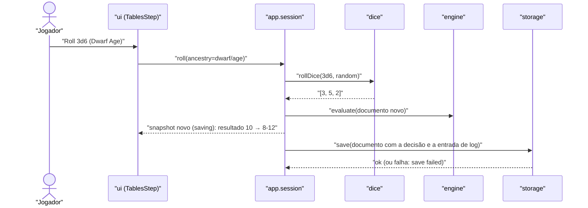

# Technical Design: FEAT-009 — Decidir uma tabela: Roll, Choose, Enter result

> Feature de: `docs/implementation-plan.md` §3 (E3) e §4 (posição 4) · Épico: E3 Construtor de nível 0
> Implementa: FR-DEC-001, 002, 004, 005, 007, 008, 012, 019, 020, 024; FR-DEC-016 (parcial: contador na primeira rolagem); FR-STEP-012 (parcial: Roll e Choose, sem Write), 013, 014; FR-CALC-010, 011; FR-CALC-005 (parcial: estágios `define` e `sum`); FR-CONT-008 (parcial: tabela sem concessões nem ligações); FR-LOG-001, 002, 004, 010
> Realiza: UC-005 (fluxo principal; 2a, 2c, 3a, 2f) · UC-006 (1, 2, 4; 1a) · Telas: SCR-WEB-009 (desenhada pelo ui-design)
> Status: Verified · Data: 2026-11-15

## 1. Intenção

Na etapa Story, o jogador com Dwarf vê um cartão por tabela de história e decide cada uma rolando ou escolhendo a entrada pela faixa, com a Hated Creature em grade. O resultado mostra dados, cálculo, entrada, página e efeitos, entra no cálculo com a origem (Corruption +1) e vai para o log. É a quarta fatia porque cria os primeiros dependentes reais, que a FEAT-011 vai tratar (plano §4).

## 2. Contexto do código

Levantado no `c8b95ab`, nas FEAT-007, 008 e 001 (technical-design, ui-design, acceptance-report) e no `docs/defects.md`:

- **Convenções em vigor:** comandos do `app` com resultado discriminado; schemas estritos com `jitless`; tipo do item pelo prefixo do id (FEAT-007 D4); nome de teste começa pelo FR; `ui` não importa `content`, `storage` nem `dice` (lint).
- **Contratos que esta feature estende:**
  - pacote (FEAT-007 §3.1, FEAT-008 §3.1): `GrantedSlot` tem `choose-value`, `attribute-increase` e `language-or-profession`; não há item `table`;
  - documento (FEAT-007 §4, FEAT-008 §4): toda decisão é `{ mode: 'chosen', value }`; `log: unknown[]`, sempre vazio;
  - sessão (FEAT-008 §3.2): `decide`, `clear`, `retrySave`, `visit`; `commit` comum a `decide` e `clear`, com o snapshot antes da gravação (D11 da FEAT-007) e a recusa `has-dependents` (D8 da FEAT-007);
  - motor (FEAT-008 §3.3): estágios `base → modifier → define → sum → limit → manual`, com `define` e `sum` como pontos de extensão desta feature; parcelas aditivas (D5 da FEAT-008).
- **`dice`:** só a fonte `cryptoRandomSource`; o sorteio de faces é desta feature (`scaffold-notes`, "Stubs").
- **Interface:** o `Builder` escolhe o corpo pelo `kind` da vaga raiz; Story não tem vaga raiz e cai no `FallbackStep`. O `DecideNow` da `AncestryStep` lista as concessões da ancestralidade escolhida em outras etapas.
- **Regra de tela em vigor** (D11 da FEAT-007; lição C2; DEF-003 a DEF-012): estado visual entra pela mudança do snapshot, nunca pelo retorno do comando; a continuação depois do `await` só desfaz a marca do clique numa recusa.
- **Divergências do plano** (para a emenda da implementation-planning, C11):
  1. **FRs parciais.** O plano dá à FEAT-009 a FR-STEP-012, a FR-DEC-016 e a FR-CONT-008 inteiras. Aqui:
     - FR-STEP-012: Roll e Choose; o Write é da FEAT-010 (FR-DEC-003, 021);
     - FR-DEC-016: o contador grava 1 na primeira rolagem; contar outras rolagens exige o Reroll, da FEAT-011 (FR-DEC-015);
     - FR-CONT-008: dado, faixas, entradas, efeitos, regime e campo de destino; concessões e ligações entre tabelas entram com a semântica delas (FEAT-010, FEAT-012).
  2. **Telas.** O plano lista só a SCR-WEB-009. A SCR-WEB-003 também muda: com as tabelas concedidas pelo Dwarf, o bloco "Decide now" do Dwarf passa a existir (ui-design da FEAT-007, "Dwarf: sem concessões nesta feature").
  3. **Blocos.** O plano lista `dice`, `engine.evaluate` e `app`. Também mudam `content` (schemas da tabela, do tipo de criatura e do log), `ui` (corpo da etapa) e `packs/`.
  4. **Tabelas do Human.** Nenhuma fatia nomeia as tabelas de história do Human do core (impressas 12 e 13). O mais próximo é a FEAT-016 ("Human do core completo"). Até lá, a Story do Human continua no `FallbackStep`.
- **Divergência entre documentos:** a FEAT-008 §8 diz que "o registro do ajuste e do `clear` entra com a FEAT-009". O registro do ajuste entra; o do `clear` não, porque é uma entrada de desfeito (FR-LOG-007, FEAT-011). Ver D9.

## 3. Contratos

### 3.1 Formato do pacote (acréscimos ao `format: 1`)

Tudo estrito; nenhum campo de texto novo além de `name` de entidade.

**Itens novos:**

```ts
table: {
  id: TableId, name, page,
  dice: Dice,                                  // ADR-009
  regime: 'choice' | 'roll-or-choose' | 'roll',   // princípios §1.1; FR-DEC-002
  field?: SheetField,                          // P28: campo da ficha que recebe o resultado
  entries: Record<EntryKey, Entry>             // ADR-003: objeto com chave
}
Dice     = { count: int >= 1, sides: int >= 2, modifier?: int }
EntryKey = "n" | "n-m"                         // a faixa é a chave (D2): "3", "4-7"
Entry    = { page?: page, entity?: EntityId, effects?: Record<localName, Effect> }
Effect   = { target: AttributeId | CharacteristicId, add: number }          // estágio sum
         | { target: AttributeId | CharacteristicId, add: { dice: Dice } }  // sum, com rolagem no cartão (D7)
         | { target: AttributeId | CharacteristicId, set: number }          // estágio define
SheetField = 'appearance' | 'background' | 'personality' | 'religion' | 'languages' | 'professions'
           | 'interesting-things' | 'companions' | 'other-possessions' | 'marks-of-darkness' | 'quirks' | 'objective'
                                               // FR-SHEET-006

'creature-type': { id, name, page }            // D38; D10
```

- `Entry.page` ausente herda a página da tabela.
- **Concessão nova:** `GrantedSlot` ganha `{ kind: 'table', step: StepId, table: TableId }`. As tabelas de história são concedidas pela ancestralidade numa etapa (ADR-003 §6).

**Regras de formato verificadas na carga**, com caminho:
- cada chave de entrada é `n` ou `n-m`, com `n ≤ m`;
- as faixas, em ordem, cobrem exatamente o intervalo do dado, de `count + modifier` a `count × sides + modifier`, sem buraco nem sobreposição;
- `entity` existe no livro;
- `target` de efeito é um atributo ou característica do livro; `add.dice` segue o `Dice`;
- `table` de uma concessão existe e é item `table:`.

A conferência entre livros continua da FEAT-003.

### 3.2 `app`: sessão

```ts
SessionDeps = { …FEAT-001, random?: RandomSource }      // padrão: cryptoRandomSource (ADR-009)

session.roll(key): Promise<DecideResult>                 // novo
session.enter(key, total: number): Promise<DecideResult> // novo
session.decide(key, value)                               // aceita EntryKey em vaga `table`

DecideResult = …FEAT-008
  | { ok: false, reason: 'out-of-range', range: [min: number, max: number] }   // FR-DEC-020
```

`createApp` repassa `random` às sessões. Os testes injetam uma sequência fixa (ADR-009).

**`roll(key)`**, numa vaga `table` ou `roll-effect`:
1. Vaga viva (`unknown-slot`); de outro `kind` → `invalid-value`.
2. Vaga decidida → `already-decided`, e nada muda (D5).
3. `dice.rollDice(slot.dice, random)` dá as faces (FR-DEC-005). É o único passo impuro, dentro do comando (ADR-004 §5).
4. Decisão `{ mode: 'rolled', dice: faces, rolls: 1, book }` (`book` só em vaga `table`; D3) e uma entrada de log (§3.3). Daí em diante, o `commit` da FEAT-008: documento novo, `evaluate`, dependentes, snapshot antes da gravação, gravação em série.

**`enter(key, total)`**, nas mesmas vagas:
1–2. Como no `roll`.
3. `total` inteiro dentro de `slot.range` (do dado, com o modificador); senão `out-of-range` com a faixa, e nada muda (FR-DEC-019, 020; D4).
4. Decisão `{ mode: 'entered', total, book }` e entrada de log com `mode: 'entered'` (FR-LOG-004); `commit`.

**`decide(key, entry)` numa vaga `table`** (Choose, FR-DEC-024):
1. Vaga viva; `entry` é chave de uma entrada da tabela (`invalid-value`).
2. Vaga decidida por `rolled` ou `entered` → `already-decided`: trocar de modo é da FEAT-011 (FR-DEC-018; D5).
3. Vaga decidida por `chosen`: escolher outra entrada substitui, como o Size (FEAT-007). Se a entrada antiga tem vaga filha decidida, o `commit` devolve `has-dependents` (D8 da FEAT-007).
4. Decisão `{ mode: 'chosen', value: entry, book }`, sem valor de dado; entrada de log; `commit`.

`decide` numa vaga `roll-effect` → `invalid-value` (o efeito com dado só tem Roll e Enter result, FR-STEP-014).

**Log em todo comando que registra decisão** (FR-LOG-001): `decide` (ancestralidade, Size, ajuste, Choose), `roll` e `enter` acrescentam uma entrada a `log`, no mesmo documento e na mesma gravação (ADR-002). Recusas não escrevem nada. `clear` e a substituição não escrevem entrada de desfeito nesta feature (D9).

**Pontos de entrada da FEAT-011** (não antecipados aqui):
- `already-decided` de `roll`, `enter` e `decide` em tabela decidida → Reroll (FR-DEC-015), troca de modo (FR-DEC-018) e contador `rolls` acima de 1 (FR-DEC-016);
- `has-dependents` em Choose → Choose e na troca de ancestralidade com tabelas decididas → diálogo de impacto (FR-DEC-017, FR-CHG-001 a 014, FR-STEP-005);
- entradas de desfeito no log, com o motivo (FR-LOG-007, FR-CHG-010, 011), inclusive para `clear` e substituição.

### 3.3 `engine`

**Vaga `table`** (filha da ancestralidade, chave `ancestry=dwarf/age`; gramática da FEAT-007 sem mudança):

```ts
SlotView (acréscimos) =
  | SlotBase & { kind: 'table', grant, table: TableView, value?: EntryKey, result?: TableResult }
  | SlotBase & { kind: 'roll-effect', dice: Dice, range: [number, number], target: { id, name },
                 result?: DiceResult }                                    // D7

TableView  = { id, name, provenance, dice: Dice, range: [number, number], regime, field?,
               modes: ('roll' | 'choose' | 'enter')[],                   // D6
               entries: EntryView[] }
EntryView  = { key: EntryKey, range: [number, number], provenance,       // FR-DEC-008, 012
               entity?: { id, name }, effects: EffectView[] }
EffectView = { id, target: { id, name }, op: 'add' | 'set', amount: number }
           | { id, target: { id, name }, op: 'add', dice: Dice, slot: SlotKey }
TableResult = { mode: 'rolled', entry, faces: number[], modifier: number, total: number, rolls: number }
            | { mode: 'entered', entry, total: number }
            | { mode: 'chosen', entry }
DiceResult  = { mode: 'rolled', faces, modifier, total } | { mode: 'entered', total }
```

- **Modos:** `roll` e `choose` em toda tabela (FR-DEC-001); `enter` também na de regime `roll` (FR-DEC-004). Na `roll-effect`: `roll` e `enter`. A FEAT-010 acrescenta `write` (FR-DEC-003).
- **Resultado:** `rolled` vale com `dice.length === count` e cada face em `1..sides`; o total é a soma das faces mais o `modifier` (FR-DEC-005, 007). `entered` vale com o total na faixa. A entrada é a que contém o total. `chosen` vale com chave existente. Decisão inválida é ignorada, e a vaga fica aberta, como a ancestralidade que sumiu (FEAT-007). Total e entrada nunca são gravados (FR-CALC-001).
- **Vaga `roll-effect`:** cada efeito `add.dice` da entrada vigente abre uma vaga filha da tabela, com chave `<vaga da tabela>=<entrada>/<id do efeito>` (ex.: `ancestry=clockwork/background=2/insanity`), na mesma etapa, com `source` = a tabela. É obrigatória: conta em `open`, `total` e `openDecisions` (FR-DEC-011). Trocar a entrada a faz sumir; decidida, ela é dependente.
- **`OpenDecision`** ganha `table?: { id, name }`, para o rótulo da pendência ("Dwarf Age"); a `roll-effect` usa `target` e `dice`.
- **Estado da etapa:** a regra da FEAT-008 não muda. As tabelas concedidas são obrigatórias: com Dwarf, Story fica `open` com 6 em aberto, e `done` quando as seis estão decididas.

**Efeitos de resultado** (FR-CALC-010, 011; FR-CALC-005, parcial). O motor coleta os efeitos das entradas vigentes das vagas `table` decididas, em ordem de vagas, e os aplica nos estágios do P11b, para atributos e características:

| Estágio | Atributo | Característica |
| :-- | :-- | :-- |
| `base` | score da ancestralidade | fórmula (FEAT-007) |
| `modifier` | ajuste (FEAT-008) | — |
| `define` | `set` | `set` |
| `sum` | `add` | `add` |
| `limit` | — (FEAT-008 §8) | `limits` (FEAT-008) |

```ts
Stage (acréscimos) =
  | { stage: 'define', value: Value, set: number, origin: ResultOrigin }   // value = set − total anterior
  | { stage: 'sum', value: Value, origin: ResultOrigin }
ResultOrigin = { kind: 'table', key: SlotKey, stepId, table: { id, name }, entry: EntryKey }
```

- Toda parcela continua aditiva, e o total é a soma (D5 da FEAT-008). Dois `define` no mesmo alvo: aplicados em ordem de vagas, e o último vale (D8).
- Os `add` se acumulam, uma parcela por efeito (FR-CALC-011).
- Efeito `add.dice` com a vaga filha aberta: parcela `sum` com `value: null`, total `null` e `pendingOn` = chave da filha, como o Size pendente. `AttributeSummary` ganha `pendingOn?`. Decidida, a parcela vale o total da filha.
- Referências leem o total (FEAT-008): Health acompanha um `sum` em Strength; o limite corta depois do `sum` (Insanity ≤ Will).
- `preview` já aceita a entrada como valor (`{ mode: 'chosen', value: entry }`), para o "o que muda" de uma escolha (FR-FLOW-014).

**Entrada de log** (montada pelo `app` a partir do `view` e das `rules` de antes do comando; o `engine` não escreve):

```ts
LogEntry = {
  id: int >= 1,                 // sequência no documento; a FEAT-011 aponta para ela
  at: ISO datetime,             // FR-LOG-010
  kind: 'decision',             // FEAT-004 'sources', FEAT-011 'undone', FEAT-019 'adjustment'
  slot: SlotKey, slotKind: SlotKind, step: { id, name },
  origin: { id, name } | null,  // quem concedeu a vaga (Dwarf, a tabela); null na vaga raiz
  mode: 'chosen' | 'rolled' | 'entered',                  // FR-LOG-001; 'written' na FEAT-010
  subject: { id, name } | null, // a tabela, ou o alvo da vaga (Size)
  source: { book, abbr, page? },                          // de onde vem a regra (abaixo)
  result: { entity: { id, name } }
        | { value: number }
        | { shift: { decrease: { id, name }, increase: { id, name } } }
        | { entry: EntryKey, entity?: { id, name } },
  roll?: { count, sides, modifier, faces?: number[], total, rolls? }   // FR-LOG-002, 004
}
```

- **`source`:** tabela → a procedência da entrada; `choose-entity` → a da entidade escolhida; demais → a do item que declara a vaga (a etapa, ou a entidade que a concedeu).
- **Nomes congelados** no momento da decisão, para a FEAT-020 mostrar a descrição sem o pacote e mesmo se um id sumir (FR-CONT-016). O tipo do filtro (Choices, Rolls) sai de `mode` na leitura (FR-LOG-012).
- `roll` em `rolled`: faces, modificador, total e `rolls`. Em `entered`: o total informado, sem faces.

### 3.4 `ui`: pontos de integração

- **Despacho:** etapa sem vaga raiz e com vagas `table` → `TablesStep` (novo). O motor não sabe que a etapa se chama Story (ADR-003 §6). Sem vaga `table` (Story com Human), continua o `FallbackStep`. O `TablesStep` mostra também as pendências não-tabela da etapa como no `FallbackStep`, para nada ficar escondido.
- **Dados da SCR-WEB-009:**

| Elemento | Fonte |
| :-- | :-- |
| Cartões, na ordem | `view.slots` com `kind: 'table'` desta etapa |
| Cabeçalho do cartão | `table.name`, `table.dice`, `table.regime`, `table.provenance` |
| Modos oferecidos | `table.modes` |
| Grade do Choose | `table.entries` (faixa, página, nome da entidade quando houver) |
| Resultado | `slot.result` + a `EntryView` da entrada: faces, modificador, total, faixa, página, entidade, efeitos |
| Sem texto | toda entrada no MVP: faixa e página da `EntryView` (FR-DEC-008) |
| Efeito com dado | vaga `roll-effect` com `source.id` da tabela: `dice`, `range`, `result` |
| Ações | `session.roll(key)`, `session.decide(key, entry)`, `session.enter(key, total)` |
| Faixa válida do Enter result | `slot.range` (ou `table.range`); recusa `out-of-range` com `range` |

- **Entrada nos estados visuais** (D11 da FEAT-007; lição C2), para Roll, Choose e Enter result, na tabela e no efeito com dado:
  - rolado, escolhido e informado começam quando o snapshot mostra a vaga decidida (`slot.result`), o que acontece antes da gravação. Foco e anúncio ("Rolled 10 on 3d6…", `design.md` §5), se o ui-design os pedir, vêm uma vez, nessa entrada, só no cartão em que a pessoa agiu: uma marca posta no clique e consumida no efeito sobre o snapshot, como a `AttributesStep` (DEF-008).
  - A continuação depois do `await` não mexe em foco nem em estado de tela. Ela só desfaz a marca numa recusa e, no `out-of-range`, mostra o erro do campo, conferindo antes por um contador de ações (DEF-006) que a pessoa não agiu depois do clique.
  - `save-failed` não muda nada no cartão: o resultado já está na tela, e o alerta é o da moldura (FEAT-007).
- **Escolha local:** o modo aberto no cartão (Roll ou Choose) e o valor digitado no Enter result são estado da tela; só o comando grava (D7 da FEAT-007).
- **Atalho `?slot=`:** os elementos das vagas `table` e `roll-effect` têm id da chave (`slotElementId`), para o atalho de Open decisions focar neles (FR-FLOW-011).
- **Anel de foco num contêiner:** se a grade e o seletor de modo forem radiogroups com input oculto, levam `data-focus-ring`, e a Story entra no `e2e/builder-dock.spec.ts` (C18).
- **Textos novos** (rascunho; o ui-design fecha, NFR-USE-001):
  - rótulo de pendência: `table` → nome da tabela ("Dwarf Age"); `roll-effect` → "{alvo} {dado}" ("Insanity 1d6");
  - dado: "3d6", "d20" (contagem 1 sem número);
  - efeito: "Corruption +1", "Size 1" (`set`), "Insanity +1d6";
  - sem texto: "No text added for this entry" + faixa + `source-badge` (FR-DEC-008);
  - `out-of-range`: "Enter a value from 3 to 18." (`design.md` §4, Validação);
  - tabela decidida (D5): "Rerolling or changing this result comes in a later version.";
  - `has-dependents` com tabelas: `decisionTitle` do `kind` `table` dá o nome da tabela na mensagem da FEAT-007.
- **`DecideNow` do Dwarf** (SCR-WEB-003): passa a ter as 6 tabelas como pendências em Story. O ui-design decide como agrupá-las.
- Telas, estados (a decidir, rolado, escolhido, informado, sem texto, efeito com dado aberto e decidido, decidida sem troca), celular e o token da caixa de valor (§8) são do ui-design.

## 4. Mudanças de esquema

**IndexedDB:** nenhuma.

**Documento do personagem, `schema: 1`, sem migração** (só alarga; todo documento gravado continua válido):

```ts
Decision =
  | { mode: 'chosen', value: EntityId | number | AttributeShift | EntryKey, book?: BookId }   // EntryKey e book: novos
  | { mode: 'rolled', dice: int[] (min 1), rolls: int >= 1, book?: BookId }                // novo
  | { mode: 'entered', total: int, book?: BookId }                                         // novo
log: LogEntry[]                                                                             // era unknown[]
```

`book` só nas decisões de vaga `table` (D3). `LogEntry` como na §3.3, estrito. Os documentos de hoje têm `log: []`.

**Pacote `packs/sotdl.core.json`:** só acréscimos; nenhum id muda ou sai. Conferido no PDF do core em 2026-11-15, página impressa = PDF − 1. Faixas lidas pela posição do texto na página, porque a extração em colunas desalinha números e linhas.

| Item | Dados | Página impressa | Conferido |
| :-- | :-- | :-- | :-- |
| `step:story` | `regime: 'roll-or-choose'` ("Ancestry Tables": rolar, escolher ou inventar) | 11 | sim |
| `ancestry:dwarf` | `grants`, na ordem: `hated-creature`, `age`, `build`, `appearance`, `background`, `personality`, todas `table` em `step:story` | — | — |
| `table:dwarf-hatred` | "Dwarf Hatred", d20, `regime: 'choice'` (talento Hated Creature: escolher uma criatura da tabela, p.17); 1-2 a 19-20 → Ogres, Troglodytes, Beastmen, Orcs, Goblins, Elves, Trolls, Giants, Dragons, Demons | 18 | sim |
| `table:dwarf-age` | "Dwarf Age", 3d6, `roll-or-choose`; 3, 4-7, 8-12, 13-15, 16-17, 18; sem efeitos | 18 | sim |
| `table:dwarf-build` | "Dwarf Build", 3d6; 3, 4-6, 7-8, 9-12, 13-15, 16-17, 18; sem efeitos | 18 | sim |
| `table:dwarf-appearance` | "Dwarf Appearance", 3d6, `field: 'appearance'`; 3-4, 5-6, 7-8, 9-11, 12-15, 16-18; sem efeitos | 18 | sim |
| `table:dwarf-background` | "Dwarf Background", d20, `field: 'background'`; 1 a 20; a entrada 1 com `{ corruption: { target: 'characteristic:corruption', add: 1 } }` | 19 | sim |
| `table:dwarf-personality` | "Dwarf Personality", 3d6, `field: 'personality'`; 3, 4, 5-6, 7-8, 9-12, 13-14, 15-16, 17, 18; sem efeitos | 19 | sim |
| `creature-type:ogre`, `troglodyte`, `beastman`, `orc`, `goblin`, `elf`, `troll`, `giant`, `dragon`, `demon` | nomes como na tabela (plural) | 18 (D10) | sim |

- Nenhum texto de entrada entra no pacote (P22). As entradas de Age, Build, Appearance, Background e Personality só têm faixa e página (D36).
- **Efeitos do Background que ficam de fora** (D12), conferidos na p.19: 12 (profissão Artisan → FEAT-012), 13 (um idioma a mais → FEAT-010), 14 (battleaxe ou warhammer → FEAT-013), 20 (2d6 cp → FEAT-013). A 7 ("2d6 years") é duração narrativa, sem alvo na ficha.
- **Sem campo de destino:** Dwarf Age e Dwarf Build não têm campo na lista da FR-SHEET-006; Dwarf Hatred é a escolha do talento (§8).

Não verificado: nenhum dado desta feature.

## 5. Desenho dos componentes



| Onde | Arquivo | Muda |
| :-- | :-- | :-- |
| `dice` | `index.ts` | `rollDie(sides, random)` por rejeição; `rollDice({ count, sides }, random)` com uma face por dado (ADR-009). Tipo `Dice` próprio, sem importar `content` |
| `content` | `schemas.ts` | itens `table` e `creature-type`; concessão `table`; `Decision` com os três modos e `book`; `LogEntry`; regras de formato da §3.1; tipos exportados |
| `engine` | `evaluate.ts` | vagas `table` e `roll-effect`; `TableView`, resultado e modos; coleta de efeitos; estágios `define` e `sum` em atributos e características; `pendingOn` dos efeitos com dado; `OpenDecision.table` |
| `engine` | `formula.ts` | o acabamento por id (`Finish`) aplica `define` e `sum` antes do `limit` |
| `app` | `session.ts`, `index.ts` | `random` nas dependências; `roll`, `enter`, Choose em tabela; `out-of-range`; montagem da `LogEntry` no `commit` |
| `ui` | `builder/copy.ts`, `builder/LiveSummary.tsx` | rótulos dos `kind` `table` e `roll-effect`; rótulo das parcelas `define` e `sum` pela origem `table` |
| `ui` | `builder/TablesStep.tsx` (novo), `screens/Builder.tsx`, `builder/AncestryStep.tsx` | despacho; integração da §3.4; `DecideNow` com as tabelas. A tela é do ui-design |
| `packs/` | `sotdl.core.json` | §4 |
| `e2e/` | `story.spec.ts` (novo), `builder-dock.spec.ts`, `home.spec.ts` | §6 e §7 |

**Sorteio por rejeição** (ADR-009): com `limit = floor(2³² / sides) × sides`, sorteia-se até `x < limit` e devolve-se `x % sides + 1`. Cada face tem a mesma chance, e cada dado da expressão é um sorteio próprio: 3d6 são três faces somadas, nunca um número de 3 a 18 (FR-DEC-005).

**NFR-PERF-002, guarda unitária** (FEAT-008 §5): dois casos novos em `evaluate.perf.test.ts`, com o mesmo limite (200 execuções, p95 ≤ 20 ms); os dois da FEAT-008 continuam:
- pacote real: Dwarf com as seis tabelas decididas, Background 1 e o ajuste;
- pacote fictício: 6 tabelas de 20 entradas, decididas por rolagem, com 10 efeitos `add`, 4 `set` e 2 `add.dice` decididos.

## 6. Critérios de aceitação

| # | Critério | Origem |
| :-- | :-- | :-- |
| AC-1 | Com Dwarf, a etapa Story mostra um cartão por tabela, na ordem do pacote (Hatred, Age, Build, Appearance, Background, Personality), cada um com nome, dado, regime e selo `CORE p.18` ou `p.19`, e Roll e Choose. A Hatred aparece em grade com as faixas do d20 e os nomes das criaturas. Write não aparece (FEAT-010). Com Human, a Story continua no `FallbackStep`. | FR-STEP-012 (parcial), FR-STEP-013; UC-006 1, 1a |
| AC-2 | Toda tabela oferece Roll e Choose, qualquer que seja o regime: a Hatred mostra "Choice" e rola; as outras mostram "Roll, choose or write your own" e se escolhem. Com pacote fictício, uma tabela de regime `roll` oferece também Enter result, e uma `choice` não. | FR-DEC-001, 002, 004 |
| AC-3 | `rollDice` de 3d6 faz três sorteios e devolve três faces de 1 a 6; d20 faz um. Com uma fonte fixa, um valor acima do limite de rejeição é descartado e o seguinte vale; uma volta completa de resíduos dá cada face o mesmo número de vezes. | FR-DEC-005; ADR-009 |
| AC-4 | Com sorteio fixo `[3, 5, 2]`, Roll em Dwarf Age grava `{ mode: 'rolled', dice: [3, 5, 2], rolls: 1, book: 'sotdl.core' }`, e a vaga mostra faces, modificador 0, total 10, entrada 8-12, página 18 e efeitos (nenhum). O snapshot muda antes da gravação. O documento não tem total nem entrada. | FR-DEC-005, 007, 016 (parcial), FR-CALC-001; UC-005 1–4 |
| AC-5 | Toda entrada do MVP aparece sem texto, com faixa e página ("No text added for this entry", 8-12, `CORE p.18`). | FR-DEC-008; UC-005 3a |
| AC-6 | Choose lista todas as entradas com a faixa (e o nome da criatura na Hatred). Escolher grava `{ mode: 'chosen', value: '3-4', book }`, sem valor de dado. Escolher outra entrada numa tabela escolhida substitui. | FR-DEC-012, 024; UC-005 2a |
| AC-7 | Com pacote fictício de regime `roll` em 3d6: Enter result 11 grava `{ mode: 'entered', total: 11 }` e mostra a entrada; 2 e 19 devolvem `out-of-range` com `[3, 18]`, e nada muda nem é gravado. | FR-DEC-019, 020; UC-005 2c, 2f |
| AC-8 | Com pacote fictício, uma entrada com "1d6 Insanity" abre, ao ser rolada ou escolhida, a vaga `roll-effect` no mesmo cartão, com Roll e Enter result (1 a 6). Aberta, ela conta como decisão aberta, e a Insanity fica pendente (`null`, `pendingOn`). Decidida, a Insanity soma o total. Escolher outra entrada com o efeito decidido devolve `has-dependents`. | FR-STEP-014, FR-DEC-011; UC-006 4 |
| AC-9 | Dwarf com Background 1: Corruption 1, com a composição "Standard rule: 0" e a parcela `sum` +1 de origem Dwarf Background, 1; sobrevive a recarregar. Com pacote fictício: dois `add` no mesmo alvo somam; um `set` vira parcela de diferença e o último `set` vale; a ordem é base → modifier → define → sum → limit, e o limite corta depois do `sum`; um `add` num atributo muda a característica que o referencia. | FR-CALC-010, 011, 005 (parcial); UC-006 3 |
| AC-10 | Cada `decide` (ancestralidade, Size, ajuste, Choose), `roll` e `enter` acrescenta ao log uma entrada com `id` em sequência, `at`, vaga, etapa, origem, modo, assunto, fonte com livro e página e resultado com nomes. A rolagem guarda faces, modificador, total e `rolls`; o Enter result guarda o total com `mode: 'entered'`. Recusas e `clear` não escrevem nada. | FR-LOG-001, 002, 004, 010 |
| AC-11 | `roll` e `enter` numa tabela decidida, e Choose numa tabela rolada ou informada, devolvem `already-decided`, e nada muda. Trocar Dwarf por Human com uma tabela da Story decidida devolve `has-dependents`. | FEAT-011 (§3.2); D8 da FEAT-007 |
| AC-12 | Com Dwarf, Story fica "6 open" no mapa, as seis entram em Open decisions com o nome da tabela e atalho que foca o cartão, e o metadado fica `creating` com 6. Com as seis decididas, Story fica "Done" e o metadado `complete`. | FR-FLOW-001, 010, 011; FR-CHAR-005, 006 |
| AC-13 | Um resultado rolado sobrevive a recarregar com as mesmas faces e a mesma entrada: abrir e avaliar nunca rolam. | NFR-REL-001; ADR-004 §5 |
| AC-14 | Com a gravação retida, Roll, Choose e Enter result mostram o resultado antes de a gravação terminar. Se a pessoa leva o foco a outro cartão durante a gravação, o fim dela não move o foco nem muda o outro cartão. Uma recusa deixa foco e campo como estavam. Com `save-failed`, o resultado fica e o alerta da moldura aparece. | D11 da FEAT-007; C2; FR-CHAR-010 |
| AC-15 | A carga recusa, com o caminho: faixa com buraco, sobreposição ou fora do dado; chave de entrada inválida; `entity` ou `target` inexistentes; concessão `table` para tabela inexistente. O pacote do core passa no `packs:check`. | FR-CONT-008 (parcial); ADR-003 §7 |
| AC-16 | O E2E do fluxo crítico 1 percorre a Story do Dwarf a partir de "New character", nos 5 projetos: escolhe a Hatred, rola uma tabela (faces e entrada coerentes), escolhe o Background 1 e vê Corruption 1, recarrega, decide as seis e vê "Complete" na Home. axe sem violação grave na Story; a Story entra no `builder-dock.spec.ts`. | UC-005, UC-006; ADR-008 fluxo 1; NFR-ACC-001 |

**NFRs:** NFR-PERF-002 (guarda unitária da §5); NFR-REL-001 (AC-13); NFR-ACC-001 (AC-14, AC-16); NFR-L10N-001; NFR-MAINT-002 (cada FR-DEC e FR-CALC desta feature com teste que o cita).

## 7. Decisões

- **D1. Tabela é item `table:`, concedida pela ancestralidade numa etapa.** Motivo: ADR-003 §6. Consequência: um `kind` de vaga novo (`table`), com código no motor e na interface, como a ADR-003 prevê.
- **D2. A faixa é a chave da entrada** ("4-7"). Motivo: é o dado mecânico da entrada, estável e sem texto (P22). Alternativa rejeitada: slug por entrada, que exigiria um nome inventado para entradas sem nome. Consequência: uma versão com outras faixas é `replaces` (ADR-003 §2), e a decisão antiga fica órfã.
- **D3. A decisão guarda só entradas.** Faces (rolado), total (informado) ou entrada (escolhido), mais `rolls` e o livro da tabela (ADR-004 §1, §3). Total e entrada da rolagem são derivados. Consequência: o livro é gravado já; lê-lo pela versão gravada é da FR-CHG-015 (Should).
- **D4. Enter result é um valor por expressão de dado**, na faixa da expressão (3d6: 3 a 18). Motivo: o exemplo da FR-DEC-020 ("3–18 para 3d6") e a validação do `design.md` §4 ("Enter a value from 3 to 18"); "cada dado ou etapa" da FR-DEC-019 lido como cada expressão da rolagem (d6 e d20 numa encadeada). Alternativa: um campo por face (três campos de 1 a 6), mais fiel à letra de "cada dado". Consequência: o log do Enter result não tem faces.
- **D5. Tabela decidida não muda por Roll, Enter result ou troca de modo até a FEAT-011.** O comando devolve `already-decided`. Choose → Choose substitui, como o Size, com a recusa de dependentes da D8 da FEAT-007. Motivo: Reroll, troca de modo e o desfeito no log são da FEAT-011 (FR-DEC-015, 018, FR-LOG-007). Alternativas: (a) travar também o Choose → Choose; (b) Reroll já aqui, sem desfeito no log.
- **D6. Os modos oferecidos vêm do motor (`table.modes`), e os comandos não os fiscalizam** (P7). Motivo: o regime é regra do pacote; a tela só lê.
- **D7. Efeito com dado é uma vaga filha `roll-effect`**, obrigatória, com o valor pendente até decidir. Motivo: o resultado do dado é decisão do jogador (rolada ou informada) e vai ao log (FR-STEP-014), e a chave filha dá a dependência sem grafo (ADR-004 §3). Consequência: a FEAT-010 reaproveita o mecanismo para as subdecisões (FR-DEC-010).
- **D8. Estágios `define` e `sum` valem para atributos e características**; dois `define` no mesmo alvo: o último em ordem de vagas vale. Motivo: FR-CALC-005 vale para "cada valor"; a Purpose da Clockwork (FEAT-017) soma em atributo. Sem regra de empilhamento por grupo (ADR-004 §2): nenhum dado a pede.
- **D9. Só entradas `decision` no log nesta feature.** `clear` e a substituição não escrevem entrada de desfeito; a FEAT-011 traz o `kind: 'undone'` com o `id` da original e o motivo (FR-LOG-007). Motivo: plano (FR-LOG-007 na FEAT-011) e o cuidado de não antecipar a mudança a montante. Alternativa: escrever já o desfeito do `clear` e da substituição, como sugere a FEAT-008 §8, e deixar o log sempre coerente. Consequência: até a FEAT-011, o log de um ajuste desfeito ou de um Size trocado tem a entrada antiga sem marca (o log só aparece na FEAT-020).
- **D10. Tipos de criatura são itens `creature-type:`, com a página da tabela Hatred.** Motivo: D38. Alternativa: a página de cada criatura no bestiário, a conferir criatura por criatura. Consequência: a página pode ser corrigida depois sem mudar o id.
- **D11. Etapa sem vaga raiz escolhe o corpo pelos `kind` das vagas concedidas** (`table` → `TablesStep`). Motivo: ADR-003 §6, "a interface renderiza por tipo de vaga".
- **D12. Efeitos sem modelo ainda ficam fora dos dados**, sem marca: profissão (FEAT-012), idioma (FEAT-010), item e dinheiro (FEAT-013) nas entradas 12, 13, 14 e 20 do Background. Motivo: cada um precisa do alvo da feature dele. Alternativa: um alvo `money` já aqui para o "2d6 cp", único caso de efeito com dado no Dwarf. Consequência: a FR-STEP-014 é verificada com pacote fictício, e até lá essas entradas aparecem só com faixa e página.

**Contratos e testes existentes que mudam** (C7), num commit de documentação anterior à mudança no teste:
- `src/content/core-pack.test.ts`, `FR-CONT-003: has Dwarf and Human with the verified level 0 data`: `ancestry('ancestry:dwarf').grants` deixa de ser `undefined` e passa a ser as seis concessões `table` da §4.
- `src/engine/core-view.test.ts`:
  - `FR-FLOW-014: preview of Dwarf → Human…`: `changes.steps` ganha `['Story', 'open', 'not-started']`, entre Attributes e Professions & languages;
  - `FR-FLOW-014: preview from no ancestry opens the locked steps`: `['Story', 'locked', 'not-started']` passa a `['Story', 'locked', 'open']`;
  - `FR-FLOW-001: Attributes is done with Dwarf…`: nos documentos com Dwarf, Story passa de `not-started` a `open`; com Human, não muda.
- `src/app/session.test.ts`: os dois testes com documento inteiro, `FR-CALC-001: the saved document holds only inputs…` e `FR-STEP-009: applying saves only the pair…`, passam a esperar `log` com a entrada da decisão (§3.3).
- `e2e/home.spec.ts`, `FR-CHAR-004, FR-CHAR-005, FR-CHAR-006: Dwarf is "Complete"…`: o Dwarf recém-escolhido passa a "Creating · 6 open", e o título do teste muda. O "Complete" com dados reais passa ao `story.spec.ts`, depois das seis tabelas (AC-16), para a FR-CHAR-006 não perder o E2E.
- Sem mudança, conferidos:
  - os testes da Human na Story (`attributes.spec.ts:215–226`, `ancestry.spec.ts:128`): o Human não tem tabelas;
  - `evaluate.test.ts`, `session.test.ts` (fora dos dois acima), `Builder.test.tsx` e `Home.test.tsx`: usam pacotes fictícios ou metadados próprios, sem tabela;
  - os fixtures com `log: []`: continuam válidos.
- **Nomes novos contra os localizadores de `e2e/`** (C1):
  - nenhum teste existente abre a Story com Dwarf;
  - nas telas em que os nomes novos aparecem com Dwarf (os links de Open decisions no `aside`, o "Decide now" na Ancestry), os localizadores existentes estão no escopo de `main` ou do mapa, ou procuram `button` por regex de característica (`/Health\s*14/`), e não casam com "Dwarf Age", "Go to Story" nem "Story · Dwarf";
  - o ui-design repete a conferência com os nomes finais.

## 8. Escalações e pendências

- **Escalações de arquitetura:** nenhuma. `table` e tipo de criatura são itens da ADR-003 §1; vaga, efeito com origem e estágios estão na ADR-004 §2 e §3; a entrada de log é a forma física da camada `log` (ADR-004 §1, §6); o `kind` novo de vaga é a consequência prevista na ADR-003.
- **Emenda do design system (ux-foundations), logo depois deste design** (C11), como a E1–E4. **E8**: token `size.roll-value` = `72px` (`$type: dimension`), "roll-card value box, width and height", para a caixa de valor do `roll-card` (`design.md` §4 e §9, "Lacunas conhecidas"). Entra no `tokens.json` e no `design.md`; este design não os edita.
- **Emenda do plano (implementation-planning):** as quatro divergências do §2 (FRs parciais, SCR-WEB-003, blocos, tabelas do Human).
- **Decisões para o usuário:**
  - D4 (Enter result por expressão ou por face);
  - D5 (Choose → Choose substitui, ou tabela decidida travada; Reroll fica na FEAT-011);
  - D9 (desfeito no log só na FEAT-011, ou já para `clear` e substituição);
  - D10 (página dos tipos de criatura);
  - D12 (2d6 cp na FEAT-013, ou alvo `money` já aqui);
  - campo de destino de Dwarf Age e Dwarf Build: a FR-SHEET-006 não tem campo para idade e porte; sem `field` até a FEAT-018 decidir (P28);
  - tabelas de história do Human (§2, divergência 4).
- **RTM:** o Design ref das FRs desta feature não foi acrescentado, por ordem do usuário nesta sessão; fica para a próxima sessão que puder escrever no RTM.
- **Texto do app:** rascunhos da §3.4; o ui-design fecha (NFR-USE-001).
- **`CONTENT_VERSION`:** continua `0.0.0`.
