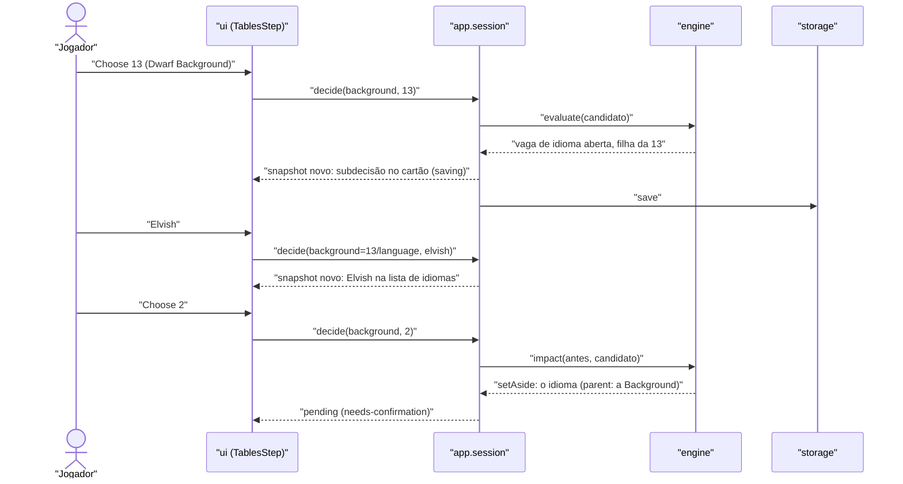

# Technical Design: FEAT-012 — Idiomas e concessões por resultado

> Feature de: `docs/implementation-plan.md` §3 (E3) e §4 (posição 7) · Épico: E3 Construtor de nível 0
> Implementa: FR-STEP-015, 020, 021; FR-DEC-010; FR-DEC-013 (parcial: idiomas); FR-DEC-009 (parcial: Secret Language, depois da emenda 2 do §8); FR-CONT-008 (parcial: concessões de entrada). Saem da linha do plano, por decisão do usuário (D1; emenda 1 do §8), para a FEAT-032 (vagas de profissão): FR-STEP-016, 017, 019; FR-DEC-006; FR-DEC-009 (parcial: profissões); FR-DEC-013 (parcial: profissões e troca); FR-DEC-016 (parcial: rolagem encadeada); FR-CONT-008 (parcial: ligações entre tabelas)
> Realiza: UC-005 (3b no Secret Language, 3c) · UC-006 (3) · UC-007 (4, 4a) · Telas: SCR-WEB-009 (subdecisão de resultado) e SCR-WEB-010 (lista de idiomas e de profissões), desenhadas pelo ui-design
> Status: Verified · Data: 2026-11-25 · Decisões do usuário de 2026-11-25: D1 a D4

## 1. Intenção

Um resultado de tabela passa a conceder entidades ao personagem: a Dwarf Background 13 abre a escolha de um idioma junto do resultado, e a 12 dá a profissão Artisan. Os idiomas do core entram no pacote, inclusive o Secret Language, de nome digitado. A etapa Professions & languages mostra os idiomas com fala, leitura, escrita e origem, os que ainda faltam decidir noutra etapa, com atalho, e as profissões ganhas. É a sétima fatia porque cria o mecanismo de concessão por resultado e a subdecisão de entrada, que as vagas de profissão (FEAT-032), o Human (FEAT-016) e o Clockwork (FEAT-017) reusam.

## 2. Contexto do código

Levantado no `7335b1a` (FEAT-010 aceita; DEF-013 e DEF-014 re-verificados; CI 45699769208 verde, 204 passed, 51 skipped, sem flaky), nos designs e aceites das FEAT-009 a 011, por leitura de código e por uma sonda de tipos (`tsc -b` numa worktree descartável fora do repositório, só com as mudanças de tipo deste design; removida).

- **Convenções:** comandos do `app` com resultado discriminado; pipeline comum da FEAT-011 §3.2; snapshot antes da gravação (D11 da FEAT-007; C2); schemas estritos; nome de teste começa pelo FR; `ui` não importa `content`, `storage` nem `dice`.
- **Pontos que esta feature estende:**
  - `entrySchema` (`src/content/schemas.ts:49`): só `page`, `entity` e `effects`. `languageId` e o item `language` (`:163`) existem, com dois idiomas no pacote (Common Tongue e Dwarfish, p.10);
  - `tableSlots` (`src/engine/evaluate.ts:610`): a ativa abre uma `roll-effect` por efeito com dado, com `childKey(<tabela>, <entrada>, <efeito>)`. É o precedente da filha de uma entrada (FEAT-009 §3.3);
  - `summarize` (`evaluate.ts:771`): `gained.languages` sai só da ancestralidade, sem origem;
  - `grantedSlots` (`evaluate.ts:535`): o comentário "sem resolvedor até a FEAT-016" continua valendo para o `language-or-profession` do Human (FR-STEP-018);
  - `rollAllChange` (`src/app/changes.ts:163`) e o `causeOf` (`:175–179`), com o fallback `?? rolled[0].slot.key`;
  - `Builder.tsx:224–233`: o corpo da etapa sai do `kind` da vaga raiz; Professions & languages, sem vaga raiz nem `table`, cai no `FallbackStep`. O `opener` (`:162–181`) devolve o foco depois do Apply sem destino próprio (FEAT-011 §8, nota 1).
- **Leitores que assumem `choose-entity` = ancestralidade** (sonda e leitura; sem erro de tipo, salvo onde indicado): `isValid` (`session.ts:197`, `switch` exaustivo, quebra com o `kind` novo), `decisionTitle` (`copy.ts:205`, exaustivo, quebra; e o ramo `choose-entity` devolve "Ancestry"), `impactWording` (`copy.ts:311`, ações da troca de ancestralidade), `appliedTarget` (`Builder.tsx:266`, o `h2` do detalhe da ancestralidade), e os ramos `default` de `logDraft` (`session.ts:282`), `shortValue` (`copy.ts:287`), da linha do impacto (`copy.ts:389`) e da `ColumnValue` (`ImpactDialog.tsx:265`), que tratariam o `kind` `name` como `chosen`. Lista no tasks.md (C8).
- **Conteúdo, conferido no PDF do core em 2026-11-25** (página impressa = PDF − 1; texto pelo `pdftotext -layout` e `-table`, faixas pela coluna do modo tabela). Nada do texto entra no pacote (P22):
  - **Idiomas** ("Languages of the Northern Reach", p.10): Common Tongue, Dark Speech, Dwarfish, Elvish, High Archaic, Trollish; Secret Language (categoria: idiomas próprios de organizações); Dead Languages (introduzidos pelo mestre). Os seis primeiros e o Secret Language entram (D3).
  - **O que cada ancestralidade do MVP dá:** Dwarf fala Common Tongue e fala, lê e escreve Dwarfish (p.17); Human fala Common Tongue e pode falar um idioma a mais ou somar uma profissão aleatória (p.11, FEAT-016). Já estão no pacote.
  - **Dwarf Background** (p.19): 12 concede a profissão artisan, "any one"; 13 concede falar um idioma a mais, à escolha. As outras entradas não concedem profissão nem idioma (a 10 cita "your profession", sem conceder; 14 e 20 são da FEAT-013). Nenhuma entrada de Age, Build, Appearance, Personality (p.18–19) nem da Hatred (p.18) concede profissão ou idioma.
  - **Profissões** (p.23–25): Profession Types d6, 1 Academic, 2 Common, 3 Criminal, 4 Martial, 5 Religious, 6 Wilderness, cada um apontando para a tabela d20 do tipo; Academic dá ler e escrever um idioma que se fala. Common (p.24): 20 entradas de faixa única, Artisan na 3; a Artist (4) dá ler e escrever um idioma só se o meio for poet ou writer. Criminal e Academic (p.24): 20 entradas de faixa única. Martial (p.24): 1, 2, 3–4, 5, 6, 7, 8, 9–10, 11–12, 13–15, 16, 17–18, 19, 20. Religious (p.25): 1–2, 3–4, 5, 6, 7–8, 9–10, 11–12, 13, 14–16, 17–18, 19–20; as quatro primeiras com efeito de idioma: 1–2, 3–4, 9–10 e 11–12 dão ler e escrever um idioma que se conhece. Wilderness (p.25): 1, 2, 3, 4, 5–6, 7, 8–9, 10, 11, 12, 13, 14, 15–16, 17, 18, 19, 20. Entram na FEAT-032, salvo a Common, que entra aqui só com as faixas e o nome Artisan (D11).
  - **Starting Professions** (p.23): duas profissões, escolhidas ou pelo d6 do tipo e o d20 da tabela. **Languages** (p.23): trocar uma profissão por falar um idioma novo ou por ler um idioma que já se fala; a troca não dá escrita. **Altering Professions** (p.24): substituir uma profissão por outra, conversando antes com o mestre (FR-STEP-019, FEAT-032).
  - **Erratas do core** (10oct17, 19nov17): nenhuma toca profissões ou idiomas.
  - **Nomes de profissão referenciados (D36):** no conteúdo do MVP, só a Dwarf Background 12 cita uma profissão por nome (Artisan). A profissão da família do *Only Human* é da FEAT-005: ela usa o mesmo `Entry.name` (§3.1), na tabela que a referência apontar, e não muda nada aqui.
- **Divergências do plano** (emenda 1 do §8):
  1. **Escopo** (D1, decisão do usuário): a conferência mostrou mecânica que o plano não previa (subdecisões de leitura e escrita do Academic, de quatro entradas da Religious e da Artist). A fatia se divide: esta feature fica com os idiomas e a concessão por resultado; as vagas de profissão vão para a FEAT-032.
  2. **Coluna UCs** (item 8 do pedido): a linha diz só UC-007, mas o RTM rastreia a FR-DEC-009 para UC-005 e UC-007, as FR-DEC-006, 010 e 013 para UC-005, e a FR-STEP-015 para UC-006. Com a divisão, esta feature realiza UC-005, UC-006 e UC-007.
  3. **Blocos:** a linha lista `dice` (encadeada) e `engine.evaluate`. Mudam `content`, `engine.evaluate`, `app`, `ui`, `packs/` e `e2e/`; o `dice` não muda (a encadeada é da FEAT-032).

## 3. Contratos

### 3.1 Formato do pacote (acréscimos ao `format: 1`)

```ts
language: { id, name, page, typed?: true }        // typed: o jogador digita o nome (Secret Language; D3)
Entry += {
  name?: string,                                   // nome curto referenciado por outra regra (D36); nunca descrição
  grants?: Record<localName, EntryGrant>           // ADR-003: objeto com chave
}
EntryGrant =
  | { kind: 'language' }                                    // falar um idioma a escolher (Background 13)
  | { kind: 'profession', table: TableId, entry: EntryKey } // profissão fixa: a entrada nomeada (Background 12 → Common 3)
step += { fields?: SheetField[] }                  // campos da ficha que a etapa reúne (P28): o corpo da tela (D12)
```

**Regras de formato verificadas na carga**, com caminho:
- `profession.table` existe no livro e é `table:`; `profession.entry` é chave dela; essa entrada tem `name`;
- toda entrada com `name` é apontada por uma concessão `profession` do mesmo livro (D36: o nome só entra referenciado). A referência entre livros (ex.: *Only Human*, FEAT-005) segue a FEAT-003;
- `name` e `entity` não aparecem juntos numa entrada: o nome da entidade vem da entidade (D38).

As faixas, `entity` e os efeitos continuam pela FEAT-009 §3.1.

### 3.2 `engine`

**Vagas filhas de uma entrada** (D5): a ativa de uma vaga `table` abre, além da `roll-effect` de cada efeito com dado (FEAT-009), uma vaga por concessão `language` da entrada vigente, com `childKey(<tabela>, <entrada>, <concessão>)`, na mesma etapa da tabela e com `source` = a tabela (FR-DEC-010). A escrita não abre nenhuma (FEAT-010 D6). Com o Dwarf: `ancestry=dwarf/background=13/language` (o exemplo da ADR-004 §3). Trocar a entrada a faz deixar de ser gerada; decidida, ela é dependente da tabela (FEAT-011).

```ts
EntityOption += { owned?: true; typed?: true }     // FR-DEC-013; typed: o nome se digita (D3)

SlotView (choose-entity) = SlotBase & {
  kind: 'choose-entity'; of: 'ancestry' | 'language'; options: EntityOption[];
  optional?: true; grant?: string                  // grant: na filha de uma entrada
}
SlotView += SlotBase & { kind: 'name'; grant: 'name'; entity: NamedRef; value?: string }   // D7

EntryView += { name?: string; grants: EntryGrantView[] }        // grants: [] na entrada sem concessão
EntryGrantView =
  | { id; kind: 'language'; slot: SlotKey }                       // chip "Language +1 (choose)"
  | { id; kind: 'profession'; table: NamedRef; entry: EntryKey; name: string }

OpenDecision += {
  of?: 'ancestry' | 'language'                     // em toda `choose-entity` (D17)
  entity?: NamedRef                                // na `name`: o que se nomeia
  from?: { table: NamedRef; entry: EntryKey }      // na filha de uma entrada, e na neta: o resultado que a concedeu
}
StepView += { fields?: SheetField[] }

Summary.gained.languages: GainedLanguage[]         // era { id, name, abilities }[]; os três campos continuam
GainedLanguage = { id; name; typed?: true; abilities: Ability[];
                   origins: { abilities: Ability[]; origin: GainOrigin }[] }
GainOrigin = { kind: 'ancestry'; id; name } | (ResultOrigin & { slot: SlotKey })
Summary.gained.professions: { table: NamedRef; entry: EntryKey; name: string; origin: ResultOrigin }[]
```

- **Vaga de idioma** (`choose-entity`, `of: 'language'`; D6): `options` são os itens `language:` vigentes, na ordem do pacote (a da p.10). Vale (passa na validade) a decisão `chosen` cujo valor é uma opção viva, como a ancestralidade; sem ativa, fica aberta e conta em `open`, `total` e `openDecisions` (FR-DEC-011).
- **"Already yours"** (FR-DEC-013; D9): `owned: true` na opção que o personagem já fala por outra origem (a ancestralidade, ou outra vaga de idioma ativa), sem contar a própria vaga. Nunca no idioma `typed` (D3: pode haver mais de um idioma secreto). É só exibição: a validade não olha `owned` (P7; D39 e FR-CHG-021 são Should).
- **Vaga do nome** (`name`; D7): quando a ativa de uma vaga de idioma é um idioma `typed`, ela abre a filha `childKey(<vaga do idioma>, <id do idioma>, 'name')`, ex.: `ancestry=dwarf/background=13/language=secret-language/name`, na mesma etapa, com `source` e `entity` = o idioma. Vale a decisão `written` (texto aparado de 1 a 2.000 pelo schema; o comando limita a 100, D7). Sem decisão, é decisão aberta (FR-DEC-009: nome em branco conta como aberta).
- **Idiomas ganhos** (FR-STEP-015, 020; D8): os da ancestralidade (origem `ancestry`), depois um por vaga de idioma ativa, na ordem das vagas, com `abilities: ['speak']` e a origem do resultado: a vaga `table` e a entrada (`ResultOrigin`) e a chave da vaga do idioma (`slot`). O idioma `typed` só entra com o nome decidido, com `name` = o nome digitado e `typed: true`; antes disso, a vaga do nome é a pendência. Linhas iguais se juntam: pelo `id`, ou, no `typed`, pelo nome aparado sem diferença de maiúsculas (D14); `abilities` é a união, na ordem fala, leitura, escrita, e `origins` guarda cada origem com as suas.
- **Profissões ganhas** (FR-STEP-015; D10): uma por concessão `profession` da entrada vigente de uma vaga `table` ativa (não escrita), na ordem das vagas, com o `name` da entrada apontada e a origem do resultado. Não abrem vaga.
- **`OpenDecision`** dá o rótulo e a origem das pendências novas (Open decisions, e a lista de idiomas da Professions & languages, FR-STEP-021): `of: 'language'` e `from` na vaga de idioma; `entity` e `from` (o do avô) na vaga do nome.
- **`rollAllKeys`** não muda: só vagas `table`. A vaga de idioma nunca é rolada (o livro diz escolher).

**Contrato da cascata do Roll all** (D2, decisão do usuário; pendência (i) da FEAT-010). Vale desde já, e a implementação entra com a primeira vaga `table` filha de uma entrada, a ligação entre tabelas da FEAT-032 (emenda 1 do §8). Nenhuma entrada do conteúdo desta feature abre vaga `table`.
- Rolar uma vaga (`roll(k)` ou cada chave do Roll all) rola também, no mesmo comando, as vagas `table` que a entrada sorteada abre **na mesma etapa** e que ficam abertas (sem ativa) no documento candidato, em profundidade, na ordem das vagas. Uma filha que volta restaurada (candidato guardado que passa na validade) não é rolada: é restaurada (FR-DEC-023: nunca sobrescreve).
- Um candidato, uma gravação (D11 da FEAT-007; C2), uma entrada `decision` por tabela rolada, cada tabela com o seu `rolls` (FR-DEC-016). O `impact` do Roll all segue com `key` nulo (FEAT-010 D8); o do `roll(k)`, com `key` = `k`.
- O comando reavalia o candidato uma vez por nível da cascata, para saber quais filhas abriram (§5, guarda).
- Filhas de outra etapa (ex.: uma profissão concedida pela Story e resolvida na Professions & languages) ficam para a etapa delas.

### 3.3 `app`: sessão

```ts
session.write(key, text)          // aceita também a vaga `name` (D7)
DecideResult                      // sem mudança
```

- **Escolher o idioma:** `decide(key, languageId)` numa vaga de idioma, pelo pipeline comum, sem mudança de código além dos leitores do §2: a `isValid` da `choose-entity` já confere a opção viva; o mesmo valor devolve `ok` sem gravar (FEAT-009 D13); trocar o idioma é substituição na própria vaga (D40 (4)), e a vaga do nome de um `typed` que sai fica suspensa, com o diálogo (FR-CHG-001).
- **Nomear:** `write(key, text)` numa vaga `name`: recusas como no Write (`change-pending`, `unknown-slot`); `text.trim()` vazio → `empty-text`, e nada muda; mais de 100 caracteres depois do `trim` → `invalid-value`; o mesmo texto da ativa → `ok` sem gravar (FEAT-010 D5); decisão `{ mode: 'written', text: trim(text) }`, sem `book` nem `rolls`. Daí, o pipeline comum. A vaga do nome não tem filhas, então nunca abre o diálogo.
- **Apagar o nome:** `clear(key)` na vaga `name` decidida tira o nome (`undone`, `cleared`), e a vaga volta a contar como aberta (FR-DEC-009). A tela decide como oferecer isso (ui-design).
- **Entrada de log da decisão do nome:** `slotKind: 'name'`, `mode: 'written'`, `subject` = o idioma, `source` = a procedência do idioma (CORE p.10), `result: { text }`, sem `roll`. A da escolha do idioma é a da `choose-entity` (FEAT-009 §3.3): `subject: null`, `source` = a do idioma escolhido, `result: { entity }`, `origin` = a tabela.
- **Origem gravada** (FR-STEP-015; P28; D8): nenhuma. A origem de um idioma ou profissão concedido é derivada da posição da vaga (a chave inclui a tabela e a entrada) e da entrada vigente; o log da escolha leva `origin` = a tabela, com os nomes congelados.
- **`causeOf`** (`changes.ts:175–179`; D13): uma restaurada do Roll all tem sempre uma vaga rolada ancestral (§7, D13), e a causa é a entrada `decision` da vaga rolada mais funda cuja chave é prefixo da restaurada (FEAT-010 D12). Sem ancestral, o `rollAllChange` lança um erro com a chave da restaurada, no lugar do fallback `?? rolled[0].slot.key`.

### 3.4 `ui`: pontos de integração

| Elemento | Fonte |
| :-- | :-- |
| Subdecisão junto do resultado (Story; FR-DEC-010) | as vagas cuja `parentKey` é a vaga `table` do cartão: `choose-entity` com `of: 'language'` e, abaixo, a `name` |
| Opções do idioma, "already yours" | `slot.options`, com `owned` e `typed`; `session.decide(key, id)` |
| Nome do idioma secreto | vaga `name`: `session.write(key, text)`; recusas `empty-text` e `invalid-value`; `session.clear(key)` |
| Chips de concessão no resultado | `entry.grants`: `language` → "Language +1 (choose)" (`design.md` §4, `effect-chip`); `profession` → o nome da profissão |
| Corpo da Professions & languages | `step.fields`: lista de idiomas com `'languages'`, de profissões com `'professions'` (D12); a vaga `language-or-profession` do Human continua na lista de pendências do `FallbackStep` |
| Lista de idiomas (FR-STEP-020) | `summary.gained.languages`: `name`, `abilities`, `origins` |
| Idioma pendente de outra etapa, com atalho (FR-STEP-021) | `view.openDecisions` com `of: 'language'` ou `kind: 'name'`, e `stepId` diferente da etapa; o atalho `?slot=` de Open decisions (FR-FLOW-011) |
| Lista de profissões (FR-STEP-015) | `summary.gained.professions` |
| Rótulo da pendência | `decisionTitle` pelo `of`, `entity` e `from` |
| Diálogo de impacto | o `impactWording` e a `ColumnValue` da `choose-entity` de idioma e da `name`; `appliedTarget` da `choose-entity` de idioma |

- **D11 e C2:** a subdecisão decidida e o nome entram pela mudança do snapshot; a continuação depois do `await` só trata a recusa (`empty-text`, `invalid-value` no campo) e desfaz a marca do clique, como no Write da FEAT-010.
- **Foco depois do Apply e do Keep** (pendência da FEAT-011, nota 1): no Choose → Choose da tabela com a vaga de idioma decidida, o destino é o do [applied](../FEAT-011-upstream-change/ui-design.md#applied) da FEAT-011, a entrada acionada da grade, pelo `opener`; no Keep, o `opener` também. O `appliedTarget` não pode devolver o `h2` da ancestralidade para a `choose-entity` de idioma (§2). Na troca do idioma com o nome decidido (Secret Language → outro), o destino é do ui-design.
- **Pendências para o ui-design:**
  - a subdecisão no cartão (`design.md` §4, `subdecision`): o controle das opções com "already yours" desabilitado (o estado existe no `range-grid`; se o controle escolhido não o tiver, a escalação é do ui-design), o campo do nome, a frase "or decide later", e o estado decidido;
  - o corpo da Professions & languages: as duas listas, a linha pendente com o atalho ("Choose it in Story"), os estados vazios, o Human, os contadores do cabeçalho (P29: idiomas pendentes), o texto do `FallbackStep` com as listas;
  - os rótulos novos (Open decisions, diálogo): vaga de idioma, vaga do nome, com a origem ("Story · Dwarf Background 13");
  - a linha "Gained so far" do resumo vivo, que já lê `gained.languages` e passa a mostrar os idiomas de resultado e os nomes digitados; se mostra a origem, é do ui-design (a FR-STEP-020 fica atendida pela lista da etapa). Profissões no resumo e na ficha ficam com a FEAT-018;
  - o roll-all-applied quando a Background sorteada abre a subdecisão (o botão fica desabilitado, e a Story, aberta);
  - a conferência C1 com os nomes finais (§7).

## 4. Mudanças de esquema

**IndexedDB:** nenhuma.

**Documento do personagem, `schema: 1`, sem migração** (ADR-005):

```ts
DecisionEntry.slotKind += 'name'
```

- A decisão da vaga de idioma é a `chosen` com um `language:` (já aceita); a do nome é a `written` sem `book` (já aceita).
- Todo documento e todo log gravados até a FEAT-010 continuam válidos.

**Pacote `packs/sotdl.core.json`:** só acréscimos; nenhum id muda ou sai. `CONTENT_VERSION` continua `0.0.0`. Conferido no PDF do core em 2026-11-25 (§2).

| Item | Dados | Página impressa | Conferido |
| :-- | :-- | :-- | :-- |
| `language:dark-speech`, `language:elvish`, `language:high-archaic`, `language:trollish` | "Dark Speech", "Elvish", "High Archaic", "Trollish", na ordem da p.10, entre os dois que já existem | 10 | sim |
| `language:secret-language` | "Secret Language", `typed: true`, depois do Trollish | 10 | sim |
| `table:common-professions` | "Common Professions", d20, `regime: 'choice'` (p.23: escolher ou rolar; princípios §1.2, item 3); 1 a 20; só a 3 com `name: 'Artisan'` | 24 | sim |
| `table:dwarf-background` | 12: `grants: { profession: { kind: 'profession', table: 'table:common-professions', entry: '3' } }`; 13: `grants: { language: { kind: 'language' } }` | 19 | sim |
| `step:professions-languages` | `fields: ['professions', 'languages']` | 23 | — |

- Nenhum texto de entrada entra (P22). A Common entra sem `field` e sem concessão de tabela; a FEAT-032 a liga ao tipo 2 do d6 e acrescenta as outras tabelas.
- Fora: Dead Languages (D3); as tabelas de tipo, Academic, Criminal, Martial, Religious e Wilderness, e as subdecisões de leitura e escrita (FEAT-032).

Não verificado: nenhum dado desta feature.

## 5. Desenho dos componentes



| Onde | Arquivo | Muda |
| :-- | :-- | :-- |
| `content` | `schemas.ts` | §3.1: `typed`, `Entry.name`, `Entry.grants`, `step.fields` e as regras de formato; §4: `slotKind` `name` |
| `engine` | `evaluate.ts` | vagas filhas de concessão; vaga `name`; `owned`; `EntryView.grants`; `gained.languages` com origens; `gained.professions`; `OpenDecision`; `StepView.fields` |
| `app` | `session.ts` | `write` na vaga `name`; `logDraft` da `name`; `isValid` com o `kind` novo |
| `app` | `changes.ts` | `causeOf` sem fallback (D13) |
| `ui` | `builder/TablesStep.tsx`, `builder/copy.ts`, `builder/ImpactDialog.tsx`, `screens/Builder.tsx`, corpo novo da Professions & languages | §3.4; a tela é do ui-design |
| `packs/` | `sotdl.core.json` | §4 |
| `e2e/` | `story.spec.ts`, spec novo da Professions & languages | §6, §7 |

**NFR-PERF-002, guardas unitárias** (método da FEAT-011 §5 e da FEAT-010 §5: 200 execuções, p95 ≤ 20 ms, um quinto de 100 ms):
- `src/engine/evaluate.perf.test.ts`, caso novo: Dwarf do core com as seis tabelas decididas, a Background 13 com Secret Language e o nome, e o ajuste. Mede o que a feature acrescenta ao `evaluate`: as vagas de concessão, o `owned` e a junção dos idiomas.
- `src/app/changes.perf.test.ts`, caso novo: o candidato do Roll all com a Background sorteada em 13 e uma escolha de idioma guardada sob a 13 (restaurada), com `settle` e `impact` de `key` nulo; o diálogo abre (`needsDialog`), e a medida cobre a restauração.
- Sem E2E de tempo novo: escolher o idioma e nomear passam pelo pipeline que o `perf.spec.ts` da FEAT-008 mede de ponta a ponta (FEAT-010 D10). Sem medida de interface nova, a C25 não se aplica.

A cascata do Roll all (§3.2) não tem guarda aqui: a FEAT-032, que a implementa, mede o comando com a reavaliação por nível.

## 6. Critérios de aceitação

| # | Critério | Origem |
| :-- | :-- | :-- |
| AC-1 | Pacote real: os sete idiomas da §4, na ordem e com p.10, só o Secret Language com `typed`; a Common Professions com d20, `regime: 'choice'`, 20 entradas de faixa única, p.24, só a 3 com `name: 'Artisan'`; as concessões da Background 12 e 13; nenhuma outra entrada da Background com concessão ou efeito além da 1; `fields` da Professions & languages. | FR-CONT-008 (parcial), FR-CONT-005; D36 |
| AC-2 | Regras de formato (pacote fictício): recusam, com caminho, a concessão `profession` para tabela inexistente, para entrada inexistente e para entrada sem `name`; a entrada com `name` sem referência; a entrada com `name` e `entity`. Aceitam a concessão `language`. | FR-CONT-008 (parcial); D36, D38 |
| AC-3 | Motor, pacote real: com a Background 13 escolhida, a vaga `ancestry=dwarf/background=13/language` é gerada na Story, depois da tabela, com `source` Dwarf Background, as sete opções na ordem do pacote, Common Tongue e Dwarfish com `owned` e o Secret Language sem; conta como aberta (Story "6 of 7", `openDecisions` com `of: 'language'` e `from` Dwarf Background 13). Com Elvish, a Story fica `done`, e `gained.languages` traz Elvish com `speak` e a origem da Background 13, depois dos idiomas do Dwarf. | FR-DEC-010, FR-DEC-011, FR-DEC-013 (parcial), FR-STEP-015, FR-STEP-020; UC-006 3 |
| AC-4 | Motor: com o Secret Language, a vaga `…/language=secret-language/name` é gerada e conta como aberta, com `entity` Secret Language e o `from` da Background 13; o idioma não entra em `gained.languages` até ser nomeado. Nomeado ("Thieves' Hand", nome inventado), entra com esse nome e `typed`. Pacote fictício com duas concessões de idioma: dois secretos de nomes diferentes são duas linhas; com o mesmo nome em outra caixa, uma linha com duas origens; o Secret Language nunca tem `owned`. | FR-DEC-009 (parcial), FR-DEC-013 (parcial), FR-STEP-020; D3, D14 |
| AC-5 | Motor: a Background 12 escolhida dá `gained.professions` com Common Professions, entrada 3, Artisan e a origem da Background 12, sem vaga nova; a `EntryView` da 12 traz a concessão `profession` com o nome, e a da 13, a `language` com a chave da vaga. A Background escrita não concede nada. | FR-STEP-015, FR-CONT-008 (parcial); FEAT-010 D6 |
| AC-6 | Motor: a escolha de idioma com um id que sumiu da versão vigente não passa; a vaga reabre e a decisão fica em `setAside` (`invalid`). O `owned` não muda a validade: a escolha de Common Tongue gravada na vaga continua valendo. | FR-CHG-012, 019; D9; P7 |
| AC-7 | Sessão: escolher o idioma grava `{ mode: 'chosen', value, logged }` e a entrada `decision` da `choose-entity` (`origin` Dwarf Background, `source` CORE p.10, `result.entity`). Nomear: vazio ou só espaços dá `empty-text`, mais de 100 caracteres dá `invalid-value`, nada gravado; o texto aparado grava `{ mode: 'written', text, logged }` e a entrada com `slotKind: 'name'`, `subject` Secret Language e `result: { text }`; o mesmo nome devolve `ok` sem gravar; `clear` do nome escreve `undone` (`cleared`) e a vaga volta a aberta. O snapshot muda antes da gravação. | FR-DEC-009 (parcial), FR-LOG-001, 003, 007; NFR-REL-001 |
| AC-8 | Sessão, pacote real: Background 13 com Elvish → Choose 2: `needs-confirmation`, com o idioma em `setAside` e `parent` = a Background; Keep não grava; Apply grava, com `set-aside` no log. Choose 13 de novo: diálogo só de restauração, com Elvish; Apply sem sorteio. Com Secret Language nomeado, o idioma e o nome saem e voltam juntos. Secret Language → Elvish com o nome decidido: o nome em `setAside`. | FR-DEC-017, FR-CHG-001, 004, 005, 008, 018; UC-010 |
| AC-9 | Roll all, pacote real: com a Background sorteada em 13 (sequência fixa), a vaga de idioma abre sem ser rolada, o comando não a inclui nas chaves, e a Story fica "6 of 7"; o segundo Roll all dá `nothing-to-roll`. Com uma escolha de idioma guardada sob a 13 e a Background limpa, o Roll all que sorteia 13 dá `pending` `roll-all` com o idioma em `restored` e `cause.entry` = a entrada da Background; Keep não grava; Apply grava. | FR-DEC-023, FR-CHG-001, 018; FEAT-010 D12 |
| AC-10 | `causeOf` (D13): o `rollAllChange` sobre um documento não assentado, com uma decisão ativa fora das vagas roladas e marcada com `setAside`, lança um erro com a chave dela; com a restaurada sob a vaga rolada, a causa é a entrada dela, e com duas roladas ancestrais, a da mais funda. | FEAT-010 D12; ADR-004 §6 |
| AC-11 | Tela, Story (SCR-WEB-009), pelos estados do ui-design: a subdecisão no cartão da Background com as opções e "already yours" desabilitado; o campo do nome com as recusas; os chips de concessão; as variantes do diálogo para idioma e nome. D11: a subdecisão decidida aparece antes do fim da gravação; `save-failed` mantém o estado com o alerta da moldura. | FR-DEC-010, 013 (parcial), FR-DEC-009 (parcial); D11 da FEAT-007; C2 |
| AC-12 | Tela, Professions & languages (SCR-WEB-010): com o Dwarf e a Background 13 com Elvish, a lista mostra Common Tongue (fala · Dwarf), Dwarfish (fala, lê e escreve · Dwarf) e Elvish (fala · Dwarf Background 13); com a 13 sem idioma, a linha pendente com o atalho, que leva à subdecisão na Story e a foca; com a 12, Artisan na lista de profissões com a origem; com o Human, Common Tongue (Human) e a pendência `language-or-profession` como hoje. | FR-STEP-020, 021, 015; UC-007 4, 4a |
| AC-13 | E2E do fluxo crítico 1 (spec novo), nos 5 projetos, só com Choose: Dwarf; Background 13; Common Tongue e Dwarfish "already yours" e desabilitados; Elvish; a Professions & languages com Elvish e a origem; a Background 13 sem idioma mostra a pendência com o atalho, que leva à subdecisão; Secret Language com nome vazio recusado e com nome aceito, que aparece na lista. axe sem violação grave na Story com a subdecisão e na Professions & languages. | UC-006 3; UC-007 4, 4a; ADR-008 fluxo 1; NFR-ACC-001 |
| AC-14 | E2E do foco no Choose → Choose com dependente (pendência da FEAT-011), nos 5 projetos: Background 13 com Elvish; Choose 2; o diálogo com Elvish em "Will be set aside"; Apply; o foco na entrada 2 da grade, agora marcada. De novo com a 13 e Elvish restaurados: Choose 2 e Keep; a grade fica na 13, Elvish continua, e o foco volta à entrada 2. | FR-DEC-017, FR-CHG-001, 009; FEAT-011 §8, nota 1 |
| AC-15 | O `story.spec.ts` (AC-12 da FEAT-010) fica determinístico pela expectativa 2 do §7 e passa com `--repeat-each=10` nos 5 projetos. | C13; FR-DEC-023 |
| AC-16 | Guardas da §5: `evaluate` do Dwarf com a 13, o Secret Language nomeado e o ajuste, e o candidato do Roll all com a restauração do idioma, p95 ≤ 20 ms. | NFR-PERF-002 |
| AC-17 | O schema aceita a entrada de log com `slotKind: 'name'`. Documentos e logs gravados até a FEAT-010 continuam válidos. | ADR-004 §1; ADR-005 |

**NFRs:** NFR-PERF-002 (AC-16); NFR-REL-001 (AC-7, AC-11); NFR-ACC-001 (AC-13); NFR-USE-001 e NFR-L10N-001 (textos do ui-design); NFR-MAINT-002 (cada FR desta feature com teste que o cita).

**Parciais e como se testam:**
- FR-DEC-013: idiomas aqui; o "already yours" das profissões e da troca é da FEAT-032.
- FR-DEC-009: Secret Language aqui, depois da emenda 2 do §8; os nomes de profissão, na FEAT-032.
- FR-CONT-008: concessões de entrada aqui; as ligações entre tabelas, na FEAT-032.
- FR-STEP-020: a lista com fala e origem; leitura e escrita vindas de profissão e de troca entram com a FEAT-032, pela mesma lista.
- AC-4 (dois secretos), AC-2 e AC-10 só existem com pacote fictício ou documento montado: o conteúdo do MVP tem uma concessão de idioma por personagem, e o documento gravado está sempre assentado.

## 7. Decisões

- **D1. Escopo: concessões e idiomas aqui, vagas de profissão na FEAT-032** (decisão do usuário). Motivo: a conferência (§2) mostrou subdecisões de leitura e escrita nas tabelas de profissão; a fatia inteira teria cerca de duas vezes o porte da FEAT-009. O risco do motor (concessão por entrada, subdecisão, impacto) vem primeiro, com um caso real pequeno. Alternativas rejeitadas: a fatia inteira; profissões antes, com o mecanismo nascendo pela ligação d6 → d20. Consequência: emenda 1 do §8; a Professions & languages é montada em duas fatias; a Artisan aparece só com o nome do pacote até a FEAT-032 (FR-STEP-019).
- **D2. Roll all rola em cascata, no mesmo comando, as filhas `table` da mesma etapa** (decisão do usuário; pendência (i) da FEAT-010). Motivo: o "Roll d6 + d20" da FR-DEC-006 e o Roll all usam a mesma regra, e um clique deixa a etapa decidida. Alternativa rejeitada: um segundo comando, que pediria outro caminho para a encadeada e deixaria a etapa aberta depois do clique. Consequência: contrato na §3.2; implementação na FEAT-032, que tem a primeira filha `table` de entrada; nada muda no `rollAll` desta feature além do `causeOf`.
- **D3. Os seis idiomas com nome e o Secret Language, de nome digitado** (decisão do usuário). O nome é aparado; em branco é decisão aberta. Pode haver mais de um idioma secreto, distinguidos pelo nome: o "already yours" nunca desabilita o Secret Language como opção, e, nas escolhas de leitura (FEAT-032), os secretos aparecem pelo nome. Dead Languages fica fora: um idioma fora da lista é concessão do mestre (P23; FR-DEC-025, Should). Consequência: emenda 2 do §8 (nota da FR-DEC-009).
- **D4. A Artist (Common 4) concede a subdecisão de leitura e escrita como opcional** (decisão do usuário): aparece junto do resultado, não conta como decisão aberta, e o jogador a usa se o meio é poet ou writer (P7). Alternativa rejeitada: efeito não modelado (FR-CONT-014, FEAT-019). Consequência: decisão herdada pelo design da FEAT-032 (emenda 1 do §8).
- **D5. A concessão de uma entrada abre a vaga filha pelo `childKey` da entrada**, como a `roll-effect` (FEAT-009 §3.3). Motivo: ADR-004 §3 (a dependência está na chave; o exemplo `ancestry=dwarf/background=9-10/language`) e ADR-003 (um resultado concede vaga); a suspensão e a restauração da FEAT-011 valem sem código novo. Alternativa rejeitada: vaga avulsa com a origem gravada, que precisaria de um vínculo explícito para ser suspensa com a mãe, contra "não há grafo de dependências gravado" (ADR-004 §3).
- **D6. A vaga de idioma é uma `choose-entity` com `of: 'language'`.** Motivo: a escolha de uma entidade viva já tem validade, log, impacto e coluna do diálogo. Alternativa rejeitada: um `kind` novo, que repetiria esse código. Consequência: os leitores que supõem a ancestralidade mudam (§2; tasks.md).
- **D7. O nome digitado é a vaga filha `name`, decidida por uma escrita.** Motivo: ADR-004 §1 já lista o nome digitado (D36) entre os campos da decisão, e o exemplo `…/name` da ADR-004 §3; como vaga, o nome em branco conta como aberta (FR-DEC-009), e trocar o idioma suspende e restaura o nome (D40). Texto aparado, de 1 a 100 caracteres, guardado como digitado: o limite protege a linha da ficha e o log, e o campo da tela o impõe; o schema aceita até 2.000, como toda escrita. Alternativa rejeitada: o nome como campo da decisão do idioma, com uma vaga "decidida, mas aberta" e sem suspensão do nome na troca de idioma. A FEAT-032 reusa o modelo nos nomes de profissão.
- **D8. A origem de um idioma ou profissão concedido é derivada**, da chave da vaga e da entrada vigente, nunca gravada. Motivo: ADR-004 §1 (só entradas no documento) e D2. O log da escolha guarda os nomes congelados.
- **D9. "Already yours" é só exibição.** Motivo: P7 e FR-DEC-013 ("exibi-la desabilitada"); a elegibilidade como validade é Should (D39, FR-CHG-021). Alternativa rejeitada: `owned` na validade, que faria uma vaga suspender outra fora da sua árvore e quebraria o "nada é suspenso" do Roll all (FEAT-010 D8).
- **D10. A profissão fixa aponta para a entrada da tabela, e o nome mora na entrada** (`Entry.name`, só referenciado, D36). Motivo: a FEAT-032 mostra a mesma entrada na grade, com o mesmo nome, sem cópia. Alternativas rejeitadas: o nome na concessão (duas cópias); a profissão como entidade (P22 e D36 não a listam). Sem vaga nem campo de nome nesta feature: o ofício ("any one", p.19) é digitado ou renomeado na FEAT-032 (FR-STEP-019).
- **D11. A Common Professions entra agora, só com as faixas e a Artisan**, com `regime: 'choice'` (p.23; princípios §1.2, item 3). Motivo: a concessão da Background 12 precisa da tabela no livro (regra de formato). A FEAT-032 a liga ao d6 e acrescenta as outras.
- **D12. O corpo da Professions & languages sai de `step.fields`**, dado do pacote (P28). Motivo: ADR-003 §6 (o motor e a tela não conhecem a etapa pelo nome). Alternativas rejeitadas: o id da etapa no código; a lista de idiomas em todo `FallbackStep`.
- **D13. O fallback do `causeOf` vira falha explícita.** No Roll all, só mudam as vagas roladas; a geração de uma vaga depende só das ativas das ancestrais, e a validade de toda vaga do MVP depende só das regras e da própria decisão (D9). Como o documento de antes está sempre assentado (FEAT-011 D4), uma restaurada descende de uma vaga rolada, e com a cascata (D2) também: a causa é a mais funda. O fallback para a primeira rolada apontaria uma causa falsa num documento não assentado; o erro denuncia o defeito. Teste que discrimina: AC-10.
- **D14. Idiomas digitados se comparam pelo nome aparado, sem diferença de maiúsculas** (D3: "compara pelo nome").
- **D15. O AC-12 da FEAT-010 fica determinístico escolhendo a Background antes do Roll all.** Motivo: com o crypto real, a 13 (1 em 20) abre a vaga de idioma, e "6 of 6 decided", o botão desabilitado e "Complete" deixam de valer (C13). Alternativas rejeitadas: trocar o `crypto` da página por uma sequência (o teste deixa de ter sorteio real); ramificar o teste pelo resultado. A Hatred continua sendo um d20 rolado pelo Roll all, e as asserções não afrouxam.
- **D16. Guardas de tempo só unitárias** (§5; FEAT-010 D10).
- **D17. `OpenDecision.of` em toda `choose-entity`**, também na ancestralidade, para o rótulo sair do dado. Consequência: a expectativa 3 abaixo.

**Contratos e testes existentes que mudam** (C7), neste commit de documentação, antes da mudança nos testes:

1. `src/content/core-pack.test.ts:139` (`FR-CALC-010: Dwarf Background 1 adds 1 to Corruption, and no other Background entry has an effect yet (D12)`): a 12 e a 13 passam a ter `grants` (§4). Fica: a 1 com o efeito; a 12 com `{ grants: { profession: { kind: 'profession', table: 'table:common-professions', entry: '3' } } }`; a 13 com `{ grants: { language: { kind: 'language' } } }`; as outras vazias. Título: "FR-CALC-010, FR-STEP-015: Dwarf Background 1 adds 1 to Corruption, 12 grants Artisan and 13 a language to choose; no other entry has an effect or grant". Muda na T2.
2. `e2e/story.spec.ts`, teste da l.229 (AC-12 da FEAT-010; D15): depois do Write e do recarregar, e antes do Roll all, a Background é escolhida pela grade (entrada 2, sem efeito nem concessão: `openChoose` e `grid(page, 'Dwarf Background').getByText('2', { exact: true })`, com o rádio marcado). O botão passa a "Roll all undecided · 4"; `ROLLED_BY_ALL` (l.213) perde a Dwarf Background; o resto fica: a Appearance sem mudança, o botão desabilitado com o motivo focado, "6 of 6 decided", `saved(page, KEYS)` e "Complete" na Home. Título: "… \"Roll all undecided\" decides the other four, with the Background chosen first, and the Home shows \"Complete\" (AC-12)". Muda na T3, junto do motor que abre a vaga de idioma, para o CI não ficar instável entre as tarefas.
3. `src/engine/evaluate.test.ts:116` (`FR-FLOW-010`): a pendência da vaga raiz ganha `of: 'ancestry'` (D17). Muda na T3.

Também conferidos:
- **Sem mudança:**
  - os E2E que decidem a Background por Choose 1 (`story.spec.ts:150`, o caso do axe da l.290, `impact.spec.ts`, `perf.spec.ts:146`) e os que rolam só Age, Build, Appearance e Personality, que não concedem nada (p.18–19);
  - `home.spec.ts` ("Creating · 6 open", sem a Background decidida);
  - os testes de sessão com sequência fixa: o AC-8 da FEAT-010 (`session.test.ts:1793`) sorteia a Background em 10, sem concessão;
  - a guarda `changes.perf.test.ts:52`: faces mais altas, a Background em 20, sem concessão;
  - `core-view.test.ts:36` (mapeia `name` e `abilities`) e os `toMatchObject` do `ancestryDetail`;
  - `session.test.ts:1211` e `:1589` comparam o `summary` com ele mesmo;
  - nenhum teste compara uma `EntryView` inteira, então o `grants: []` não muda nada.
- **Fixtures:** os pacotes fictícios não mudam; o AC-2 e o AC-4 usam pacotes novos.
- **Nomes novos contra os localizadores de `e2e/` (C1),** com os rascunhos; o ui-design confere de novo com os nomes finais:
  - `card(page, name)` é `getByRole('region', { name })` sem `exact` (`story.spec.ts:31`, `impact.spec.ts:18`, `perf.spec.ts:162`, `builder-dock.spec.ts:359`). Uma região nova na Story cujo nome contenha o nome de uma tabela ("Dwarf Background …") faria o localizador achar duas. A subdecisão não deve ser região com esse nome; se for, os quatro ajudantes passam a `exact: true`, como contrato alterado no §7 do ui-design;
  - `getByRole('button', { name: 'Choose Dwarf' })` (`story.spec.ts:21`, `perf.spec.ts`, `ancestry.spec.ts`) casaria com um botão "Choose Dwarfish"; esses localizadores rodam só na Ancestry, onde a subdecisão não aparece, e os testes novos usam `exact: true`;
  - `grid(page, name)` (`getByRole('radiogroup', { name: '{tabela} Choose a result.' })`, sem `exact`) casaria com um radiogroup da subdecisão cujo nome contenha "Dwarf Background Choose a result."; o rótulo da subdecisão não deve repetir esse texto;
  - `dialog.getByRole('listitem').filter({ hasText: 'Dwarf Background: 1 · chosen' })` (`impact.spec.ts:134`, `:154`): no diálogo da troca de ancestralidade com a Background 1, não há vaga de idioma, então não muda;
  - `main.getByText(/^\d+ open$/)` com contagem 0 (`story.spec.ts:194`) roda na Story; um texto "N open" novo na Story, fora do cabeçalho, quebraria a contagem;
  - os localizadores do mapa de etapas por contagem (`ancestry.spec.ts:57`, `:103`) não mudam: nenhum link novo no mapa.
- **`switch` e leitores que o `kind` novo e a `choose-entity` de idioma quebram** (C8): listados no tasks.md, T3.

## 8. Escalações e pendências

- **Escalações e emendas** (rodam logo depois deste design, num prompt à parte, cada uma na skill dona; C11):
  1. **implementation-planning, plano e RTM** (D1, D2, D4; §2, divergências 1 a 3; item 8 do pedido):
     - linha da FEAT-012: nome "Idiomas e concessões por resultado" (a pasta `FEAT-012-professions-and-languages` fica, pelo id estável); texto: idiomas do core com o Secret Language, a concessão por resultado e a subdecisão de entrada, a Background 12 e 13, a lista de idiomas e de profissões da Professions & languages; FRs: FR-STEP-015, 020, 021; FR-DEC-010; FR-DEC-009 (parcial: Secret Language); FR-DEC-013 (parcial: idiomas); FR-CONT-008 (parcial: concessões de entrada); UCs: UC-005, UC-006, UC-007; telas: SCR-WEB-009, SCR-WEB-010; blocos: `content`, `engine.evaluate`, `app`, `ui`, `packs/`, `e2e/`; dados: idiomas, Common Professions (faixas e Artisan), Background 12 e 13. As duas pendências da FEAT-010 saem da linha, respondidas aqui (D2, D13, AC-14);
     - linha nova, FEAT-032 "Vagas de profissão", logo depois da FEAT-012 (posição 8; as seguintes descem uma): as duas vagas com Roll d6 + d20, Choose e Trade for a language, sem Write (SCR-WEB-010); o nome digitado pelo modelo da D7 e o renomear com aval do mestre (FR-STEP-019, p.24, Altering Professions), inclusive o ofício da Artisan da Background 12; as tabelas Profession Types, Academic, Criminal, Martial, Religious e Wilderness (p.23–25) e a ligação da Common ao tipo 2; as subdecisões de leitura e escrita do Academic e das Religious 1–2, 3–4, 9–10, 11–12, e a da Artist como opcional (D4); o "already yours" das profissões e da troca, com os idiomas secretos pelo nome (D3); a implementação da cascata do Roll all (D2), com a guarda de tempo dela. O design decide: o modelo da encadeada (vaga mãe e filha pelo `childKey`, ou outro), como o pacote marca a tabela de nomes (E10 do ui-design da FEAT-009), a diferença entre digitar e renomear, e se a etapa tem o "Roll all undecided". FRs: FR-STEP-016, 017, 019; FR-DEC-006; FR-DEC-009 (parcial: profissões); FR-DEC-013 (parcial: profissões e troca); FR-DEC-016 (parcial: rolagem encadeada); FR-CONT-008 (parcial: ligações entre tabelas). UCs: UC-005, UC-007. Telas: SCR-WEB-010. Blocos: `dice` (encadeada), `content`, `engine.evaluate`, `app`, `ui`, `packs/`, `e2e/`. Dados: tabelas de profissão;
     - §4: posição 7 "FEAT-012 Idiomas e concessões por resultado"; posição 8 "FEAT-032 Vagas de profissão", com o motivo da ordem (rolagem encadeada e nomes digitados, D36); o grafo do §4 com o nó novo; o risco "Nomes digitados (D36) … validados no FEAT-012" passa a "FEAT-012 e FEAT-032";
     - RTM, Plan ref: FR-STEP-016, 017, 019 e FR-DEC-006 → FEAT-032; FR-DEC-009 e FR-DEC-013 → FEAT-012, FEAT-032; FR-DEC-016 → FEAT-009, FEAT-011, FEAT-010, FEAT-032; FR-CONT-008 → FEAT-009, FEAT-012, FEAT-032.
  2. **requirements-engineering, SRS** (D3, decisão do usuário): nota na FR-DEC-009, sem mudar o requisito: vale também para o Secret Language (core p.10), cujo nome o jogador digita (aparado; em branco conta como decisão aberta); pode haver mais de um idioma secreto, distinguidos pelo nome; o "already yours" (FR-DEC-013) compara os secretos pelo nome e nunca desabilita o Secret Language como opção; nas escolhas de leitura, os secretos aparecem pelo nome. Dead Languages fica com o mestre (P23).
  3. **ux-foundations, `design.md` §4 (`range-grid`) e `ux-foundations.md` (F2, l.138)**: a frase "Como o pacote marca uma tabela de nomes fica para o detailed-design da FEAT-012" passa a FEAT-032 (D1). Sem mudança de componente, estado, leiaute nem token; nenhum ui-design aceito a usa, então não há re-verificação.
- **Sem escalação:**
  - **software-architecture:** o modelo conceitual não guarda idiomas só por id. Idioma é item com id (ADR-003 §1); o nome digitado já é campo da decisão (ADR-004 §1, "nome digitado (D36)"); os idiomas do personagem são derivados das decisões (ADR-004 §2, campos fixos como listas de entradas com origem). O idioma secreto é o item `language:secret-language` mais a decisão do nome; nenhuma entidade nem fronteira nova. A vaga `name` é um tipo de vaga novo, o custo já previsto na architecture.md §11 ("Tipos de vaga");
  - a `ux-foundations.md` (linha da SCR-WEB-010) descreve a tela inteira e continua certa: a tela é montada em duas fatias.
- **Respostas às pendências do plano e do pedido:**
  - Roll all e vagas filhas (FEAT-010, (i)): D2 e §3.2, contrato da cascata; implementação na FEAT-032. Vagas da Professions & languages no Roll all e o botão: nesta feature a etapa não tem vaga `table`; a FEAT-032 decide.
  - `causeOf`: D13 e §3.3, falha explícita; AC-10.
  - Foco no Choose → Choose (FEAT-011, nota 1): a Background 13 abre a primeira filha real de entrada; AC-14, nos 5 projetos.
  - Tabela de nomes (E10): vai para a FEAT-032 com as tabelas de profissão; esta feature fixa o `Entry.name` dos nomes referenciados (D10) e o modelo do nome digitado (D7), que a FEAT-032 reusa.
  - Coluna UCs: emenda 1.
- **Para a FEAT-016 e a FEAT-017** (sem decidir aqui): a Human Background 13 (p.12) concede falar um idioma a mais, pela concessão `language` desta feature. A Clockwork Background 2 ("add an extra profession") e a 14 (ler e escrever o Common Tongue) pedem uma concessão de profissão sem entrada fixa (a vaga da FEAT-032) e uma de leitura e escrita fixa. O `language-or-profession` do Human continua sem resolvedor (FR-STEP-018).
- **Pendências do ui-design:** as da §3.4.
- **Dados não verificados:** nenhum. As conferências do §2 foram feitas no PDF do core e nas erratas.
- **RTM:** Design ref acrescentado nas FRs do cabeçalho: FR-STEP-015, 020, 021; FR-DEC-009, 010, 013; FR-CONT-008.
