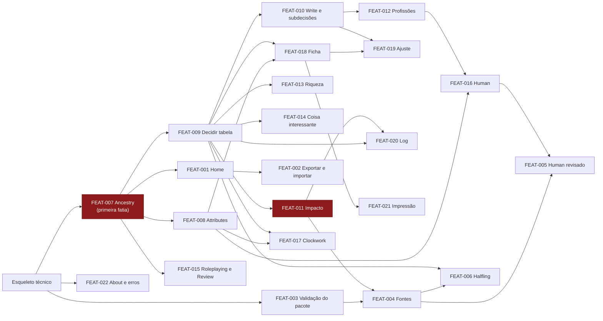

# Plano de implementação: Gerador de personagens SotDL

> Status: Aprovado · Última atualização: 2026-11-11
> Entradas: `docs/srs.md` v1.1 · `docs/use-cases.md` · `docs/architecture.md` (ADR-001 a 010) · `docs/ux-foundations.md` (com `docs/design.md`). Todas presentes.

## 1. Visão geral

O plano constrói o MVP do SRS §1.2.1 em fatias verticais, cada uma atravessando interface, aplicação, motor, conteúdo e armazenamento. A ordem segue o CLAUDE.md e as lições 1 e 2: primeiro um **esqueleto técnico** publicado; depois o **marco 1, esqueleto funcional**, um Dwarf criado do começo à ficha impressa só com o core; depois o **marco 2, ampliação de conteúdo**, que fecha o MVP com Human, Clockwork, o Human revisado e o Halfling. Dentro de cada marco, o risco do núcleo (ADR-003, ADR-004) vem primeiro. Um desenvolvedor, sem prazo fixo. Os Should entram depois, só com título e rastreio; os Could ficam fora do plano.

## 2. Esqueleto técnico

O caminho mínimo de ponta a ponta, publicado.

- **Real:**
  - Projeto Vite + React + TypeScript com os módulos da arquitetura (`engine`, `content`, `app`, `storage`, `dice`, `ui`) e a regra de lint que isola o `engine`.
  - Casca da interface: cabeçalho, link para About, as três zonas do construtor vazias, tokens do `design.md` como variáveis CSS, as três fontes servidas pelo site.
  - Pacote mínimo em `packs/` (índice + core com o procedimento de 8 etapas, sem entidades), validado pelo schema ao carregar (FR-CONT-001, FR-CONT-002).
  - Repositório IndexedDB e o primeiro comando: "New character" cria um personagem de nível 0 com o core como única fonte (FR-CHAR-001), grava e abre o construtor; a Home lista o personagem depois de recarregar a página.
  - CI no GitHub Actions (tipos, lint, Vitest, um E2E do Playwright com axe) e deploy no GitHub Pages a partir do `main`.
- **Simulado:** o `evaluate` devolve só a lista de etapas, todas "Not started"; nenhuma regra calculada; About com texto provisório.
- **Pronto quando:** no endereço publicado, criar um personagem, recarregar e vê-lo na Home funciona; o CI está verde; o axe não acusa violação grave na casca.

## 3. Épicos e fatias

Épicos alinhados aos blocos da arquitetura (§5.2). IDs `FEAT-NNN` estáveis, em ordem de definição; a ordem de construção está na §4. "parcial" indica requisito dividido entre fatias.

### E1. Personagens (`app`, `storage`, `ui`)

| ID | Fatia | FRs | UCs | Telas | Blocos | Dados |
| :- | :-- | :-- | :-- | :-- | :-- | :-- |
| FEAT-001 | Home: listar, continuar e excluir personagens, com estado vazio e aviso de dados só no navegador | FR-CHAR-003, 004, 005, 006, 007, 011, 013, 014, 015, 016 | UC-001 (parcial) | SCR-WEB-001 | `app`, `storage`, `engine.evaluate` (contagem de decisões abertas) | Personagem (metadados), documento |
| FEAT-002 | Exportar e importar o arquivo do personagem | FR-CHAR-018, 019, 023 | UC-015 | SCR-WEB-001, SCR-WEB-014 | `app`, `content` (schema do personagem), `storage` | Documento do personagem, arquivo JSON |

### E2. Conteúdo e fontes (`content`, `engine.resolve`, `packs/`)

| ID | Fatia | FRs | UCs | Telas | Blocos | Dados |
| :- | :-- | :-- | :-- | :-- | :-- | :-- |
| FEAT-003 | Validação completa e carga do pacote por livro, com mensagem de falha | FR-CONT-010, 011, 012, 013; FR-HELP-004 | — | SCR-WEB-001 (estado de erro) | `content`, CI | Índice, pacotes |
| FEAT-004 | Configurar fontes do personagem: ligar, desligar, ordenar, aplicar | FR-CHAR-002; FR-SRC-001 a 008, 011, 012, 013, 014; FR-CHG-007; FR-LOG-006 | UC-002 | SCR-WEB-002, SCR-WEB-007 | `engine.resolve`, `engine.impact`, `app` | `sources`, log |
| FEAT-005 | Human revisado do *Only Human* (padrão 2): versões, herança, precedência, erratas | FR-SRC-009, 015; FR-CONT-007; FR-CONT-003 (parcial) | UC-002, UC-003 | SCR-WEB-002, SCR-WEB-003 | `engine.resolve`, `packs/` | Pacote *Only Human* |
| FEAT-006 | Halfling do *Demon Lord's Companion* (padrão 1) | FR-CONT-003 (parcial) | UC-003, UC-006 | SCR-WEB-003, SCR-WEB-009 | `packs/` | Pacote DLC |

### E3. Construtor de nível 0 (`engine.evaluate`, `engine.impact`, `dice`, `ui`)

| ID | Fatia | FRs | UCs | Telas | Blocos | Dados |
| :- | :-- | :-- | :-- | :-- | :-- | :-- |
| FEAT-007 | **Etapa Ancestry, mapa de etapas e resumo vivo** (Dwarf e Human do core) | FR-STEP-001, 002, 003; FR-FLOW-001 a 014, 018; FR-CALC-001; FR-DEC-011; FR-SRC-010; FR-CONT-006, 009; FR-CONT-003 (parcial) | UC-003 | SCR-WEB-003, SCR-WEB-016 | `engine.resolve`, `engine.evaluate`, `app`, `ui` | Ancestralidade, procedimento, fórmulas, `decisions` |
| FEAT-008 | Etapa Attributes: ajuste ±1, características com fórmula e composição | FR-STEP-007, 009, 010, 011; FR-CALC-002, 003, 005, 006, 007, 008, 009 | UC-004 | SCR-WEB-005 | `engine.evaluate` | Fórmulas, limites |
| FEAT-009 | Decidir uma tabela: Roll, Choose, Enter result (tabelas de história do Dwarf, Hated Creature) | FR-DEC-001, 002, 004, 005, 007, 008, 012, 016, 019, 020, 024; FR-STEP-012, 013, 014; FR-CALC-010, 011; FR-CONT-008; FR-LOG-001, 002, 004, 010 | UC-005, UC-006 | SCR-WEB-009 | `dice`, `engine.evaluate`, `app` | Tabelas, decisões, log |
| FEAT-010 | Write, subdecisões, tabelas aguardando e "Roll all undecided" | FR-DEC-003, 010, 014, 021, 023; FR-STEP-015; FR-LOG-003 | UC-005, UC-006 | SCR-WEB-009 | `engine.evaluate`, `app` | Decisões, concessões |
| FEAT-011 | Mudança a montante: diálogo de impacto, rerrolagem, troca de modo, troca de ancestralidade, versão nova do pacote | FR-CHG-001 a 006, 008 a 014; FR-DEC-015, 017, 018; FR-STEP-005; FR-LOG-007; FR-CONT-015, 016 | UC-010 | SCR-WEB-007 | `engine.impact`, `app` | Decisões, ajustes ligados, log |
| FEAT-012 | Profissões e idiomas, com nome digitado (D36) e troca por idioma | FR-STEP-016, 017, 019, 020, 021; FR-DEC-006, 009, 013 | UC-007 | SCR-WEB-010 | `dice` (encadeada), `engine.evaluate` | Tabelas de profissão, idiomas |
| FEAT-013 | Riqueza e equipamento | FR-STEP-022, 023, 024; FR-CALC-012 | UC-008 | SCR-WEB-011 | `engine.evaluate` | Estilo de vida, pacotes de equipamento |
| FEAT-014 | Coisa interessante | FR-STEP-026, 027 | UC-009 | SCR-WEB-008 | `dice`, `engine.evaluate` | Tabelas de coisa interessante |
| FEAT-015 | Roleplaying e Review | FR-STEP-029, 030, 031; FR-FLOW-015, 016, 017; FR-CHAR-012; FR-LOG-008 | UC-011 | SCR-WEB-017, SCR-WEB-018 | `app`, `ui` | `text`, decisões abertas |
| FEAT-016 | Human do core completo: +1 em atributo, idioma ou profissão aleatória | FR-STEP-008, 018; FR-CONT-003 (parcial) | UC-003, UC-004, UC-007 | SCR-WEB-005, SCR-WEB-010 | `packs/`, `engine.evaluate` | Pacote do core |
| FEAT-017 | Clockwork: Defense própria, Purpose e Form | FR-STEP-004; FR-CALC-004; FR-CONT-003 (parcial) | UC-003, UC-005 | SCR-WEB-003, SCR-WEB-005 | `packs/`, `engine.evaluate` | Pacote do core |

### E4. Ficha, ajuste e log (`ui`, `engine.evaluate`, `app`)

| ID | Fatia | FRs | UCs | Telas | Blocos | Dados |
| :- | :-- | :-- | :-- | :-- | :-- | :-- |
| FEAT-018 | Ficha final em leitura, também no celular | FR-SHEET-001 a 008, 010, 011, 012, 014; FR-CHAR-008 | UC-012 | SCR-WEB-014, SCR-WEB-021 | `engine.evaluate`, `ui` | Visão do personagem |
| FEAT-019 | Ajuste manual (modificador, substituição, campos fixos, itens) | FR-ADJ-001 a 016; FR-SHEET-009; FR-DEC-022; FR-LOG-005; FR-CONT-014 | UC-013 | SCR-WEB-014, SCR-WEB-009 | `engine.evaluate`, `app` | `adjustments`, log |
| FEAT-020 | Log com filtros e entradas desfeitas | FR-LOG-009, 011, 012, 013, 014, 015 | UC-014 | SCR-WEB-015 | `app`, `ui` | Log |
| FEAT-021 | Impressão da ficha | FR-SHEET-013 | UC-012 | SCR-WEB-020 | `ui` (`@media print`) | Visão do personagem |

### E5. Ajuda e erros (`ui`, `app`)

| ID | Fatia | FRs | UCs | Telas | Blocos | Dados |
| :- | :-- | :-- | :-- | :-- | :-- | :-- |
| FEAT-022 | About e tratamento de erros inesperados | FR-HELP-001, 002, 003, 005 | — | SCR-WEB-019 | `ui` (error boundary) | — |

### E6. Depois do MVP (Should, só título e rastreio)

| ID | Fatia | FRs | Telas |
| :- | :-- | :-- | :-- |
| FEAT-023 | Componentes por livro, regras opcionais, atributos aleatórios, pacote da casa embarcado, documentação do formato | FR-SRC-016, 017, 018; FR-CONT-017 | SCR-WEB-002, SCR-WEB-005 |
| FEAT-024 | Revisão de procedimento e substituição de tabela: Development do *Only Human*, *Oddities* | FR-FLOW-019; FR-SRC-021, 025; FR-CHG-015; FR-STEP-028 | SCR-WEB-006, SCR-WEB-008 |
| FEAT-025 | Versão no cartão e comparação | FR-SRC-019, 020 | SCR-WEB-003, SCR-WEB-004 |
| FEAT-026 | Motivos de indisponível, resumo das fontes, lista navegável, busca de ancestralidade | FR-SRC-022, 023, 024; FR-STEP-006 | SCR-WEB-002, SCR-WEB-003 |
| FEAT-027 | Concessões e decisões do mestre | FR-DEC-025 | SCR-WEB-011, SCR-WEB-014 |
| FEAT-028 | Gatilhos de regra na criação | FR-DEC-026 | SCR-WEB-009 |
| FEAT-029 | Demais ancestralidades do core, mudar escolha pelo log, exportar o log e a ficha em PDF | FR-CHG-016; FR-LOG-016; FR-SHEET-015 | SCR-WEB-003, SCR-WEB-015 |
| FEAT-030 | Subida de nível 1 a 10 com paths e magia (sem FR detalhado no SRS: item 8 dos Should) e armadura | FR-CALC-013 | SCR-WEB-012, SCR-WEB-013 |
| FEAT-031 | Offline e aviso entre abas | FR-CHAR-017; NFR-REL-003 | — |

## 4. Ordem de construção

| # | Fatia | Por que aqui |
| :-- | :-- | :-- |
| 0 | Esqueleto técnico | Torna a arquitetura real e publicada. |
| **Marco 1: esqueleto funcional (Dwarf do começo à ficha impressa)** | | |
| 1 | FEAT-007 Ancestry, mapa e resumo | Primeira fatia: maior risco (`resolve`, `evaluate`, chaves de vaga, fórmulas como dado). |
| 2 | FEAT-008 Attributes | Completa o cálculo com composição e limites; mede a NFR-PERF-002. |
| 3 | FEAT-001 Home | Torna o app usável entre sessões; precisa da contagem de decisões abertas. |
| 4 | FEAT-009 Decidir uma tabela | Cria os primeiros dependentes reais. |
| 5 | FEAT-011 Mudança a montante | Risco da ADR-004 puxado para cedo, assim que existem dependentes. |
| 6 | FEAT-010 Write e subdecisões | Completa os modos de decisão antes das etapas que os reusam. |
| 7 | FEAT-012 Profissões e idiomas | Rolagem encadeada e nomes digitados (D36). |
| 8 | FEAT-013 Riqueza e equipamento | |
| 9 | FEAT-014 Coisa interessante | |
| 10 | FEAT-015 Roleplaying e Review | Fecha as 8 etapas. |
| 11 | FEAT-018 Ficha final | |
| 12 | FEAT-019 Ajuste manual | Depende da ficha. |
| 13 | FEAT-020 Log | |
| 14 | FEAT-021 Impressão | Valida a NFR-COMP-003 com um personagem completo. |
| 15 | FEAT-022 About e erros | Fecha o marco 1. |
| **Marco 2: ampliação de conteúdo (fecha o MVP)** | | |
| 16 | FEAT-002 Exportar e importar | Primeiro do marco 2 pelo risco do Safari (ADR-002). |
| 17 | FEAT-003 Validação do pacote | Pré-requisito para mais de um livro. |
| 18 | FEAT-004 Configurar fontes | Depende de vários livros e do impacto (FEAT-011). |
| 19 | FEAT-016 Human do core completo | |
| 20 | FEAT-017 Clockwork | Fórmula que substitui a padrão (P11a). |
| 21 | FEAT-005 Human revisado | Valida o padrão 2 sem código novo no motor (NFR-MAINT-001). |
| 22 | FEAT-006 Halfling | Valida o padrão 1 só com dados; fecha o MVP. |
| **Depois do MVP (Should, na ordem do SRS)** | | |
| 23–31 | FEAT-023 a FEAT-031 | Ordem viva; reavaliar ao fim do marco 2. |

## 5. Primeira fatia: FEAT-007 Ancestry, mapa de etapas e resumo vivo

**Fluxo:** UC-003, fluxo principal e alternativa 4a. O jogador, com um personagem recém-criado (esqueleto), abre o construtor na etapa Ancestry; as demais etapas aparecem bloqueadas. Vê Dwarf e Human do core como cartões com linha de mecânica, página e selos; seleciona um, vê o detalhe e o que muda na ficha; confirma. As etapas seguintes se liberam e o resumo vivo mostra atributos e características calculados. No Human, a escolha de Size aparece agora ou fica em Open decisions.

**Por que esta:** exercita o núcleo arriscado (ADR-003 e ADR-004: `resolve`, `evaluate`, procedimento como dado, fórmulas como árvore, chaves de vaga e vagas filhas) e põe o design system numa tela real, nas três zonas e no celular. É demonstrável e pequena.

**Critérios de aceitação:**
1. Sem ancestralidade escolhida, só Ancestry abre; as outras etapas mostram "Choose an ancestry first" e não abrem (FR-FLOW-004, 005).
2. Cada ancestralidade aparece uma vez, com linha de mecânica gerada dos dados, livro, página e tipo "Core" (FR-STEP-001, FR-SRC-010, FR-CONT-009).
3. Selecionar mostra atributos iniciais, características, idiomas e profissões, benefício de nível 4 e página da descrição, sem texto do livro (FR-STEP-002, FR-FLOW-014).
4. Escolher Human oferece Size ½ ou 1; adiar cria uma decisão aberta com atalho que leva de volta ao ponto (FR-STEP-003, FR-DEC-011, FR-FLOW-010, 011).
5. Depois da escolha, o mapa mostra o estado de cada etapa e libera as seguintes; Next abre a próxima mesmo com pendência; Back volta (FR-FLOW-001, 002, 003, 006, 007, 008).
6. O cabeçalho da etapa mostra regime, pergunta, linha de regra com página e contadores (FR-FLOW-009).
7. O resumo vivo mostra os quatro atributos com modificador e as características calculadas pelas fórmulas do pacote (Dwarf: Health = Strength + 4), e se atualiza ao trocar a escolha (FR-FLOW-012, 013, FR-CALC-001).
8. Trocar Dwarf por Human sem outras decisões aplica direto (FR-CHG-002 vem no FEAT-011; aqui não há dependentes).
9. Abaixo de 768px, o layout de celular do SCR-WEB-016 vale para esta etapa (FR-FLOW-018).
10. A decisão sobrevive a recarregar a página. Os ids de entidade são estáveis e independentes do nome (FR-CONT-006).

**Entrada para o ui-design:** SCR-WEB-003 (etapa Ancestry) e SCR-WEB-016 (layout de celular), mais a casca do construtor (`app-header`, `step-map`, `step-header`, `option-card`, `subdecision`, `live-summary`, `open-decisions`, do `design.md` §4).

**Entrada para o detailed-design:**
- Schema do pacote para ancestralidade, procedimento e etapas, fórmula (árvore) e concessão de vaga (ADR-003, ADR-005).
- Schema do documento do personagem v1: `sources`, `decisions`, `text`, `log` (ADR-004).
- Formato da chave de vaga e regra de geração das vagas filhas.
- `resolve(pacotes, fontes)` e `evaluate(regras, personagem)`: etapas e estados, vagas abertas, valores com composição.
- Comandos `chooseAncestry` e `decide(vaga, valor)`, com gravação pelo repositório.
- Dados do core para Dwarf e Human (atributos, características, idiomas, nível 4, páginas), **conferidos no PDF**, e as fórmulas padrão das características.

**Fora desta fatia:** Clockwork e Halfling, interações da etapa Attributes, diálogo de impacto, +1 do Human e idioma ou profissão (ficam como decisões abertas até o FEAT-016).

## 6. Fundações de engenharia

Montadas junto com o esqueleto e mantidas por todas as fatias.

- [ ] **Repositório:** um projeto Vite (ADR-006); pastas `src/engine`, `src/content`, `src/app`, `src/storage`, `src/dice`, `src/ui`; `packs/` público só com mecânica; `content/` fora do Git (já está).
- [ ] **Fronteira do motor:** regra de lint que proíbe `engine` de importar React, DOM ou armazenamento.
- [ ] **CI (GitHub Actions):** tipos, lint, Vitest, validação do pacote (schema, integridade, ausência de texto descritivo, ids removidos), build, Playwright em Chromium, Firefox e WebKit com axe, Lighthouse CI; deploy no Pages só com `main` verde (ADR-007, ADR-008).
- [ ] **Ambientes:** local e produção; CSP por `<meta>`; base de caminho do Pages.
- [ ] **Persistência e salvamento automático:** repositório IndexedDB, pipeline de comandos que grava documento e log numa transação, aviso de falha mantendo o estado na tela, versão de schema com migração (FR-CHAR-009, FR-CHAR-010; NFR-REL-001).
- [ ] **Design system:** variáveis CSS geradas de `tokens.json`; Spectral, Inter e IBM Plex Mono servidas pelo site; React Aria Components; anel de foco; folha de impressão base (NFR-ACC-001, NFR-PRIV-001).
- [ ] **Testes:** convenção de citar o FR no nome do teste, para provar a NFR-MAINT-002; pacotes sintéticos só em testes.
- [ ] **Conteúdo oficial:** todo dado conferido no PDF antes do commit; dado não conferido marcado e fora da publicação; nomes só de entidades ou referenciados (FR-CONT-004, FR-CONT-005).
- [ ] **Observabilidade:** nenhuma (NFR-OBS-001); error boundary.
- [ ] **Antes de cada publicação:** revisão dos textos visíveis (NFR-USE-001) e revisão manual de acessibilidade das telas novas.
- [ ] **Ao fim do marco 2:** teste com uma pessoa sem os livros (três ancestralidades até a ficha impressa) e com um jogador experiente cronometrado (NFR-USE-002; métricas M1, M4).

**Requisitos absorvidos pelo esqueleto e pelas fundações:** FR-CHAR-001, 009, 010; FR-CONT-001, 002, 004, 005.

**NFRs:** NFR-PERF-001, NFR-REL-001, NFR-REL-002, NFR-SEC-001, NFR-PRIV-001, NFR-ACC-001, NFR-USE-001, NFR-USE-002, NFR-COMP-001, NFR-COMP-002, NFR-MAINT-002, NFR-COST-001, NFR-L10N-001 e NFR-OBS-001 ficam nas fundações. As demais são verificadas em fatias: NFR-PERF-002 (FEAT-008), NFR-PERF-003 (FEAT-011), NFR-CAP-001 (FEAT-001), NFR-CAP-002 (FEAT-003), NFR-SEC-002 (FEAT-002 para o arquivo do personagem, FEAT-003 para o pacote), NFR-COMP-003 (FEAT-021), NFR-MAINT-001 (FEAT-005, FEAT-006).

## 7. Riscos e premissas

- **Núcleo da ADR-004:** se as chaves de vaga ou o `impact` não se sustentarem, o FEAT-007 ou o FEAT-011 mostram isso cedo; uma mudança aí reabre a ADR-004 antes de existirem as outras etapas.
- **Autoria do pacote:** cada fatia de etapa inclui escrever e conferir no PDF os dados que usa. É o trabalho mais longo; as páginas do SRS são aproximadas.
- **Safari antes do FEAT-002:** até o marco 2, um personagem pode sumir no Safari. Aceitável enquanto o site não é divulgado; o aviso da FR-CHAR-016 existe desde o FEAT-001.
- **Nomes digitados (D36)** e **impressão em 2 páginas**: validados no FEAT-012 e no FEAT-021; se falharem, viram ajuste de UX, não de arquitetura.
- **Ordem viva:** o marco 2 e os Should serão reordenados com o que se aprender no marco 1.
- **Cobertura:** todo Must está numa fatia ou nas fundações; toda tela do inventário é tocada por alguma fatia. Nenhuma lacuna aberta.
- **Fora do plano (Could):** FR-CHAR-020, 021, 022; FR-SRC-026; FR-STEP-025; FR-CALC-014; FR-CHG-017; FR-LOG-017; FR-SHEET-016, 017, 018, 019; FR-HELP-006. Entram por emenda do plano quando forem priorizados.
