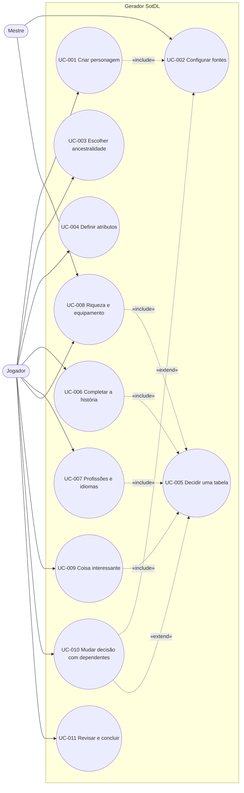
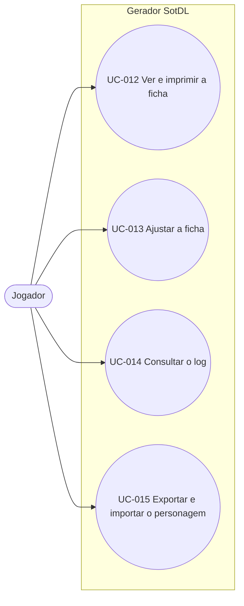

# Casos de uso: Gerador de personagens SotDL

> Fonte: `docs/srs.md` (v1.1) · Última atualização: 2026-11-11
> Escopo: MVP (requisitos Must). Requisitos Should e Could não têm caso de uso.

## Atores

| Ator | Papel |
|---|---|
| Jogador | Cria e consulta o personagem. Ator principal de todos os casos. |
| Mestre | Ator secundário: define as fontes da mesa e toma decisões dentro do fluxo. No MVP, essas decisões entram por Write ou "Enter result" (FR-DEC-025). |
| Visitante | Jogador sem os livros (D35). Usa os mesmos casos; as entradas sem texto mostram faixa, página e efeitos. |

Não há contas no MVP: os atores são papéis, não perfis de acesso.

**Sem caso de uso próprio** (cobertos só pelos requisitos): listar, continuar e excluir personagens (FR-CHAR-003, 004, 007, 013, 014); página About e erros gerais (FR-HELP); pacote oficial (FR-CONT, requisitos de sistema); layout de celular (FR-FLOW-018).

## Diagramas

### Criação

### Ficha e log

---

## UC-001: Criar um personagem

- **Atores:** Jogador (principal)
- **Descrição:** O jogador começa um personagem novo de nível 0.
- **Pré-condições:** Nenhuma.
- **Pós-condições (sucesso):** Existe um personagem salvo, com fontes definidas, e o construtor está aberto na etapa Ancestry.
- **Rastreia:** FR-CHAR-001, FR-CHAR-002, FR-CHAR-009, FR-CHAR-010, FR-CHAR-011, FR-CHAR-015, FR-CHAR-016, FR-FLOW-001, FR-FLOW-004, FR-FLOW-005

**Fluxo principal**
1. O jogador aciona "New character" na tela inicial.
2. O sistema cria o personagem com o core como única fonte e o exibe como "Unnamed character".
3. O sistema abre a configuração de fontes (UC-002).
4. O jogador aplica as fontes.
5. O sistema abre o construtor na etapa Ancestry, com as demais etapas bloqueadas até a escolha da ancestralidade.

**Fluxos alternativos**
- 1a. Primeiro acesso, sem personagens: o sistema mostra o estado vazio (o que o app faz, aviso de que o texto vem do livro) e o botão "New character".
- 4a. O jogador mantém só o core: aplica sem alterar.

**Fluxos de exceção**
- 2a. O salvamento falha: o sistema avisa e mantém o personagem na tela.

## UC-002: Configurar as fontes do personagem

- **Atores:** Jogador (principal), Mestre (define quais livros a mesa usa)
- **Descrição:** Escolher os livros ativos do personagem e a ordem de prioridade.
- **Pré-condições:** O personagem existe.
- **Pós-condições (sucesso):** A configuração aplicada vale para o personagem e está registrada no log.
- **Rastreia:** FR-SRC-001..015, FR-CHG-001, FR-CHG-007, FR-LOG-006

**Fluxo principal**
1. O jogador abre a configuração de fontes (pela criação ou pelo cabeçalho do construtor).
2. O sistema lista os livros com conteúdo, em ordem de prioridade, com o core fixo no fim.
3. O jogador liga um livro.
4. O sistema o coloca na posição da sua camada (suplementos por data de publicação; empate por nome).
5. O jogador aciona "Apply and continue".
6. O sistema aplica a configuração, registra uma entrada "Sources" no log e volta ao construtor.

**Fluxos alternativos**
- 3a. O jogador desliga um livro: o conteúdo dele sai das opções.
- 3b. O jogador reordena os livros: a nova ordem passa a valer como prioridade.
- 5a. A mudança afeta escolhas feitas: o sistema abre o diálogo de impacto, agrupado por livro (UC-010).

**Fluxos de exceção**
- 5b. O jogador sai sem aplicar: o sistema pede confirmação para descartar as alterações.

## UC-003: Escolher a ancestralidade

- **Atores:** Jogador
- **Descrição:** Escolher a ancestralidade e resolver as subdecisões dela.
- **Pré-condições:** O personagem existe.
- **Pós-condições (sucesso):** A ancestralidade está escolhida, as etapas seguintes estão liberadas e as subdecisões estão resolvidas ou abertas.
- **Rastreia:** FR-STEP-001..005, FR-FLOW-002, FR-FLOW-003, FR-FLOW-009, FR-FLOW-014, FR-SRC-009, FR-SRC-010, FR-CONT-009

**Fluxo principal**
1. O sistema exibe as ancestralidades dos livros ativos, uma por entidade, na versão do livro mais acima, com linha de mecânica, página e selos.
2. O jogador seleciona uma ancestralidade.
3. O sistema mostra o detalhe e o que a escolha muda na ficha.
4. O jogador confirma.
5. O sistema recalcula o conjunto de etapas e libera as seguintes.

**Fluxos alternativos**
- 4a. Human: o sistema oferece Size ½ ou 1; o jogador escolhe ou adia (vira decisão aberta).
- 4b. Clockwork: o sistema oferece Purpose e Form, com rolar ou escolher (UC-005).
- 4c. O jogador troca uma ancestralidade já escolhida: segue o UC-010.

## UC-004: Definir os atributos

- **Atores:** Jogador
- **Descrição:** Fechar os atributos iniciais e ver as características calculadas.
- **Pré-condições:** A ancestralidade está escolhida.
- **Pós-condições (sucesso):** Atributos definidos; características recalculadas com composição visível.
- **Rastreia:** FR-STEP-007..011, FR-CALC-001..010, FR-FLOW-012, FR-FLOW-013

**Fluxo principal**
1. O sistema exibe os quatro atributos com valor, modificador e composição, e as características com fórmula e valor.
2. Se a ancestralidade conceder aumento à escolha, o jogador escolhe o atributo.
3. O jogador aplica, se quiser, o ajuste opcional: −1 num atributo e +1 em outro.
4. O sistema recalcula as características e atualiza o resumo vivo.

**Fluxos alternativos**
- 3a. O jogador desfaz o ajuste: os dois atributos voltam ao valor anterior.

**Fluxos de exceção**
- 3b. O jogador tenta um segundo ajuste: o sistema impede e oferece desfazer o atual.

## UC-005: Decidir uma tabela

- **Atores:** Jogador; Mestre (quando a mesa decide)
- **Descrição:** Obter o resultado de uma tabela por rolagem, escolha, texto próprio ou resultado informado. Incluído pelos UC-006 a UC-009.
- **Pré-condições:** A tabela não está aguardando outra.
- **Pós-condições (sucesso):** O resultado está registrado com origem e efeitos aplicados; subdecisões geradas estão resolvidas ou abertas.
- **Rastreia:** FR-DEC-001..024, FR-LOG-001..004, FR-CONT-014

**Fluxo principal**
1. O sistema exibe a tabela com o regime previsto e os modos disponíveis.
2. O jogador aciona Roll.
3. O sistema sorteia cada dado e exibe valor, dados, cálculo com modificadores, resultado e efeitos.
4. O sistema aplica os efeitos e registra a rolagem no log.

**Fluxos alternativos**
- 2a. Choose: o jogador escolhe uma entrada pela faixa; o sistema registra a entrada sem valor de dado.
- 2b. Write (rolagem com escolha permitida): o jogador escreve o resultado; pode marcar que ele tem efeito de regra, o que abre um ajuste manual (UC-013).
- 2c. "Enter result" (rolagem prescrita): o jogador informa o valor de cada dado.
- 3a. Entrada sem texto: o sistema mostra "No text added for this entry" com faixa e página.
- 3b. Nome não incluído no pacote (D36): o sistema pede que o jogador digite o nome.
- 3c. O resultado gera uma subdecisão: o jogador resolve agora ou adia (vira decisão aberta).
- 3d. Efeito não modelado: o sistema mostra a página e sugere ajuste manual.
- 2d. "Roll all undecided": o sistema rola só as tabelas sem decisão e não aguardando outra.
- 2e. Reroll ou troca de modo numa tabela decidida: o resultado anterior vai para o log como desfeito; com dependentes, segue o UC-010.

**Fluxos de exceção**
- 2f. Valor informado fora da faixa: o sistema recusa e informa a faixa válida.
- 2g. Write sem texto: o sistema recusa e pede o texto.

## UC-006: Completar a história da ancestralidade

- **Atores:** Jogador
- **Descrição:** Resolver as tabelas de história da ancestralidade.
- **Pré-condições:** A ancestralidade está escolhida.
- **Pós-condições (sucesso):** As tabelas estão decididas ou abertas; entidades e efeitos ganhos estão no personagem.
- **Rastreia:** FR-STEP-012..015, FR-CALC-010, FR-CALC-011

**Fluxo principal**
1. O sistema exibe um cartão por tabela de história, com Roll, Choose e Write.
2. O jogador decide cada tabela (UC-005).
3. Quando um resultado concede idioma, profissão ou outra entidade, o sistema a adiciona com a origem.
4. Quando um resultado tem efeito com dado (ex.: "1d6 Insanity"), o jogador rola ou informa no próprio cartão.

**Fluxos alternativos**
- 1a. Dwarf: o sistema oferece a Hated Creature em grade, com as faixas do d20 e os nomes das criaturas (D38).

## UC-007: Definir profissões e idiomas

- **Atores:** Jogador; Mestre (aprova profissão renomeada)
- **Descrição:** Preencher as duas vagas de profissão e fechar os idiomas.
- **Pré-condições:** A ancestralidade está escolhida.
- **Pós-condições (sucesso):** Profissões e idiomas registrados com origem.
- **Rastreia:** FR-STEP-016..021, FR-DEC-009

**Fluxo principal**
1. O sistema oferece duas vagas de profissão, cada uma com Roll d6 + d20, Choose e "Trade for a language".
2. O jogador rola: o d6 define o tipo e o d20, a entrada na tabela do tipo (UC-005).
3. O sistema mostra faixa e página e pede o nome da profissão, quando ele não vem no pacote.
4. O sistema exibe os idiomas com fala, leitura, escrita e origem.

**Fluxos alternativos**
- 1a. "Trade for a language": o jogador escolhe falar um idioma novo ou ler um que já fala.
- 1b. A ancestralidade concede idioma extra ou profissão aleatória: o sistema oferece uma vaga a mais.
- 3a. O jogador renomeia a profissão e marca a aprovação do mestre.
- 4a. Há idioma pendente vindo da história: o sistema o mostra com atalho para onde se resolve.

## UC-008: Definir riqueza e equipamento

- **Atores:** Jogador; Mestre (escolhe a magia do pergaminho)
- **Descrição:** Rolar a riqueza e receber o pacote de equipamento.
- **Pré-condições:** A ancestralidade está escolhida.
- **Pós-condições (sucesso):** Estilo de vida, equipamento e dinheiro estão no personagem; escolhas internas resolvidas ou abertas.
- **Rastreia:** FR-STEP-022..024, FR-STEP-014, FR-CALC-012

**Fluxo principal**
1. O jogador rola 3d6 na tabela de riqueza ou informa o resultado (UC-005).
2. O sistema adiciona o pacote de equipamento do estilo de vida.
3. O jogador resolve as escolhas internas (arma; escudo, pergaminho ou kit).
4. O jogador rola ou informa as moedas do pacote.

**Fluxos alternativos**
- 3a. Pergaminho: a magia é decisão do mestre; o jogador a registra por Write ou deixa aberta, e a ficha mostra "GM's choice".
- 3b. Escudo: aparece no equipamento com o seu efeito, fora da Defense (FR-CALC-012).

## UC-009: Obter a coisa interessante

- **Atores:** Jogador
- **Descrição:** Rolar a coisa interessante inicial.
- **Pré-condições:** Nenhuma além do personagem existir e da ancestralidade estar escolhida.
- **Pós-condições (sucesso):** A coisa interessante está no campo Interesting Things, com origem.
- **Rastreia:** FR-STEP-026, FR-STEP-027

**Fluxo principal**
1. O jogador rola o tipo (d6) e o item (d20) (UC-005).
2. O sistema mostra faixa e página (sem texto, no pacote oficial) e registra a entrada em Interesting Things.

**Fluxos alternativos**
- 1a. "Reroll item" ou "Reroll type and item".
- 1b. "Enter result": o jogador informa os dois valores.

## UC-010: Mudar uma decisão que tem dependentes

- **Atores:** Jogador
- **Descrição:** Mudar uma escolha, rolagem, modo ou fonte da qual outras decisões dependem, sabendo antes o que será desfeito.
- **Pré-condições:** A decisão a mudar tem dependentes.
- **Pós-condições (sucesso):** A mudança está aplicada; dependentes removidos estão no log como desfeitos; decisões ainda exigidas voltaram a ficar abertas; o personagem está em estado válido.
- **Rastreia:** FR-CHG-001..014, FR-DEC-015, FR-DEC-017, FR-DEC-018, FR-STEP-005, FR-LOG-007

**Fluxo principal**
1. O jogador pede a mudança (ex.: rerrolar a idade, trocar a ancestralidade, desligar um livro).
2. O sistema exibe o diálogo de impacto: atual × novo; o que será removido (inclusive dependentes transitivos e ajustes ligados); o que será recalculado (valor antigo → novo); o que permanece.
3. O jogador aplica a mudança.
4. O sistema remove os dependentes, recalcula, devolve como abertas as decisões ainda exigidas e registra os desfeitos no log.

**Fluxos alternativos**
- 1a. A mudança não tem dependentes: o sistema aplica direto, sem diálogo.
- 2a. A mudança vem das fontes: o impacto aparece agrupado por livro.
- 3a. O jogador mantém o atual: nada muda; numa rerrolagem, o valor recusado vai para o log como desfeito.

## UC-011: Revisar e concluir a criação

- **Atores:** Jogador
- **Descrição:** Navegar pelas etapas, completar a interpretação e revisar o que falta antes de abrir a ficha.
- **Pré-condições:** O personagem existe.
- **Pós-condições (sucesso):** A ficha está aberta; decisões que restarem continuam indicadas.
- **Rastreia:** FR-FLOW-006..011, FR-FLOW-015..017, FR-STEP-029..031, FR-CHAR-005, FR-CHAR-006, FR-CHAR-012, FR-LOG-008

**Fluxo principal**
1. O jogador avança pelas etapas com Next ou pelo mapa; pendências não bloqueiam.
2. Na etapa Roleplaying (opcional), o jogador dá nome, traços e notas.
3. Na etapa Review, o sistema lista as decisões abertas com atalhos.
4. O jogador abre a ficha.
5. Sem decisões abertas, o personagem passa a "Complete".

**Fluxos alternativos**
- 1a. O jogador usa o atalho de uma pendência no painel "Open decisions": o sistema abre o ponto onde ela se resolve.
- 1b. A etapa escolhida no mapa está bloqueada: o sistema mostra a dependência que falta.
- 4a. Há decisões abertas: a ficha abre com elas indicadas, e o personagem segue "Creating".

## UC-012: Ver e imprimir a ficha

- **Atores:** Jogador
- **Descrição:** Consultar a ficha final e imprimi-la.
- **Pré-condições:** O personagem existe.
- **Pós-condições (sucesso):** A ficha foi exibida ou impressa.
- **Rastreia:** FR-SHEET-001..014, FR-CHAR-008, FR-FLOW-016

**Fluxo principal**
1. O jogador abre a ficha (pela Review, pela tela inicial ou pelo construtor).
2. O sistema exibe cabeçalho, atributos, características com composição, talentos, equipamento, dinheiro e campos fixos com origem, em leitura.
3. O jogador imprime.
4. O sistema gera o layout de impressão sem controles, com páginas, decisões abertas marcadas e rodapé de fontes.

**Fluxos alternativos**
- 2a. Personagem em criação: as decisões abertas aparecem indicadas; decisões do mestre como "GM's choice".
- 2b. Tela de celular: a ficha aparece em coluna única.

## UC-013: Ajustar a ficha manualmente

- **Atores:** Jogador
- **Descrição:** Corrigir ou completar a ficha com um ajuste nomeado e reversível.
- **Pré-condições:** A ficha está aberta.
- **Pós-condições (sucesso):** O ajuste está aplicado, visível na composição e registrado no log.
- **Rastreia:** FR-ADJ-001..016, FR-SHEET-009, FR-LOG-005, FR-CHG-013, FR-CHG-014

**Fluxo principal**
1. O jogador aciona "Edit sheet".
2. O jogador escolhe um atributo ou característica e cria um modificador ou uma substituição, com nome.
3. O sistema aplica o ajuste por último no cálculo, mostra a composição (calculado e ajustado) e recalcula os derivados.
4. O sistema registra o ajuste no log.

**Fluxos alternativos**
- 2a. O jogador adiciona, edita ou remove uma entrada de campo fixo (inclusive pelo "+", com origem "Added by player").
- 2b. O jogador adiciona um item como texto ou remove um item do pacote.
- 2c. O jogador remove um ajuste: o valor ou a entrada original volta.
- 3a. O valor ajustado passa do máximo da regra: a composição indica isso.

**Fluxos de exceção**
- 2d. Ajuste sem nome: o sistema recusa e pede o nome.
- 2e. Valor não inteiro: o sistema recusa e informa o formato.

## UC-014: Consultar o log

- **Atores:** Jogador
- **Descrição:** Ver o histórico de decisões e ajustes do personagem.
- **Pré-condições:** O personagem existe.
- **Pós-condições (sucesso):** O log foi exibido; nada foi alterado.
- **Rastreia:** FR-LOG-009..015

**Fluxo principal**
1. O jogador abre o log pelo cabeçalho do construtor ou da ficha.
2. O sistema exibe as entradas em ordem cronológica, agrupadas por fase, com as desfeitas riscadas e o motivo.

**Fluxos alternativos**
- 2a. O jogador filtra por All, Choices, Rolls ou Edits.
- 2b. O jogador oculta as entradas desfeitas.

## UC-015: Exportar e importar o personagem

- **Atores:** Jogador
- **Descrição:** Guardar o personagem num arquivo e recriá-lo a partir dele, como cópia de segurança ou para usar em outro navegador.
- **Pré-condições:** Para exportar, o personagem existe.
- **Pós-condições (sucesso):** Exportar: o arquivo foi baixado. Importar: existe um personagem novo com as fontes, decisões, ajustes e log do arquivo.
- **Rastreia:** FR-CHAR-018, FR-CHAR-019, FR-CHAR-023, NFR-SEC-002

**Fluxo principal**
1. O jogador aciona a exportação de um personagem.
2. O sistema gera e baixa o arquivo do personagem.
3. Em outro momento ou navegador, o jogador aciona a importação e escolhe o arquivo.
4. O sistema valida o arquivo e cria um personagem novo com o conteúdo dele.

**Fluxos alternativos**
- 4a. Alguma decisão do arquivo não existe no pacote atual: o sistema a reabre como decisão aberta, avisa e registra no log (FR-CONT-016).

**Fluxos de exceção**
- 4b. O arquivo não é um arquivo de personagem válido: o sistema recusa, informa o motivo e não altera os personagens salvos.
