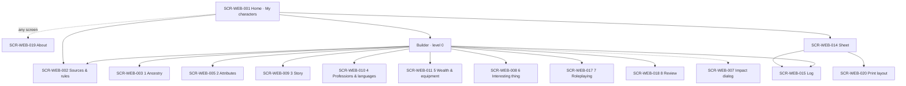
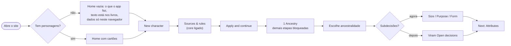
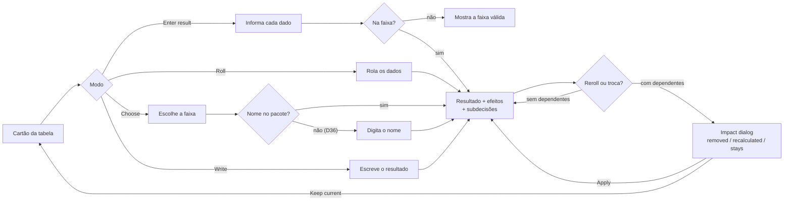
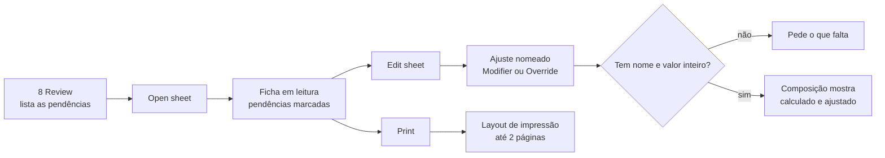
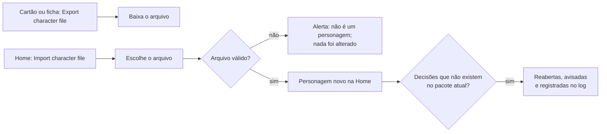

# UX Foundations: Gerador de personagens SotDL

> Status: Rascunho · Última atualização: 2026-11-11
> Fontes: `docs/srs.md` v1.1 · `docs/architecture.md` · `docs/use-cases.md` · princípios · wireframe v1 (`docs/reference/wireframe/`, `docs/reference/screens/`)
> Design system: **`docs/design.md` + `docs/tokens.json`** (fonte única de todos os valores de design; este documento referencia, não repete)

## 1. Visão geral

Aplicação web que conduz a criação de um personagem de *Shadow of the Demon Lord* de nível 0 e entrega a ficha, mostrando de onde vem cada regra e como cada número foi calculado (SRS §1.2). Uma superfície:

| Superfície | Código | Para quem |
|---|---|---|
| Web app responsivo, de 360 a 1920px, com layout de impressão da ficha | `WEB` | Jogadores, mestres e visitantes sem os livros (SRS §2.3) |

Modo de origem do design: **ingestão** do wireframe v1 (estrutura, componentes, medidas), como pede o CLAUDE.md, com a identidade visual A escolhida pelo usuário (P33, D28).

---

## Parte A — Núcleo compartilhado (resumo; a autoridade é o design.md)

### A1. Identidade visual
Estrutura limpa e neutra do wireframe; clima do SotDL só nas bordas: fundo pergaminho, vermelho-sangue em poucos pontos de identidade, serifa de livro nas perguntas das etapas e nos títulos da ficha. Detalhes e proveniência: `design.md` §1 e §9.

### A2. Voz e tom
Inglês simples, termos do jogo como nos livros, instrução sem julgamento, sempre dizendo o que falta e onde (P29). Nenhum termo interno (NFR-USE-001). Regras e exemplos: `design.md` §6.

### A3. Linguagem visual
Neutros quentes, cartões planos com borda, ação principal em preto, vermelho reservado a identidade e perigo; Inter para a interface, Spectral para perguntas e títulos, IBM Plex Mono para selos de fonte e dados; densidade média, como o wireframe. Tokens: `design.md` §2 e `tokens.json`; componentes e estados: `design.md` §4.

### A4. Acessibilidade
WCAG 2.2 AA em construtor, ficha e log, com tudo operável por teclado (NFR-ACC-001). Regras mecânicas: `design.md` §5.

### A5. Princípios de interação do produto
1. **Registrar, não fiscalizar** (P7): toda tabela aceita rolar, escolher, escrever ou informar; o regime da regra aparece como indicação.
2. **Pendência não bloqueia** (P4, D5): só a dependência real bloqueia; o resto vira contagem em Open decisions.
3. **Nada some sem aviso** (P6): mudança com dependentes abre o diálogo de impacto; sem dependentes, aplica direto.
4. **Tudo se explica** (P1, P11): toda opção mostra livro, página e tipo; todo valor mostra a composição.
5. **Salvar é automático** (FR-CHAR-009): não há botão Save; falha de gravação aparece e o estado fica na tela.
6. **Destruição confirmada** pelo nome da consequência ("Delete permanently"); nada destrutivo em um clique.
7. **Formulário pequeno abre no lugar**; diálogo só para comparação e confirmação com consequência (D34).
8. **Sem texto dos livros** (P22): entrada sem texto mostra faixa e página; o jogador lê no livro ou escreve o seu.

---

## Parte B — Superfície

### B1. Web app — código `WEB`

#### Usuários e tarefas

| Classe (SRS §2.3) | Contexto | Tarefas principais |
|---|---|---|
| Jogador experiente | Tem os livros; quer rapidez; desktop ou celular na mesa. | Criar um personagem em até 10 minutos (M4): ler só a linha de mecânica, rolar tudo de uma vez, imprimir. |
| Jogador iniciante | Não domina as regras. | Entender o que cada escolha muda (P10), de onde vem cada regra e o que falta (P4, P29). |
| Mestre | Define as fontes da mesa; decide dentro do fluxo. | Configurar fontes por personagem; registrar suas decisões por Write ou "Enter result" (MVP). |
| Visitante sem os livros | Avalia o portfólio. | Percorrer o fluxo até a ficha sem ajuda (M1), entendendo que o texto está nos livros (D35). |

Tarefas comuns: criar um personagem (UC-001 a UC-011), consultar e imprimir a ficha (UC-012), ajustar (UC-013), consultar o log (UC-014), exportar e importar (UC-015).

#### Arquitetura de informação e navegação

Navegação **hub-and-spoke** a partir da Home: a lista de personagens é o centro; cada personagem tem três lugares (construtor, ficha, log) acessados pelo cabeçalho do app. Dentro do construtor, a navegação é o **mapa de etapas**, guiado por dependências (P4, P5), com Back e Next. Configuração de fontes é um lugar do personagem, aberto pela criação e pelo cabeçalho. About fica acessível de toda tela (FR-HELP-001). Rotas por hash (ADR-006).

A ordem das etapas vem do procedimento no pacote (ADR-003); no MVP são as oito do core.

#### Fluxos principais

**F1. Primeira visita e criação [UC-001, UC-002, UC-003]**

**F2. Decidir uma tabela e mudar com dependentes [UC-005, UC-010]**

**F3. Concluir, ajustar e imprimir [UC-011, UC-012, UC-013]**

**F4. Exportar e importar [UC-015]**

#### Inventário de telas

IDs estáveis. `SCR-WEB-001` a `016` correspondem a `SCR-01` a `SCR-16` do wireframe (o SRS cita os IDs antigos). Telas novas a partir de 017.

**Personagens e configuração**

| ID | Wireframe | Tela | Propósito | Estados-chave | Prioridade |
| :-- | :-- | :-- | :-- | :-- | :-- |
| SCR-WEB-001 | SCR-01 | Home · My characters | Listar, criar, continuar, excluir, exportar e importar personagens. MVP: cartões, New character, Import character file, aviso "só neste navegador", menu do cartão (Preview sheet, Export character file, Delete). | vazio (FR-CHAR-015), carregando, populado, confirmação de exclusão, importação recusada (FR-CHAR-023), importação com decisões reabertas | Must |
| SCR-WEB-002 | SCR-02 | Sources & rules | Ligar, desligar e ordenar os livros do personagem. MVP: só a aba Books, livros só com o nome, core travado no fim, coluna "What these settings mean", Apply and continue. | sem alterações, alterações pendentes, descartar alterações (FR-SRC-013), mudança com dependentes → 007 | Must (abas Optional rules, House rules, Rule texts: Should/Could) |
| SCR-WEB-019 | — | About | Aviso de não afiliação, onde está o texto das regras, onde comprar os livros (FR-HELP-001 a 003). | — | Must |

**Construtor (nível 0)**

| ID | Wireframe | Tela | Propósito | Estados-chave | Prioridade |
| :-- | :-- | :-- | :-- | :-- | :-- |
| SCR-WEB-003 | SCR-03 | 1 Ancestry | Escolher a ancestralidade e resolver Size, Purpose e Form. MVP: sem busca nem filtro, sem alternador de versão. | nada escolhido, escolhido com subdecisões abertas, troca → 007 | Must |
| SCR-WEB-004 | SCR-04 | Compare versions | Comparar versões de uma entidade (P2d). | — | Should |
| SCR-WEB-005 | SCR-05 | 2 Attributes | Atributos com composição, +1 à escolha, ajuste ±1 único, características com fórmula. MVP: sem dado de atributos aleatórios. | aumento pendente, ajuste usado, segunda tentativa de ajuste | Must |
| SCR-WEB-006 | SCR-06 | Development (*Only Human*) | Cadeia de tabelas do *Only Human*. | — | Should |
| SCR-WEB-007 | SCR-07 | Impact dialog | Mostrar o que uma mudança remove, recalcula e mantém, antes de aplicar. | por decisão, por fontes (agrupado por livro), por rerrolagem | Must |
| SCR-WEB-008 | SCR-08 | 6 Interesting thing | Rolar tipo e item (d6 + d20), Reroll item, Reroll type and item, Enter result. MVP: sem troca de tabela por rolagem. | a rolar, rolado (faixa + página), informado | Must |
| SCR-WEB-009 | SCR-09 | 3 Story | Tabelas de história da ancestralidade com Roll / Choose / Write; Hated Creature em grade com nomes (D38); Roll all undecided. | por cartão: a decidir, rolado, escolhido, escrito, aguardando, sem texto, com subdecisão | Must |
| SCR-WEB-010 | SCR-10 | 4 Professions & languages | Duas vagas de profissão (Roll d6 + d20 / Choose / Trade for a language), idiomas com fala, leitura, escrita e origem. **Ajuste da D36:** Choose mostra faixas e página sem nomes e pede o nome ao selecionar; Roll mostra faixa, página e campo do nome; nome em branco conta como decisão aberta. | vaga vazia, rolada sem nome, nomeada, renomeada com aval do mestre, trocada por idioma, idioma pendente de outra etapa | Must |
| SCR-WEB-011 | SCR-11 | 5 Wealth & equipment | Riqueza 3d6 com Enter result, pacote do estilo de vida, escolhas internas, moedas. MVP: magia do pergaminho por Write ou aberta (aparece como "GM's choice" na ficha); sem Buy equipment nem GM grant. | a rolar, rolado, escolha interna aberta | Must |
| SCR-WEB-017 | — | 7 Roleplaying | Nome em texto livre, dois traços positivos e um negativo (tabela ou texto, nomes conforme D36), notas com a página das perguntas do livro. Opcional, sem pendências (FR-FLOW-017). | vazio, preenchido | Must |
| SCR-WEB-018 | — | 8 Review | Listar decisões abertas com atalho para cada uma e abrir a ficha (FR-FLOW-015, 016). | sem pendências, com pendências | Must |
| SCR-WEB-016 | SCR-16 | Builder · layout de celular | Variante de layout de todas as etapas abaixo do breakpoint `md` (`design.md` §3): seletor de etapa no topo, barra de resumo recolhível, Back e Next fixos. | resumo recolhido, resumo aberto, seletor aberto | Must |

**Ficha e log**

| ID | Wireframe | Tela | Propósito | Estados-chave | Prioridade |
| :-- | :-- | :-- | :-- | :-- | :-- |
| SCR-WEB-014 | SCR-14 | Sheet | MVP: ficha final de nível 0: cabeçalho, atributos, características com composição, talentos com origem e página, equipamento e dinheiro, campos fixos com origem; Edit sheet com ajustes; Export (Print, Character file). Sem gatilhos, efeitos, ataques, recursos e retrato (ficha de jogo, Could). | leitura, em criação (pendências e "GM's choice"), Edit sheet, ajuste com valor acima do máximo | Must (ficha de jogo: Could) |
| SCR-WEB-020 | — | Sheet · print layout | Layout de impressão sem controles, preto e branco, até 2 páginas A4 ou Letter, pendências marcadas, páginas e rodapé de fontes (FR-SHEET-013). | com e sem pendências | Must |
| SCR-WEB-021 | — | Sheet · layout de celular | Coluna única com os ajustes acessíveis (FR-SHEET-014). Ordem em `design.md` §3. | leitura, Edit sheet | Must |
| SCR-WEB-015 | SCR-15 | Log | Entradas em ordem cronológica, agrupadas por fase, filtros All / Choices / Rolls / Edits, "Show undone entries". MVP: sem Change nem painel de exportação. | vazio (só a entrada Sources), com desfeitas, filtrado | Must (Change, exportar o log: Should) |

**Subida de nível (fora do MVP)**

| ID | Wireframe | Tela | Propósito | Prioridade |
| :-- | :-- | :-- | :-- | :-- |
| SCR-WEB-012 | SCR-12 | Level up · Expert path | Escolher o path e ver os benefícios do nível. | Should |
| SCR-WEB-013 | SCR-13 | Level up · Magic | Descobrir tradição ou aprender magia. | Should |

**Estados globais (sem tela própria):** erro inesperado (FR-HELP-005) e falha ao carregar o pacote (FR-HELP-004), como `inline-alert` no topo da tela atual, com os personagens preservados; falha de gravação (FR-CHAR-010), como alerta que mantém o estado na tela.

#### Componentes específicos

Uma superfície só, então todos os componentes estão no núcleo (`design.md` §4). Os do domínio usados no MVP: `app-header`, `step-map`, `step-header`, `source-badge`, `type-badge`, `option-card`, `roll-card`, `effect-chip`, `range-grid`, `subdecision`, `live-summary`, `open-decisions`, `value-composition`, `characteristic-row`, `impact-dialog`, `sheet-field`, `adjustment-form`, `log-entry`, `book-row`, `character-card`, `print-sheet`.

#### Sobrescritas de tokens

Nenhuma paleta própria. Variantes por contexto (`design.md` §4, "Variantes por superfície"): ponteiro grosso (controles em `--size-touch-target`), celular (`display` com `--font-size-display-mobile`, padding `--space-4`) e impressão (vermelho vira preto).

---

## Parte D — Questões abertas e riscos

- **Breakpoint intermediário (768–1279):** layout assumido (seletor de etapa no topo, etapa e resumo lado a lado), sem desenho. Validar no primeiro protótipo.
- **Duas páginas de impressão:** a ficha de nível 0 tem 12 campos fixos; se Background e Appearance escritos à mão forem longos, a meta da NFR-COMP-003 pode estourar. Validar com personagens reais.
- **Spectral na pergunta da etapa:** confere identidade, mas precisa ser testada em telas pequenas e em perguntas longas.
- **Profissões sem nome (D36):** escolher por faixa e digitar o nome é menos convidativo que uma lista de nomes. Testar com o visitante sem livros (M1).
- **Telas novas sem desenho** (017 a 021): especificadas aqui; o desenho vem no `ui-design` de cada fatia.
- **Ícones:** conjunto a escolher (sugestão no `design.md` §9).
